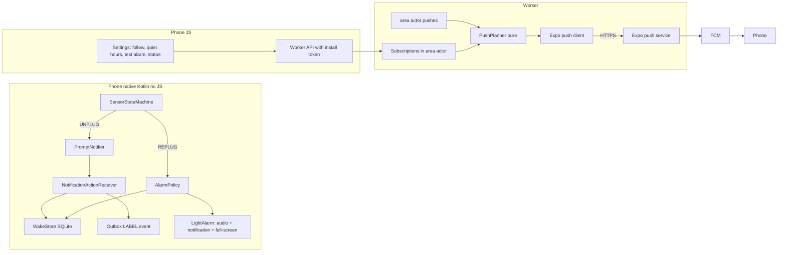
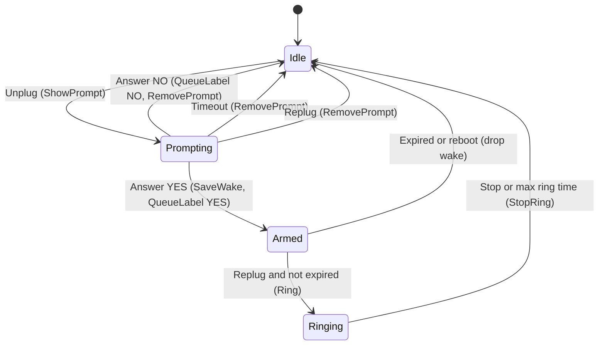
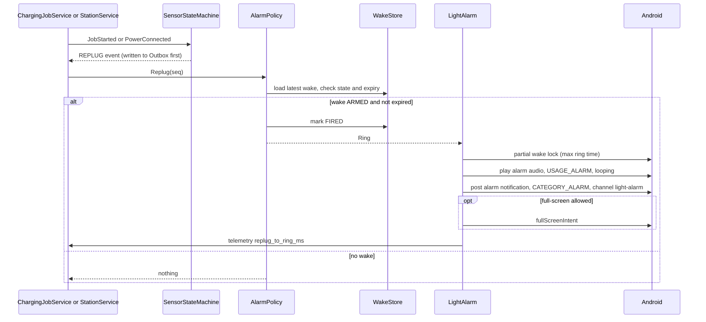
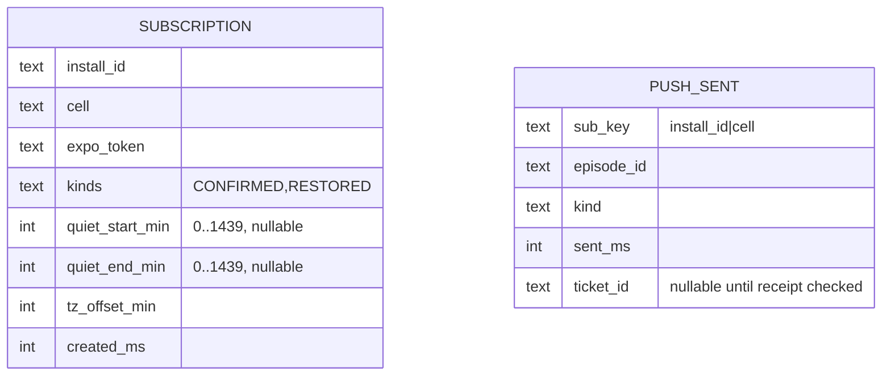
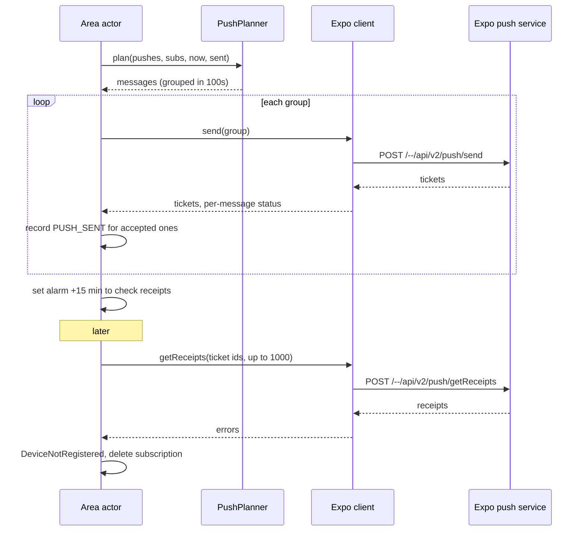

# Design: alerts-and-light-alarm

Status: APPROVED by delegation on 2026-11-14. Based on `requirements.md`. Tasks in `tasks.md`.

## 1. Overview

Three parts, kept apart so the alarm never depends on anything it does not need.



- **Light Alarm** = `PromptNotifier`, `WakeStore`, `AlarmPolicy` and `LightAlarm`. All native, none uses the network.
- **Pushes** = Worker only for planning and sending. The phone only receives them.
- **JS** supplies settings screens and calls. It is not in the alarm path.

## 2. Verified platform facts

| Fact | Source |
|---|---|
| Apps targeting Android 14 may use full-screen intents only if they are calling or alarm apps. The store revokes the permission for others. `NotificationManager.canUseFullScreenIntent()` checks it, and `ACTION_MANAGE_APP_USE_FULL_SCREEN_INTENT` opens the settings page. | https://developer.android.com/about/versions/14/behavior-changes-14 |
| Mutable pending intents without an explicit component throw on Android 14 targets. Implicit intents reach only exported components. | same |
| `SCHEDULE_EXACT_ALARM` is denied by default for new apps that target Android 13+. `USE_EXACT_ALARM` is only for calendar and alarm-clock apps. The Light Alarm is triggered by an event, so it does not use exact alarms. | https://developer.android.com/about/versions/14/changes/schedule-exact-alarms |
| Expo push on Android needs FCM v1 credentials. Limits: 600 notifications per second per project, 100 per request, 1,000 receipts per request, payload up to 4 KiB. A message whose `channelId` does not exist on the device is not displayed. Errors to handle: `DeviceNotRegistered`, `MessageRateExceeded`, `InvalidCredentials`. | https://docs.expo.dev/push-notifications/push-notifications-setup/ , https://docs.expo.dev/push-notifications/sending-notifications/ |

To confirm with the docs servers before implementing: `NotificationChannel.setSound` with `AudioAttributes.USAGE_ALARM`, `Notification.CATEGORY_ALARM`, `FLAG_INSISTENT` behavior, `MediaPlayer` or `Ringtone` with alarm usage and looping, `RingtoneManager.TYPE_ALARM` default, `setBypassDnd` and policy access, `PowerManager` wake lock rules inside a running `JobService`, behavior of Doze when charging resumes, Expo `getExpoPushTokenAsync` and channel creation (`expo-notifications`), the receipts endpoint, and the Cloudflare alarm API for delayed receipt checks.

## 3. Native layer

### 3.1 `AlarmPolicy` (pure Kotlin)

Inputs: events from the state machine (`Unplug(seq)`, `Replug(seq)`), user answers `Answer(unplugSeq, YES|NO)`, prompt timeouts, reboot, clock (elapsed). Outputs: actions `ShowPrompt(seq)`, `RemovePrompt(seq)`, `SaveWake(seq, expiresElapsed)`, `QueueLabel(seq, answer)`, `Ring(seq)`, `StopRing`.



Rules enforced here and nowhere else:
- First answer for an unplug wins. After `Replug` for that unplug, answers are ignored.
- `Ring` happens at most once per wake request.
- `Unplug` events with a seq already seen change nothing (idempotent).
- A new `Unplug` while `Armed` supersedes the old wake request only if the old one has not rung; the old label stays.
- Reboot clears `Armed` (time cannot be trusted).

### 3.2 Components

| Component | Responsibility |
|---|---|
| `PromptNotifier` | Builds the prompt on channel `power-check`, with two `PendingIntent`s to an explicit, non-exported `NotificationActionReceiver`, `FLAG_IMMUTABLE`, set to time out after the prompt timeout. |
| `NotificationActionReceiver` | Maps the tapped action to `AlarmPolicy.Answer`, applies actions. Works with no JS. |
| `WakeStore` | SQLite table in the module database: `unplug_seq`, `created_elapsed_ms`, `boot_count`, `expires_elapsed_ms`, `state` (`ARMED`, `FIRED`, `DROPPED`). |
| `LightAlarm` | Starts looped alarm audio and the alarm notification. Holds a partial wake lock for at most the maximum ring time. |
| `ChannelSetup` | Creates native channels at module start (also done from JS for push channels). |

### 3.3 Ring path (layers)



Layers, from most to least reliable:
1. **Alarm audio** played directly in the running service with the alarm audio usage. Works without notification permission. Follows the alarm volume and the Do Not Disturb alarm exception.
2. **Alarm notification** on `light-alarm` (highest importance, alarm category, lock-screen visible, "Stop" action). Shows the user what is ringing and offers Stop.
3. **Full-screen intent** only if `canUseFullScreenIntent()` is true.

Ring order is fixed: the `REPLUG` is written to the Outbox first (so the event is not lost), then the alarm starts. The alarm never waits for a network call, a JS call, or an upload.

The sound is the system default alarm ringtone. If it cannot be resolved, a short bundled sound is used.

### 3.4 Interaction with Station mode

The Station service's `PowerConnected` path calls the same `AlarmPolicy`. A station phone does not normally have a wake request, since nobody answers its prompt; the prompt on a station is not shown (Station mode shows no per-unplug prompts), so no alarm rings from a station. Home Watch handles stations.

## 4. Labels on the wire

New event type `LABEL` in the sensor Outbox and the ingest wire schema:

```ts
type LabelEvent = {
  installId: string; seq: number; type: 'LABEL';
  elapsedMs: number; cell: string; confidence: 'HIGH'; timeQuality: 'OK';
  refSeq: number;                 // the UNPLUG's seq
  answer: 'YES' | 'NO';
};
```

- Time: `elapsedMs` is the time since the answer, as for any event. The detection engine uses `refSeq`, not the label's time.
- Ingest treats `LABEL` as a detection-class event for upload priority (uploaded promptly) and routes it to the area actor, which passes it to the engines as `Label { installId, unplugSeq: refSeq, answer }`.
- Stored as a row (it must survive recompute). One row per answer; the engine takes the label with the lowest seq per unplug if duplicates exist (the phone sends one).
- Schema amendments are task 1: `sensor-android` EVENT table (`type` gains `LABEL`, columns `ref_seq`, `answer`), shared types, ingest strict schema allow-list, I8 test, golden fixtures.

## 5. Server: subscriptions and pushes

### 5.1 Data

Stored in the area actor that owns the followed cell's parent:



- `SUBSCRIPTION` primary key is (`install_id`, `cell`). One row per install and cell (R8.5).
- `PUSH_SENT` is the de-duplication memory (R6.4). It is pruned after 7 days.
- Delete-my-data removes both tables' rows for the install, and removes labels.

### 5.2 `PushPlanner` (pure TypeScript)

```ts
plan(decisions: AreaPush[], subs: Subscription[], nowMs: number, sent: SentMemory): PlannedMessage[]
```

For each `AreaPush { cell, episodeId, kind, level, decisionTimeMs, precision }`:
1. Drop it if `nowMs - decisionTimeMs > 10 min`.
2. Drop it if the cell's scope is not public.
3. Select subscriptions for the cell with the kind enabled and not already in `sent` for (sub, episode, kind).
4. Pick the channel: `alerts-quiet` if the subscriber's local time (`nowMs + tz_offset`) lies in the quiet window, else `alerts`.
5. Build title and body from the string pack (`copy.md`): no install IDs, no number under 3, "wide area" when precision is `COARSE`.
6. Set `data: { cell, episodeId, kind }`, `priority: 'high'`, `ttl` short enough that an old message is not delivered later (equal to the push-age rule, 600 seconds).

Quiet window test: with `local = (nowMs/60000 + tz_offset) mod 1440`; window `[s, e)` contains `local` if `s < e ? s <= local < e : local >= s || local < e`; `s == e` means no window.

### 5.3 Sending



- Request URL and receipt URL are the Expo push API (https://docs.expo.dev/push-notifications/sending-notifications/). Confirm the exact paths and headers with the docs server before writing the client.
- Free-plan limits: at most 50 subrequests per invocation, so one invocation sends at most about 40 groups (4,000 messages) and defers the rest to an alarm. A cell with more followers than that is far beyond the field test.
- Optional `Authorization: Bearer ${EXPO_ACCESS_TOKEN}` when the secret is set.
- `MessageRateExceeded` or request failure: retry with back-off from the alarm; accepted messages are never resent because `PUSH_SENT` was written.
- Tokens are never logged.

### 5.4 Follow API

- `POST /v1/follow` with `{ cell, token, kinds, quietStartMin, quietEndMin, tzOffsetMin }` and the install token. The Worker validates the cell, checks that a public status exists for it or that the cell is valid (following before coverage is allowed so the install button works; pushes still need a public status), then writes the subscription in the owning area actor.
- `POST /v1/unfollow` with `{ cell }`.
- Rate limit like ingest. Strict schema, no extra fields. A token that fails validation is rejected without storing.
- Both endpoints count toward the free request budget; follow changes are rare.

## 6. JS layer

- `registerForPush()` creates channels first, then asks permission, then gets the Expo push token (confirm with the `expo-notifications` docs).
- Screens: Follow area, Quiet hours, "Test Light Alarm", "Alarm check" list (notification permission, alarm volume, full-screen allowed, battery exemption), and the in-app prompt for denied-notification users (R1.7).
- Strings live in the string pack; Pidgin is optional. A test checks that every key exists in each language that is present.
- No alarm logic in JS.

## 7. Error handling

| Case | Behavior |
|---|---|
| Notification permission denied | Prompt hidden; app screen shows the two actions. Alarm audio still rings. |
| Alarm volume zero | Alarm check list says so. The alarm rings silently; the notification and vibration still appear. |
| Sound resolution fails | Fall back to the bundled sound; log a diagnostic. |
| Service killed while ringing | The ring stops. On next start the wake is `FIRED`, so it does not ring again. Accepted. |
| Reboot before power returns | Wake dropped (R4.2). The app explains. |
| Two unplugs in a row | New prompt replaces old; old wake dropped if not rung. |
| User taps an action after REPLUG | Ignored. |
| Duplicate `REPLUG` event | The second finds the wake `FIRED` and does nothing. |
| Expo returns `DeviceNotRegistered` | Remove subscription. |
| Expo returns `InvalidCredentials` or `MismatchSenderId` | Stop sending, raise a counter, keep subscriptions. Needs the human (Firebase credentials). |
| Request over 4 KiB | Cannot happen with the fixed message shape; test checks size. |
| Push for a cell with no public status | Skipped, counted. |
| Follow of an invalid cell | 400 with `BAD_CELL`. |
| Follower count over one invocation's budget | Remaining messages deferred to an alarm. |

## 8. Risks and device checks

| Risk | Check on a device | Fallback |
|---|---|---|
| Alarm audio blocked from a background service on some Android versions | Ring from a locked, idle phone after charger replug, on Android 12, 13, 14 and 15 | Start the ring from a high-priority notification with insistent flags and the full-screen intent if allowed |
| Doze delays the job that detects the replug | Plugging in exits Doze; confirm by timing REPLUG to ring, 20 trials, screen off, 30 min idle | Station mode receiver driver |
| OEM kills the service during the outage | Tecno, Infinix, itel, Samsung, Xiaomi with and without exemption | OEM guide; Station mode |
| Full-screen intent not allowed (sideload on Android 14+) | `canUseFullScreenIntent()` result per device | Heads-up notification layer |
| Alarm stream muted | Alarm check list | Vibration and notification |
| Prompt fatigue from human unplugs | Count prompts per day in field telemetry | Raise prompt timeout or add a screen-state rule through a new ADR |

## 9. Testing strategy

Properties use IDs `L1` to `L12`. Kotlin tests: plain JUnit4 with seeded random loops (no new dependency). Server and JS tests: Vitest and fast-check. Test names include the ID.

| ID | Property | Requirement | Test |
|---|---|---|---|
| L1 | Each distinct `UNPLUG` seq produces exactly one `ShowPrompt`; duplicates produce none; the prompt is removed by answer, `REPLUG` or timeout. | R1 | `L1_one_prompt_per_unplug` |
| L2 | `Ring` happens iff the latest unplug has an unexpired YES, a later `REPLUG` arrives, and the wake is not yet fired; never twice for one wake; never without YES. | R3.1, R3.2 | `L2_ring_iff_conditions` |
| L3 | The alarm path (`AlarmPolicy`, `WakeStore`, `LightAlarm`) has no dependency on network, JS or upload classes (dependency check), and runs with all of them replaced by throwing fakes. | R3.3, R3.5 | `L3_alarm_has_no_network` |
| L4 | The first answer per unplug wins, later answers are ignored, answers after `REPLUG` are ignored, and exactly one `LABEL` is queued per unplug. | R2 | `L4_first_answer_wins` |
| L5 | For any quiet window (including across midnight and `s == e`) and any UTC offset, `quietContains` matches a reference implementation, and the Light Alarm path never reads it. | R7 | `L5_quiet_window` |
| L6 | The push list contains each (subscription, episode, kind) at most once, only for followers of the cell, only for `CONFIRMED` and `RESTORED`, with no install ID and no number under 3 in the text. | R6 | `L6_push_planning` |
| L7 | `DeviceNotRegistered` removes the subscription, and delete-my-data removes every subscription and label for the install. | R8.2, R10.2 | `L7_token_hygiene_and_delete` |
| L8 | For any follower count, messages are split into groups of at most 100, every eligible follower is covered exactly once, and retries after a failed request send none twice. | R8.1, R8.3 | `L8_batching_and_retry` |
| L9 | A wake request past its expiry or from an earlier boot never rings. | R4.1, R4.2 | `L9_expiry_and_reboot` |
| L10 | Replaying any sequence of state-machine events, answers and timeouts in a different interleaving that keeps per-unplug order gives the same ring decisions. | R1.4, R3 | `L10_replay_equivalence` |
| L11 | Channel definitions: `power-check` has no sound and importance at most default; `light-alarm` has alarm usage and highest importance; push channels named in messages exist in the setup list. | R1.2, R9 | `L11_channel_config` |
| L12 | Every string key exists in English and in each other language present; no message exceeds 4 KiB. | R6.6, R10.5 | `L12_string_pack` |

Other tests: a notification action test using Robolectric-free fakes through the `NotificationActionReceiver` logic; the follow and unfollow API with strict schema (I8 style); an Expo client test with an injectable `fetch` that replays recorded response shapes from the docs; an end-to-end Judge-style scenario in `tools/sim`: simulated outage, push planned for followers, push recorded as simulated and never sent.

Device checklist `docs/probe-checklist.md` adds: prompt appears quiet; Yes then replug rings with screen off and app closed, offline (airplane mode); No does not ring; ring survives lock; Stop works; test alarm; each OEM.

Traceability: `docs/traceability.md`.
