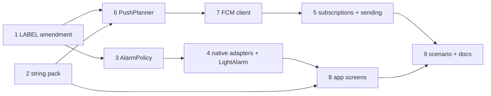

# Tasks: alerts-and-light-alarm

Rules: only real dependencies are listed. Tasks in the same wave run in parallel. A task is done only per `definition-of-done.md`. Commit after each, for example `feat(alarm): ring only after YES [spec:alerts-and-light-alarm task:3]`.

Highest reasoning effort for tasks 3, 4 and 5. Checkpoint before tasks 4 and 5. Plan mode first for tasks 1 and 5 (each touches more than 3 files). Confirm every Android, FCM and Cloudflare API with the docs servers and put the doc URL in a comment.

Depends on `sensor-android` (tasks 4, 5, 7, 9), `station-mode` (task 2), `event-ingest` (tasks 2, 4, 5, 8), `area-cells` (task 9) and `detection-engine` (task 1). No new dependency is added by this spec text. The Firebase Messaging app dependency needs human approval (ADR 0012). Do not add a server SDK for FCM; use `fetch`.

Human actions before deploy (see requirements): Firebase project, service-account key stored with `wrangler secret put FCM_SERVICE_ACCOUNT`, and approval of the Firebase Messaging dependency.

## Wave 1

- [ ] 1. Amend shared types for `LABEL`: `sensor-android` EVENT table and `SensorEvent` type, `event-ingest` strict schema allow-list and tests (I8), shared fixtures, and the engine `Label` mapping in `area-cells` routing. Update tasks 2 and 5 of ingest where they list event types.
  - Depends on: `sensor-android` 2, `event-ingest` 2, `detection-engine` 1
  - Requirements: R2.5
- [ ] 2. String pack: English and optional Pidgin strings for the prompt, alarm, test, push texts, status list; a checker for missing keys. Test L12.
  - Depends on: `event-ingest` 1
  - Requirements: R6.6, R10.5

## Wave 2

- [ ] 3. `AlarmPolicy` pure core, `WakeStore` interface with an in-memory fake, expiry and reboot handling. Tests L1, L2, L4, L9, L10.
  - Depends on: 1, `sensor-android` 4
  - Requirements: R1, R2, R3.1, R3.2, R4
- [ ] 6. `PushPlanner` and the quiet-window function, string selection by precision, size check. Tests L5, L6, L12.
  - Depends on: 1, 2
  - Requirements: R6, R7

## Wave 3

- [ ] 4. Kotlin adapters in `apps/android` (packages `alarm`, `sensor`): `PromptNotifier`, `NotificationActionReceiver`, SQLite `WakeStore`, `ChannelSetup`, `LightAlarm` (audio, notification, optional full-screen intent, wake lock, telemetry), wiring into `ChargingJobService` and `StationService`. Tests L3, L11 (JUnit 4). Device checks recorded in `docs/probe-checklist.md`.
  - Depends on: 3, `sensor-android` 7, `station-mode` 3
  - Requirements: R1, R2, R3, R4, R9.3
- [ ] 7. FCM HTTP v1 client with injectable `fetch`: access token from the `FCM_SERVICE_ACCOUNT` secret (Web Crypto), one message per request, error mapping (`UNREGISTERED`, `QUOTA_EXCEEDED`, `UNAVAILABLE`), back-off, deferral across invocations. Test L8.
  - Depends on: 6
  - Requirements: R8, R11

## Wave 4

- [ ] 5. Subscriptions in the area actor: schema, follow and unfollow endpoints, strict validation, `PUSH_SENT` memory, deferred-send alarm, push hook from `area-cells` outputs, delete-my-data. Test L7.
  - Depends on: 7, `area-cells` 9, `event-ingest` 4
  - Requirements: R6, R8, R10
- [ ] 8. Screens (Jetpack Compose, approved 2026-11-14) and `net` package: channel creation, permission flow, FCM token registration and refresh, follow and quiet-hours screens, Test Light Alarm, Alarm check list, in-app prompt for denied notifications, string pack wiring; JVM unit tests for the follow request against the contract fixtures.
  - Depends on: 4, 2, `event-ingest` 10
  - Requirements: R1.7, R5, R6.1, R6.2, R7, R9

## Wave 5

- [ ] 9. Scenario test in `tools/sim`: simulated outage creates a planned push set for followers, marked simulated and never sent. Update `docs/traceability.md` (L1 to L12), `docs/probe-checklist.md`, `docs/kiro-log.md`.
  - Depends on: 5, 8, `detection-engine` 16
  - Requirements: all

## Dependency graph

## Not in this spec
- Manual "power is out" and "Power is back" reports: `power-log`.
- Freezer Guard alert (a local alert after N hours without power): `power-log`.
- Home Watch push within 60 seconds and "Station offline": `home-watch`.
- Area names in push text come from the catalog in `web-and-area-pages`; until then the text says "your area".
- Auto-arming the alarm without a "Yes": deliberately excluded, since an unplug at 7 a.m. must not ring at 8 p.m.
