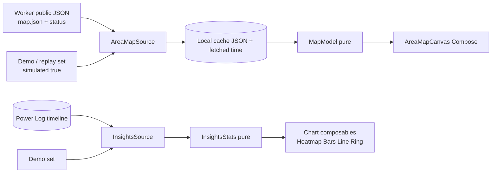

# Design: app-map-insights

Status: APPROVED by delegation on 2026-11-15. Based on `requirements.md`. Tasks in `tasks.md`. Decisions: ADR 0022 (map), ADR 0023 (charts).

## 1. Overview



- Everything that decides a number or a shape is pure Kotlin with no Android imports, so JUnit 4 on the JVM tests it (same pattern as `Route.kt`, `StatusStyle.kt`).
- Compose draws. It does not decide.
- No new Gradle dependency. The Area and Insights screens register in `FeatureRegistry` under `AREA` and `INSIGHTS`.

## 2. Verified platform facts

| Fact | Source | Status |
|---|---|---|
| `Modifier.pointerInput` with `detectTransformGestures` gives pan, zoom and centroid; `detectTapGestures(onDoubleTap, onTap)` gives taps. | https://developer.android.com/develop/ui/compose/touch-input/pointer-input/multi-touch | Confirm with Context7 in task 2 |
| `Canvas`, `DrawScope.drawPath`, `Path`, `withTransform` draw custom shapes. | https://developer.android.com/develop/ui/compose/graphics/draw/overview | Confirm in task 2 |
| `Modifier.semantics { contentDescription = ... }` and custom accessibility actions give TalkBack text. A canvas has no children, so per-hex text uses an invisible overlay list of semantic nodes or the list view. | https://developer.android.com/develop/ui/compose/accessibility/semantics | Confirm in task 3 |
| `ModalBottomSheet` (Material 3) shows the cell sheet. | https://developer.android.com/develop/ui/compose/components/bottom-sheets | Confirm in task 4 |

Anything marked "Confirm" is unverified until the named task checks it with Context7 (`docs-servers.md`).

## 3. Data

### Map JSON (new Worker route, same data as the SVG map)
`GET /api/map.json?city=<slug>` returns:

```
{ "city": "lagos", "generatedMs": 0, "simulated": false,
  "areas": [ { "slug": "yaba", "name": "Yaba", "centreCell": "88...", "cells": ["88..."] } ],
  "cells": [ { "id": "88...", "area": "yaba", "state": "CONFIRMED", "sinceMs": 0, "restoredMs": null,
               "history30d": [ { "startMs": 0, "endMs": 0, "level": "CONFIRMED" } ],
               "ring": [ [6.52, 3.37], ... 6 vertices ] } ] }
```

- A cell appears only if it is in the catalog. A cell under the floor appears with `state: "NO_DATA"` and no history, the same as a cell with no sensors (ADR 0007).
- No member count, no device id. The Worker builds `ring` from `cellToBoundary` (already used for the SVG map, ADR 0010).
- Types and a fixture go in `packages/shared` so both the Worker tests and the Kotlin tests read the same file (`structure.md`).

### Kotlin model (pure)
```
enum class CellState { NORMAL, POSSIBLE, CONFIRMED, RESTORED, NO_DATA }
data class MapCell(id, areaSlug, state, sinceMs?, restoredMs?, history: List<OutageSpan>, ring: List<LatLng>)
data class MapArea(slug, name, centreCell, cellIds)
data class AreaMap(city, generatedMs, simulated, areas, cells)
interface AreaMapSource { suspend fun load(city: String): MapResult }
sealed interface MapResult { Fresh(map), Cached(map, fetchedMs), Empty }
```

- `NetAreaMapSource` fetches the JSON, writes the cache file, falls back to the cache (R4). Uses the app's existing HTTP client in `net`.
- `DemoAreaMapSource` returns a labelled sample map (`simulated = true`), hard-coded in `DemoAreaMap` with hex ids starting `sim-` (it does not read `replay.json`). It never touches the cache (R5.2).
- `MiniJson` (existing, `onboarding`) reads the JSON, so no JSON library is needed.

### Insights model (pure)
```
interface InsightsSource { fun intervals(fromMs, toMs): List<PowerInterval>; fun band(): Band?; fun simulated(): Boolean }
data class InsightsState(range, counts, hoursPerDay, heatmap, longest, weeklyTrend, meanGap, promise, lightScore, phase)
```
- `PowerLogInsightsSource` reads the Power Log timeline. `DemoInsightsSource` returns 12 weeks of labelled sample intervals.
- `InsightsStats.compute(intervals, band, nowMs, zone)` returns `InsightsState`. Uses the user's time zone for day and weekday edges, passed in as an input (no hidden clock).

## 4. Map geometry and gestures

- `MapProjection`: equirectangular projection around the city centre with `x = (lng - lng0) * cos(lat0)`, `y = lat0 - lat`. Over a city this error is negligible.
- `MapTransform(scale, offsetX, offsetY)`: pure. `zoomAbout(centroid, factor)`, `panBy(dx, dy)`, `fitTo(bounds, viewSize)`, clamps scale between min and max, and keeps the map from leaving the view.
- Hit test: point to hex by the nearest centre then a point-in-polygon check on the 6 vertices. Pure, tested.
- Drawing: build one `Path` per cell once per data change in world units. On each frame apply `withTransform` and draw only cells whose bounds intersect the view (R1.10).
- Fills by state, with a pattern per state (hatch for POSSIBLE, solid for CONFIRMED, dots for RESTORED, outline only for NO_DATA, plain for NORMAL) so colour is never the only signal (R6.2).
- Labels: area names at the area's centre cell, only when zoomed in enough that they do not overlap (a simple min-pixel-gap rule, pure and tested).

## 5. Screens

### Area
Top: city and "Simulated" chip if simulated. Middle: canvas map. Overlay: legend (collapsible), recentre button, list-view toggle. Banner: offline. Bottom sheet: cell details. Pull to refresh is replaced by the 60 s refresh rule (R4.4).

### Insights
A scrolling column:
1. Range chips 7 / 30 / 90 days.
2. Summary tiles: outages, hours without power, average hours per day, longest.
3. Bars: hours of power per day, promise line.
4. Heatmap: weekday by hour.
5. Insight sentence.
6. Longest outages list.
7. 12-week trend line.
8. Light Score ring and the promise check card.

Early state (R10) replaces 3 to 8 with the progress card until each minimum is met.

## 6. Navigation and strings

- `Route.Insights` is added, with deep link `insights`, and the bottom bar gains an Insights tab. `Routes.fromIntent` and its tests are updated. Shell's `when(current)` gets one more branch.
- Strings in `res/values/strings.xml` and `res/values-pcm/strings.xml`. `StringPackTest` stays green. Copy follows `copy.md`: short, "power" not "electricity".

## 7. Correctness properties and tests

| ID | Property | Test |
|---|---|---|
| AM1 | Every cell with fewer than 3 phones renders as `NO_DATA` and the model carries no count. | JUnit on `AreaMapParser` with the shared fixture |
| AM2 | Zoom about a point leaves that point fixed on screen (within 1e-6). Scale stays in bounds. | JUnit, seeded random gestures |
| AM3 | Pan then recentre returns the initial transform. | JUnit |
| AM4 | Hit test returns the cell whose polygon contains the point, or none. | JUnit, seeded random points |
| AM5 | Every state has a distinct glyph and a text description. | JUnit |
| AM6 | A simulated map never writes the cache. | JUnit with a fake cache |
| IN1 | Hours of power per day plus hours without power per day equals observed hours for that day, over any ordering of intervals. | JUnit, seeded random |
| IN2 | Heatmap shares are within 0 and 1 and a slot seen fewer than 3 times is `null`. | JUnit |
| IN3 | The weekly trend has 12 entries, in time order, with `null` for weeks without data. | JUnit |
| IN4 | Days without enough coverage are `null`, never 0. | JUnit |
| IN5 | Day and weekday edges follow the given time zone across a daylight-saving change. | JUnit |
| IN6 | The promise text never contains refund, compensation or claim, and says "unconfirmed" for an unverified band. | JUnit on strings |

Instrumented drawing is checked by a screenshot pass on an emulator or the field phone (the Kiro IDE pass); JVM tests cover all logic.

## 8. Error handling

| Case | Behaviour |
|---|---|
| Map JSON bad shape | Treated as `Empty`, keep the cache, log a short message. Never crash. |
| City with no cells | "No area data yet" (app-shell). |
| Power Log empty | R10.3. |
| Clock jump backwards | Intervals are clipped to `[from, now]`. |
