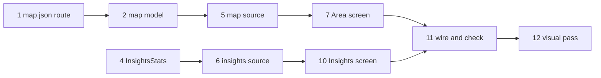

# Tasks: app-map-insights

Rules: only real dependencies are listed. A task is done only per `definition-of-done.md`. Commit after each, for example `feat(map): hit test [spec:app-map-insights task:3]`. No new Gradle dependency (ADR 0022, 0023).

Depends on `app-shell` (Shell, FeatureRegistry), `web-and-area-pages` (public JSON, catalog), `power-log` (timeline, `bands.json`, Light Score). Where a power-log task is not done, use the demo source and keep the screen behind the interface.

## Dependency graph

## Wave 1: data and pure logic

- [x] 1. Worker route `GET /api/map.json` and shared types plus fixture in `packages/shared/fixtures/`. Vitest checks the floor (no cell under 3 phones shows a state, no counts in the output).
  - Requirements: R2, R11.2
- [x] 2. `AreaMap` model, `AreaMapParser` (MiniJson), `MapProjection`, `MapTransform`, hit test. JUnit 4 tests AM1 to AM4. Confirm gesture and Canvas APIs with Context7 first.
  - Depends on: 1
  - Requirements: R1, R2
- [x] 3. `CellStyle` (colour, glyph, description per state) with a colour-blind-safe set and area label placement rule. Tests AM5.
  - Requirements: R1.2, R1.8, R6
- [x] 4. `InsightsStats` (counts, per-day hours, heatmap, longest, weekly trend, mean gap, promise text). Tests IN1 to IN6 with seeded random inputs.
  - Requirements: R7, R8, R9, R10

## Wave 2: sources and cache

- [x] 5. `AreaMapSource` with `NetAreaMapSource`, cache file, `DemoAreaMapSource`. Test AM6. Delete-my-data clears the cache.
  - Depends on: 2
  - Requirements: R4, R5, R11.4
- [x] 6. `InsightsSource` with `PowerLogInsightsSource` and `DemoInsightsSource` (12 weeks, simulated true). `PowerLogInsightsSource` exists but reads `PowerLogTimeline.None` (empty state) until the Power Log timeline is built; untick when that wires in.
  - Done 2026-11-23: `LogStoreTimeline` reads the real log (ADR 0039); a build with a Worker address always shows the user's own record, a demo build shows it once it has data and the labelled 12-week demo before that.
  - Depends on: 4
  - Requirements: R5, R10

## Wave 3: screens

- [x] 7. `AreaMapCanvas` composable (draw, pan, pinch, double-tap, recentre, legend, labels) and the Area screen with offline banner and list view.
  - Depends on: 2, 3, 5
  - Requirements: R1, R2, R4, R5, R6
- [x] 8. Cell detail bottom sheet and "Follow this area".
  - Depends on: 7
  - Requirements: R3
- [x] 9. Chart composables: `HeatmapChart`, `BarChart` with promise line, `LineChart`, `RingChart`, each with a text summary. 
  - Depends on: 4
  - Requirements: R7, R8, R6.5
- [x] 10. Insights screen, range chips, early states, promise card, and `Route.Insights` with deep link and bottom bar tab. Strings in English and Pidgin.
  - Depends on: 6, 9
  - Requirements: R7 to R10, R12

## Wave 4: checks

- [x] 11. Wire both screens into `FeatureRegistry`, run build, unit tests and lint, and update `docs/traceability.md`.
  - Depends on: 8, 10
- [ ] 12. Visual and TalkBack pass on an emulator or phone (Kiro IDE pass). Record screenshots in `docs/`.
  - Depends on: 11

Notes (2026-11-15): task 1 is done (ADR 0025): the Worker serves `GET /api/map.json`, the shared fixture is read by Vitest and `MapContractTest`, and the app has the `INTERNET` permission. The app still defaults to the labelled demo map until `-PoutageApiBase` is set. With the base set, Insights uses `PowerLogInsightsSource` and shows the empty state because the Power Log timeline does not exist yet, so task 6 stays open. Task 12 (emulator screenshots, TalkBack) is open: no emulator in the sandbox.
