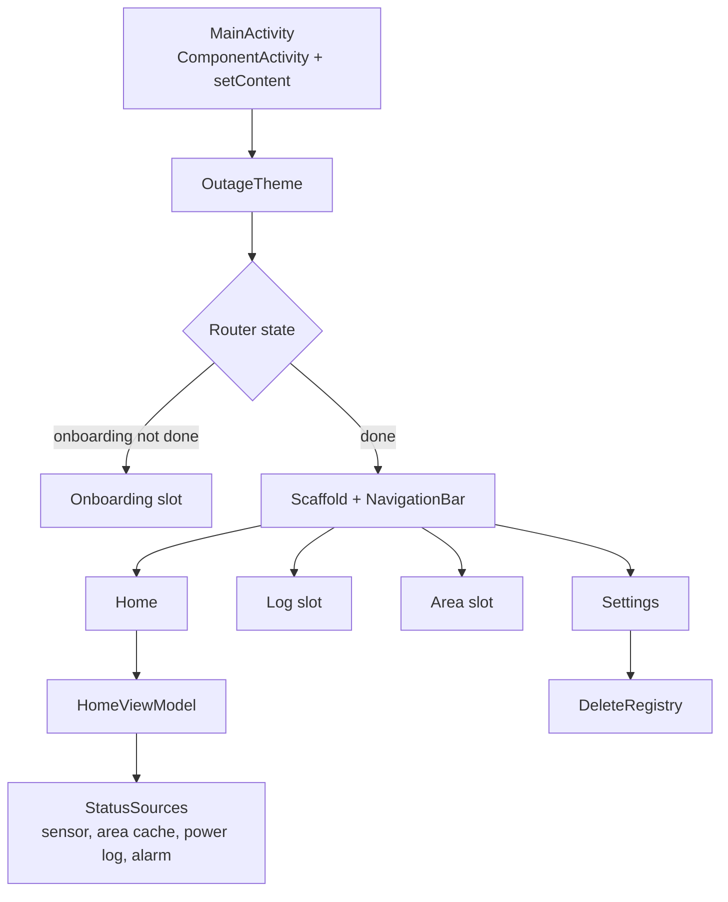
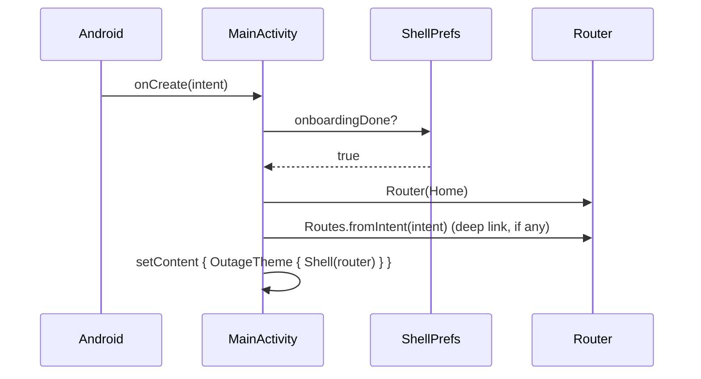
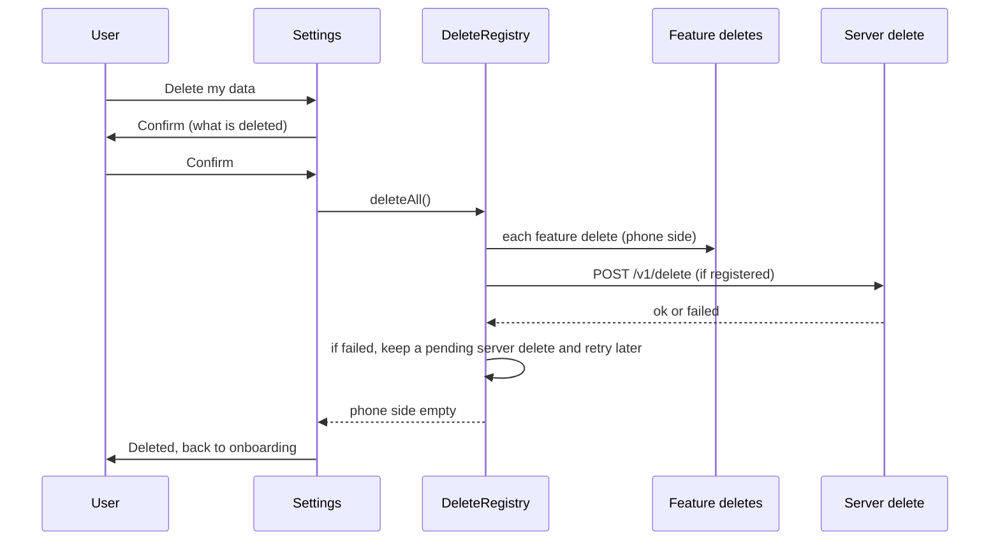
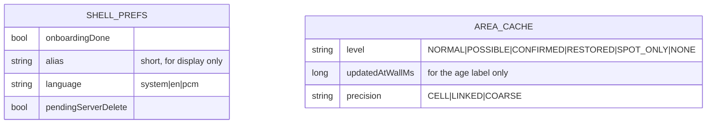

# Design: app-shell

Status: APPROVED by the human on 2026-11-14. Based on `requirements.md`. Tasks in `tasks.md`.

## 1. Overview



The shell is a thin layer. Screens read immutable UI state from `ViewModel`s. `ViewModel`s read from small interfaces (`StatusSources`) that feature packages implement. Until a feature exists, a `None` implementation supplies "not available", which the screen turns into a hidden card or a "Coming soon" screen.

## 2. Verified platform facts

| Fact | Source |
|---|---|
| Compose UI in an Activity: `ComponentActivity` with `setContent { }` from `androidx.activity:activity-compose`. | https://developer.android.com/develop/ui/compose/setup |
| Material 3 components `Scaffold`, `NavigationBar`, `NavigationBarItem`, light and dark `ColorScheme`. | https://developer.android.com/develop/ui/compose/designsystems/material3 |
| A Compose BOM pins compatible Compose library versions. | https://developer.android.com/develop/ui/compose/bom |
| With Kotlin 2.x the Compose compiler is the Kotlin plugin `org.jetbrains.kotlin.plugin.compose`, versioned with Kotlin. | https://developer.android.com/develop/ui/compose/compiler |
| Adaptive icons: foreground and background layers plus an optional monochrome layer. | https://developer.android.com/develop/ui/views/launch/icon_design_adaptive |
| Per-language resources by folder qualifier; missing keys fall back to the default `values`. | https://developer.android.com/guide/topics/resources/localization |

To confirm with a docs server in task 1: the Compose compiler plugin version that matches the Kotlin version AGP 9.2.1 uses, and the stable BOM.

## 3. Router (no navigation library)

```kotlin
sealed interface Route { data object Onboarding : Route; data object Home : Route; data object Log : Route; data object Area : Route; data object Settings : Route; data class Feature(val key: String) : Route }
class Router(initial: Route) { val stack: List<Route>; fun go(r: Route); fun tab(r: Route); fun back(): Boolean }
```

- `tab()` switches destination and resets the stack to `[Home, tab]` (back returns to Home, R3.3).
- `back()` returns false on Home so the Activity finishes.
- Deep links: an intent extra `route` (`home`, `log`, `area`, `settings`, `feature:<key>`) is parsed by `Routes.fromIntent`, which ignores unknown values (R1.3). Pure Kotlin, unit tested.
- Scroll state per destination is held in `rememberSaveable` keyed by route (R3.4).

## 4. Feature slots

| Destination | Owner spec | Until it exists |
|---|---|---|
| Onboarding | `onboarding` task 7 | A one-screen "Set up" placeholder with a Done button (debug builds) so the shell is testable |
| Log | `power-log` task 8 | "Coming soon" |
| Area | `web-and-area-pages` routes + `area-cells` | "Coming soon" |
| Alarm control on Home | `alerts-and-light-alarm` task 8 | Card hidden |
| Settings items | each feature | "Coming soon" per item |

A feature registers with `FeatureRegistry.register(key, title, screen, deleteFn?)` at app start. The shell lists what is registered.

## 5. Sequences

### 5.1 Start



### 5.2 Delete my data



## 6. Data model



- `SHELL_PREFS` and `AREA_CACHE` live in `SharedPreferences` (small values; DataStore is not approved).
- `HomeUiState(sensor: SensorState, area: AreaStatus?, ageMinutes: Int?, offline: Boolean, todayPowerHours: Double?, alarm: AlarmState?, simulated: Boolean)`.
- `StatusSources` interface: `sensorState()`, `areaStatus()`, `todayPowerHours()`, `alarmState()`; each returns null when its feature is missing.

## 7. Theme

- Material 3 `lightColorScheme` and `darkColorScheme`, following `isSystemInDarkTheme()` (R6.1). Dynamic colour is off, so status colours stay recognisable.
- Status style table (colour, icon, label) in one place, `StatusStyle.of(level)`, unit tested to give every level an icon and a label (R6.2).

| Level | Colour role | Icon |
|---|---|---|
| Normal | primary (green) | check |
| Your spot only | tertiary (amber) | person pin |
| Possible | tertiary (amber) | help |
| Confirmed | error (red) | power off |
| Restored | primary (green) | power on |

Icons are vector drawables in `res/drawable`, drawn for this app (no icon library).

## 8. Error handling

| Case | Behavior |
|---|---|
| A feature screen throws while composing | Not caught by Compose; prevented by registering only built features. Unbuilt slots show "Coming soon". |
| Unknown deep-link route | Ignored; Home opens. |
| No network | Home shows "Offline" and the cached area status with its age. |
| Area cache missing | "No area data yet". |
| Server delete fails | Phone side still deleted; `pendingServerDelete` retried on next start with network. |
| Prefs unreadable | Treated as onboarding not done (safe: the user sets up again). |

## 9. Testing strategy

| ID | Property or check | Requirement | Test |
|---|---|---|---|
| AS1 | Start routing: onboarding not done gives Onboarding; done gives Home; deep link opens its destination with Home under it. | R1 | `AS1_start_routing` (JUnit) |
| AS2 | Router: back from any tab returns Home; back on Home returns false; tab resets the stack. | R3.3 | `AS2_router_back` (JUnit) |
| AS3 | Unknown or malicious route strings never crash and give Home. | R1.3 | `AS3_unknown_routes` (JUnit, many generated strings) |
| AS4 | Every status level has a colour role, an icon and a non-empty label. | R6.2 | `AS4_status_style_complete` (JUnit) |
| AS5 | Home state: offline keeps sensor state and cached area with age; missing features hide their cards; simulated data is labeled. | R2 | `AS5_home_state` (JUnit, pure reducer) |
| AS6 | Delete: phone side empty even when the server call fails; pending flag set; flag cleared after a later success. | R5 | `AS6_delete_all` (JUnit with fakes) |
| AS7 | String pack: every key in `values-pcm` exists in `values`; no literal user text in `ui` Kotlin files. | R7 | `AS7_strings` (JUnit reads the XML; plus a lint check) |
| AS8 | Screen at 390 x 844 and 360 dp at 200% font: status text not clipped. | R6.3 | Compose UI test where it runs, else the probe checklist device step |

Android Lint must pass with 0 errors. Pure logic (router, routes, reducers, style table, delete registry) has no Android imports so it runs on the JVM.

Traceability: `docs/traceability.md` lists AS1 to AS8.
