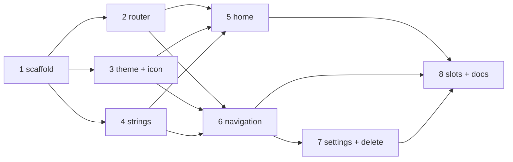

# Tasks: app-shell

Rules: only real dependencies are listed. Tasks in the same wave run in parallel. A task is done only per `definition-of-done.md`. Commit after each, for example `feat(app): router [spec:app-shell task:2]`.

Plan mode first for task 1 (new Gradle project, more than 3 files). Confirm every Compose and Android API with a docs server and put the URL in a comment. Build and test with `.kiro/scripts/android-sandbox.sh gradle android/outage :app:assembleDebug :app:testDebugUnitTest :app:lintDebug`.

Dependencies approved: the ADR 0012 toolchain and Jetpack Compose with Material 3 (human, 2026-11-14). No navigation library.

## Wave 1 (no dependencies)

- [x] 1. Scaffold `android/outage`: Gradle project (AGP 9.2.1, built-in Kotlin, Compose compiler plugin, Compose BOM), `app` module with packages `ui`, `shell`, `sensor`, `alarm`, `log`, `net`; `MainActivity` with `setContent`; extend `.github/workflows/android.yml` to build and test it.
  - Requirements: R1, R8.2

## Wave 2 (needs 1)

- [x] 2. Router and routes: `Route`, `Router`, `Routes.fromIntent`, `ShellPrefs`. Tests AS1, AS2, AS3.
  - Depends on: 1
  - Requirements: R1, R3.3
- [x] 3. Theme and status style: light and dark schemes, `StatusStyle`, vector icons, adaptive launcher icon with monochrome layer. Test AS4.
  - Depends on: 1
  - Requirements: R6, R8
- [x] 4. String pack: `values/strings.xml`, optional `values-pcm` with a few keys, the checker. Test AS7.
  - Depends on: 1
  - Requirements: R7

## Wave 3 (needs 2, 3, 4)

- [x] 5. Home: `StatusSources` with `None` implementations, `HomeUiState` reducer, `HomeViewModel`, Home screen. Test AS5.
  - Depends on: 2, 3, 4
  - Requirements: R2
- [x] 6. Scaffold with `NavigationBar`, the four destinations, "Coming soon" screens, `FeatureRegistry`, per-destination scroll state.
  - Depends on: 2, 3, 4
  - Requirements: R3, R4.2

## Wave 4 (needs 5, 6)

- [x] 7. Settings screen and `DeleteRegistry` with the pending server delete. Test AS6.
  - Depends on: 6
  - Requirements: R4, R5, R9
- [x] 8. Onboarding placeholder slot (debug only) until `onboarding` task 7; traceability (AS1 to AS8); `docs/kiro-log.md`; `android/outage/README.md`; device check AS8 added to `docs/probe-checklist.md`.
  - Depends on: 5, 6, 7
  - Requirements: R1.1, R6.3

## Dependency graph

## Not in this spec
- The feature screens themselves: `onboarding`, `alerts-and-light-alarm`, `power-log`, `home-watch`, `demo-mode`.
- The sensor and the uploader: `sensor-android`, `event-ingest`.
- The web pages: `web-and-area-pages`.
