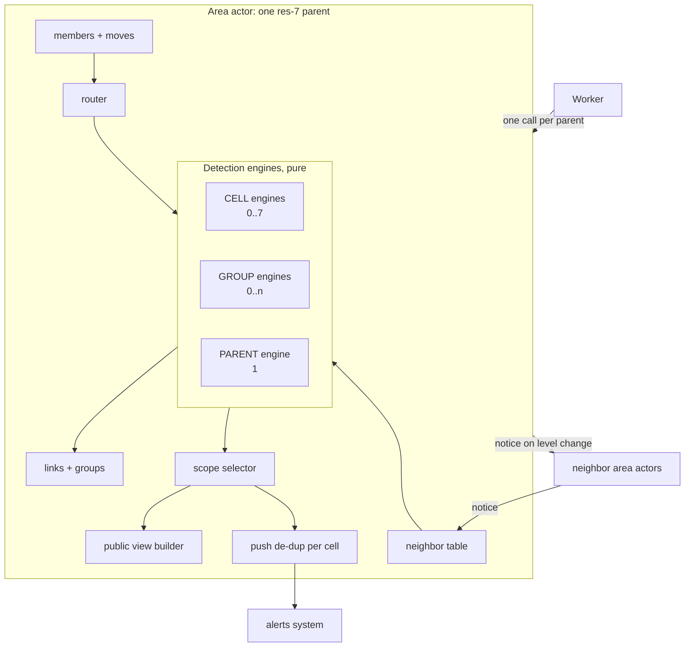
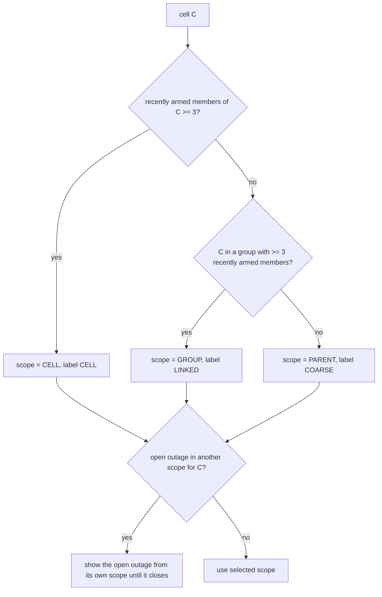
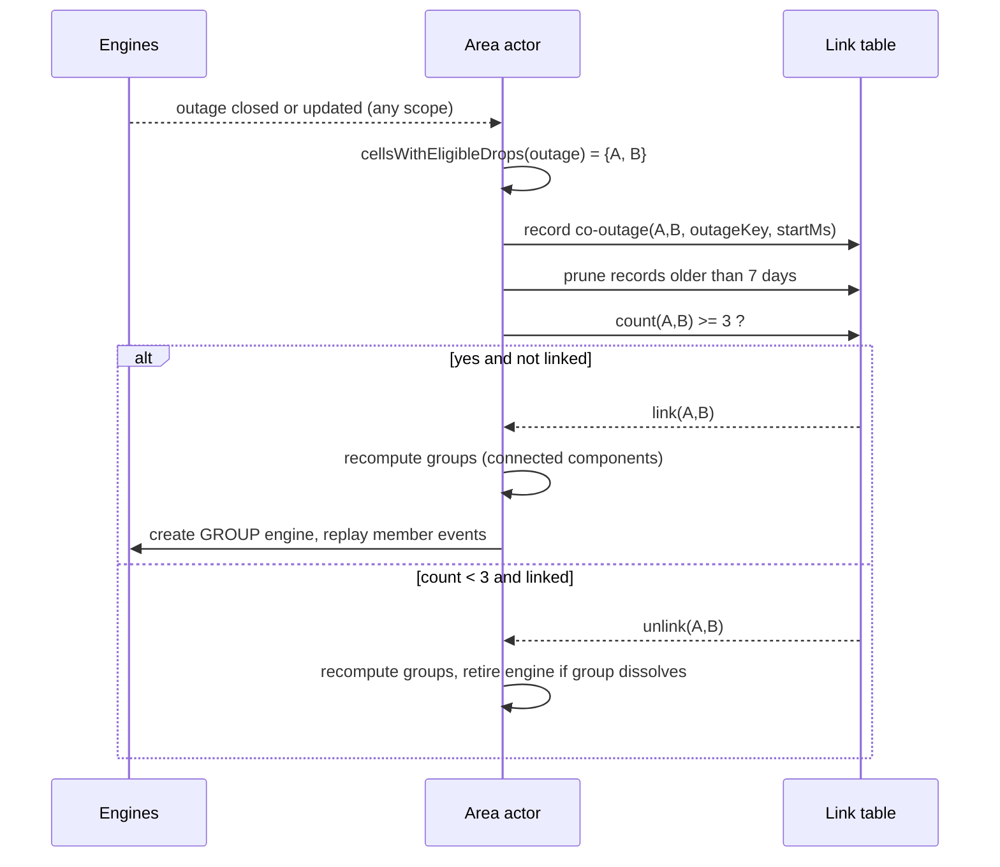
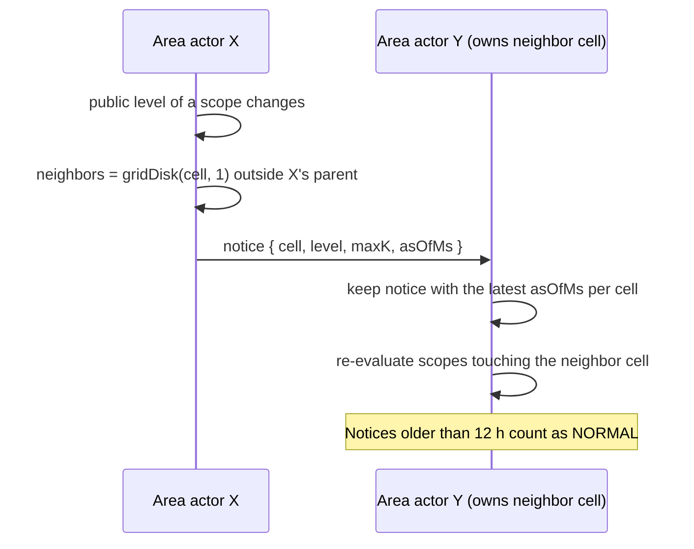
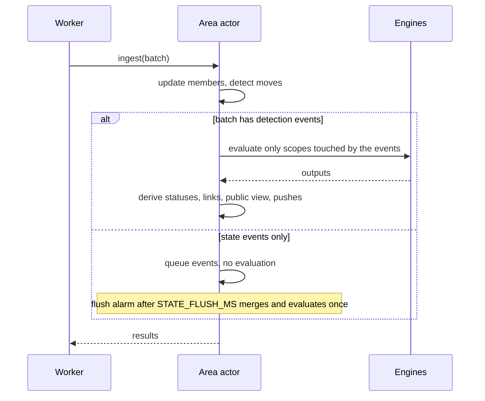
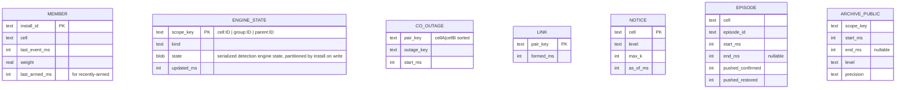

# Design: area-cells

Status: APPROVED by delegation on 2026-11-14. Based on `requirements.md`. Tasks in `tasks.md`.

## 1. Overview

One **area actor** (a SQLite-backed Durable Object) per active res-7 parent. It owns seven res-8 cells. For each scope it keeps a detection-engine state. For every incoming batch it routes events to engines, evaluates them, derives cell statuses and public views, and hands pushes to the alert system.



## 2. Verified facts and sources

| Fact | Source |
|---|---|
| Res 8: average area 0.737 km², edge about 0.53 km. Res 7: 5.161 km². Each hexagon has 7 children, a pentagon has 6. | https://h3geo.org/docs/core-library/restable/ |
| `h3-js` provides `latLngToCell`, `cellToParent`, `cellToChildren`, `gridDisk`, `isValidCell`, `getResolution`, `cellToBoundary`, `isPentagon`. | https://github.com/uber/h3-js |
| Durable Objects free plan: only SQLite-backed, 100,000 requests and 100,000 rows written per day. Worker CPU 10 ms and startup 1 s. | https://developers.cloudflare.com/durable-objects/platform/pricing/ , https://developers.cloudflare.com/workers/platform/limits/ |

To confirm with the docs server before implementing: whether the H3 library (compiled code) fits Worker startup (1 s) and CPU, whether DO-to-DO RPC from inside a DO is allowed and billed as one request, alarm API, and DO CPU limits on the free plan.

## 3. Why shard by parent

| Option | Pooling a sparse cell | DO calls per batch | Notes |
|---|---|---|---|
| One DO per res-8 cell (brief) | needs a call to the parent DO | up to 2 per event | Simple, but doubles the request cost. |
| **One DO per res-7 parent (chosen)** | in-process | 1 per parent | The fallback "evaluate in the parent" is free. |
| One DO per city | in-process, everything | 1 | Becomes a bottleneck and a single point of failure. |

Cross-parent needs (neighbor hints) go through notices, which are sent only when a public level changes. Links across parents are out of scope for this version. See ADR 0006.

## 4. Scope selection



- "Recently armed" = armed at any time in the last 24 hours, weight >= 0.5. It does not drop when phones unplug in an outage, so a cell cannot turn sparse in the middle of an outage (gap G1).
- The engine still enforces its own rule: `n >= 3` armed at the window start for Confirmed (P11). So the selector and the engine agree in the normal case and the engine is the last guard.
- An outage record keeps `scope` and `scopeKey`. A later change of membership changes only the scope for new outages.

## 5. Public view

```ts
type PublicScopeView = {
  scopeKind: 'CELL' | 'GROUP' | 'PARENT';
  precision: 'CELL' | 'LINKED' | 'COARSE';
  boundary: string[];              // res-8 cells (CELL, GROUP) or the parent res-7 cell
  status: 'NORMAL' | 'POSSIBLE' | 'CONFIRMED';
  openOutage?: { startMs: number; level: 'POSSIBLE'|'CONFIRMED'; precision: ... };
  lastRestoredAtMs?: number;
  history30d: { startMs: number; endMs: number | null; level: ...; precision: ... }[];
  phones: '3+';                    // never a smaller number
};
```

Rules (ADR 0007):
1. A view exists only if the scope's members >= 3 (R9.1). Otherwise the page shows an install invitation.
2. The boundary is the union of the scope's cells. A `CELL` boundary of a cell with fewer than 3 members is never sent. A parent boundary is never sent when the parent has fewer than 3 members.
3. A group boundary is the union of its cells' outlines. No inner cell is highlighted.
4. No per-install data and no number below 3 appear. `SPOT_ONLY` and any single-phone state stay on the phone.
5. A member count can reveal a person only together with the boundary; with 3 or more members the area is a k-anonymity group of 3.

What the view cannot protect: two views that change at different times (an install joins or leaves) can narrow down a member. The 3-member floor is a starting rule; the human decides whether to raise it.

## 6. Linking



- A co-outage needs the per-cell drop counts of an outage. The engine's explanation holds counts only, so the area actor adds a private record `dropsByCell` from its own routing (the engine itself stays unaware of cells). The record is internal and never published.
- The counting is a pure function of the set of outage records in the trailing 7 days, so the link table can be rebuilt from them (A4, A5).
- Forming a group creates a `GROUP` engine whose state is built by replaying the pooled events. Retiring it only drops state.

## 7. Neighbor notices



- Notices are idempotent: the table keeps the notice with the greatest `asOfMs`; for equal `asOfMs` the higher level wins. Delivery order and duplicates do not change the table (A6).
- Neighbors inside the same parent need no notice: the area actor already knows their statuses.
- If Y's actor does not exist yet, the notice creates it only when the neighbor's level is above `NORMAL`; a `NORMAL` notice to a missing actor is dropped (R13.1).

## 8. Push de-duplication

Per cell: `episodes` list of `{ episodeId, intervals, pushedConfirmed, pushedRestored }`.

- When any scope's engine reports a `CONFIRMED` push for an outage touching cell C, the area actor merges the outage's interval into the cell's open episode, or opens a new one.
- A `CONFIRMED` push is passed on only if `pushedConfirmed` is false for that episode, then set to true.
- The same for `RESTORED`, which also closes the episode once the cell's last overlapping outage is restored.
- The 10-minute age rule is applied by the engine and not repeated here.

## 9. Evaluation schedule and CPU



Every scope is pure, so evaluating later on the union of the queued events equals evaluating each batch (A12). A detection event touches at most three scopes (its cell, the group, the parent). The benchmark task from `detection-engine` (task 17) decides whether this fits the free-plan CPU limit; if not, the incremental engine (D1) becomes a prerequisite.

## 10. Data model



Rows: member rows are written behind with the ingest flush. Engine states are written only when changed. Links, co-outages and episodes are small. The ingest actor's `INSTALL_STATE` and `DETECTION_EVENT` tables merge into this model: `DETECTION_EVENT` gains a `cell` column and `INSTALL_STATE` gains `cell`. Task 1 amends the ingest design.

## 11. Error handling

| Case | Behavior |
|---|---|
| Event with a cell outside the actor's parent | Rejected as `BAD_ROUTE` (transient to the caller; routing bug). The Worker computes the parent, so this indicates a bug. |
| Notice for a cell the actor does not neighbor | Ignored, counted. |
| Notice with an as-of time in the future by more than 1 day | Ignored, counted. |
| Engine throws a typed schema error | Rebuild that scope from stored events and retry once. |
| State too large for one row | Partition by install; the engine already supports it (R16.4). |
| H3 library fails to load | Neighbor hints are skipped and counted; everything else keeps working. |
| Actor evicted before a flush | Lose at most one flush interval of state events and engine changes; the detection events are already written through (ingest ADR 0002). |
| Link flapping at the 3-co-outage edge | Accepted; groups follow the trailing 7 days. A flap changes scope labels only for sparse cells. |
| Moving between parents | Old actor gets a removal request; failure is retried on the next event; membership expires after 7 days anyway. |

## 12. Testing strategy

Properties use IDs `A1` to `A12`, in Vitest and fast-check, with the engine used as a library. Tests drive the area actor logic as a pure module (`areaReducer(state, input) -> state, outputs`) so no Cloudflare runtime is needed. The Durable Object class is a thin shell around it.

| ID | Property | Requirement | Test |
|---|---|---|---|
| A1 | The scope chosen for a cell is a pure function of its recently armed members, its group and the open outages; cells under 3 recently armed members never use `CELL`; every non-`CELL` scope carries a non-`CELL` label. | R4.1 to R4.4 | `A1_scope_selection` |
| A2 | No `CONFIRMED` is ever shown at `CELL` precision for a cell with fewer than 3 recently armed members. | R4.6 | `A2_no_confirmed_for_sparse_cell` |
| A3 | Changing membership while an outage is open never changes, closes or duplicates it. | R4.5 | `A3_open_outage_keeps_scope` |
| A4 | A pair is linked exactly when it has 3 or more co-outages in the trailing 7 days, and unlinks when fewer. | R6.1 to R6.3 | `A4_link_rule` |
| A5 | Groups are the connected components of the links, equal for any insertion order. | R6.4, R6.6 | `A5_groups_deterministic` |
| A6 | The neighbor table is equal for any delivery order or duplication of the same notices. | R7.3, R7.4 | `A6_notice_convergence` |
| A7 | With hints from neighbors, linked cells or manual reports, no scope reaches `CONFIRMED` unless some scope has k >= 3. | R7.5, R8 | `A7_hints_never_confirm_alone` |
| A8 | The public view never contains a scope with fewer than 3 members, any install ID, or a count below 3. | R9 | `A8_public_view_privacy` |
| A9 | At most one `CONFIRMED` and one `RESTORED` push per cell per episode, across any scope changes. | R10 | `A9_push_dedup` |
| A10 | An install is a member of exactly one cell, and a move closes its armed interval in the old cell. | R3.2, R5 | `A10_move_closes_old_cell` |
| A11 | After delete-my-data, no state in the actor references the install, and archive and public history are unchanged. | R12 | `A11_delete_removes_install` |
| A12 | Deferring state-only batches gives the same decisions as evaluating every batch. | R11 | `A12_deferred_evaluation_equivalence` |

Other tests: parent and validity helpers in `packages/shared` against `h3-js` for 10,000 random cells including pentagons and cells on face edges; boundary generation (union of cells) in unit tests; a simulated scenario (8 phones in one cell, 2 in a neighbor, 1 elsewhere) that checks scope labels and the 30-phone outage still confirming with `CELL` precision; a scenario where 3 sparse cells link after 3 co-outages and then confirm in the group; the shard routing amendment in the ingest tests (I2 still holds with parent routing).

Traceability: `docs/traceability.md` links requirement, property, test and task.
