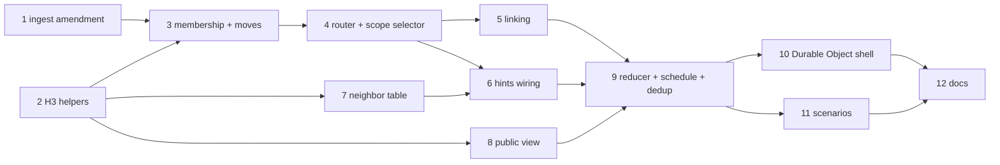

# Tasks: area-cells

Rules: only real dependencies are listed. Tasks in the same wave run in parallel. A task is done only per `definition-of-done.md`. Commit after each, for example `feat(area): scope selector [spec:area-cells task:4]`.

Highest reasoning effort for tasks 4, 5, 6 and 9. Checkpoint before tasks 4 and 9. Plan mode first for tasks 1 and 9 (each touches more than 3 files). Confirm H3 and Cloudflare APIs with the docs servers and put the doc URL in a comment.

This spec depends on `detection-engine` (tasks 1, 3, 13) and `event-ingest` (tasks 1, 2, 5). The area actor logic is a pure module with a thin Durable Object shell. No new dependency: `h3-js` is in the approved stack.

## Wave 1 (needs event-ingest 1, 2 and detection-engine 1)

- [ ] 1. Amend `event-ingest`: route by the res-7 parent (R7.1, I-tests), add `cell` to `DETECTION_EVENT` and `INSTALL_STATE`, rename "cell actor" to "area actor" in the design, and update fixtures. Update tasks 4, 5 and 8 of ingest where they name the cell actor.
  - Requirements: R2.1, R2.4
- [ ] 2. H3 helpers in `packages/shared`: pure `parentOf`, `isCell`, `childrenOf` (bit operations on the index), and lazy `neighborsOf`, `cellOf`, `boundaryOf` using `h3-js`. Tests against `h3-js` on 10,000 random cells including pentagons. Measure Worker startup cost with and without `h3-js`; record in ADR 0006.
  - Depends on: `event-ingest` 1
  - Requirements: R1, R13.4

## Wave 2 (needs 1, 2)

- [ ] 3. Membership and moves: members table logic, one cell per install, synthetic `MOVED` disarm, expiry, weight exclusion. Tests A10.
  - Depends on: 1, 2
  - Requirements: R3, R5
- [ ] 7. Neighbor table and notices: latest-as-of rule, 12-hour expiry, idempotent merge, notice creation rules. Tests A6.
  - Depends on: 2
  - Requirements: R7
- [ ] 8. Public view builder: boundary union, 3-member floor, "3+" phones, history list. Tests A8.
  - Depends on: 2
  - Requirements: R9

## Wave 3 (needs 3)

- [ ] 4. Router and scope selector: feed events to cell, group and parent engines, recently-armed rule, open-outage pinning, precision labels. Tests A1, A2, A3.
  - Depends on: 3, `detection-engine` 3, `detection-engine` 13
  - Requirements: R4, R2.2

## Wave 4 (needs 4)

- [ ] 5. Linking: co-outage records from per-cell drops, 7-day rule, connected components, group engine create and retire. Tests A4, A5.
  - Depends on: 4
  - Requirements: R6
- [ ] 6. Hints wiring: neighbor and linked levels and the manual-report count into the engine's context. Tests A7.
  - Depends on: 4, 7
  - Requirements: R7.5, R8

## Wave 5 (needs 5, 6, 8)

- [ ] 9. Evaluation scheduling and the reducer: deferred state-only batches, one evaluation per scope per request, unknown-end alarm, push de-dup by episode, delete-my-data. Tests A9, A11, A12.
  - Depends on: 5, 6, 8
  - Requirements: R10, R11, R12

## Wave 6 (needs 9)

- [ ] 10. Durable Object shell: SQLite persistence for the model in design 10, write-behind flush, partitioned engine states, counters, notice sending (DO to DO) and the flush alarm.
  - Depends on: 9, `event-ingest` 5
  - Requirements: R2, R13, R14
- [ ] 11. Scenario tests: 8 and 2 phones, link then confirm, 30-phone outage with `CELL` precision, cross-parent notice. Runs against the reducer and, if available, Miniflare.
  - Depends on: 9, `detection-engine` 16
  - Requirements: R4, R6, R7

## Wave 7

- [ ] 12. Update `docs/traceability.md` (A1 to A12), `docs/kiro-log.md`, `workers/api/README.md` area section, and ADR 0006 with measured startup and CPU numbers.
  - Depends on: 10, 11
  - Requirements: all

## Dependency graph

## Not in this spec
- Named neighborhoods ("Yaba") and their cell sets: `web-and-area-pages`.
- Sending pushes and manual-report UI: `alerts-and-light-alarm`.
- Cross-parent linking: a later version if the field test shows feeders crossing parent borders.
