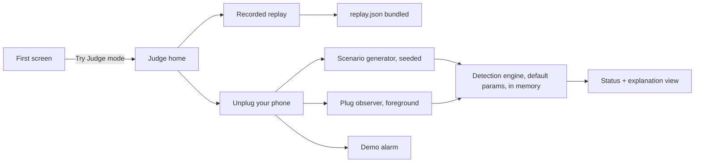
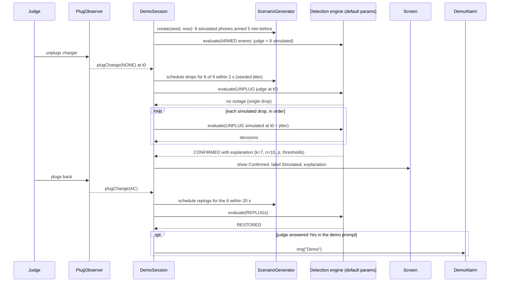
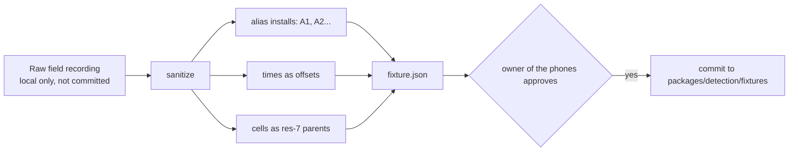

# Design: demo-mode

Status: APPROVED by delegation on 2026-11-14. Based on `requirements.md`. Tasks in `tasks.md`.

## 1. Overview

The demo session is a closed box: its own engine state, its own clock input, its own screens. The only real device features it touches are the battery observer and the alarm sound.

## 2. Verified facts and sources

| Fact | Source |
|---|---|
| A foreground observer can read plug state from the sticky `ACTION_BATTERY_CHANGED` intent (`EXTRA_PLUGGED`: AC 1, USB 2, wireless 4, dock 8). | https://developer.android.com/reference/android/os/BatteryManager |
| The engine is a pure function, so the app can run it with no server (`detection-engine` R1). | `.kiro/specs/detection-engine/requirements.md` |

To confirm with the docs servers: how to register a battery-changed receiver from an Expo module and deliver events to JS, and how to bundle a JSON asset in an Expo app.

## 3. Components

| Component | Responsibility |
|---|---|
| `DemoSession` | Owns the in-memory engine state, the simulated phones, the clock, and the banner state. Pure TypeScript with injected clock and seed. |
| `ScenarioGenerator` | Given a seed, creates `N` simulated neighbors, their `ARMED` history before the drop, their drops with jitter, and their replugs. All objects have `simulated: true`. |
| `PlugObserver` | Native foreground receiver exposed by the module: `onPlugChange(type)`. No sensor job, no Outbox. |
| `ReplayPlayer` | Plays `replay.json` frames with speed control. |
| `DemoAlarm` | Calls the module's test alarm path with a "Demo" label. |
| `DemoScreens` | Judge home, replay, unplug, explanation panel, banner. |

## 4. Unplug scenario

- The clock passed to the engine is the demo's own clock. The judge's real time offsets start at `t0`. No wall clock is used for decisions.
- The scenario numbers come from a function `demoPlan(params)`, which finds the smallest set of simulated phones so that the engine's thresholds are met with a margin, so a change in parameters produces a new plan and the test (DM4) still passes. It never changes the parameters.
- The judge's unplug is shown on screen before any simulated drop, so the order is visible: "Your phone lost power. Simulated neighbors lose power too. The engine counts 7 of 10 phones within 2 seconds."

## 5. Recorded replay

- The replay file is the one built by `web-and-area-pages` task 9 and has the type in that design (section 7).
- The player reads `frames` in order, scaled by speed. It shows the state, the phones as dots in cells (res-7 groups after sanitizing), and the explanation for each decision.
- The "Your spot only" frame is explicit: one phone dot turns orange, the legend says "Only this phone lost power".

## 6. Fixtures and the sanitizer

- The raw recording is never committed. The sanitizer is a script in `tools/sim` with a test that scans output for forbidden shapes (install ID pattern, res-8 cell pattern, ISO dates).
- Fixture shape: `{ source, deviceCount, phones: [{alias, role}], events: [{alias, type, tMs, cellParent, ...}], labels: [...] }`. Same shape as the engine golden fixtures (`detection-engine` R17).
- The synthetic fixture is generated by `tools/sim` from the generators of the engine tests and labeled `SYNTHETIC`.

## 7. Isolation rules in code

- `DemoSession` imports only `packages/detection`, `packages/shared` types and the replay data. A dependency check test (like L3) fails if it imports the Outbox, the uploader, the timeline store, the subscription code or any network module.
- Storage is memory only. A test runs a full session and diffs all real stores (Outbox rows, timeline, labels, settings) before and after (DM3).
- The module's `setDemoSession(true)` flag suppresses only the native prompt; it is cleared when the screen closes or the app is backgrounded for more than 30 seconds.
- Every simulated event factory sets `simulated: true`. A lint-like test (`demo-label-check` hook script) fails if a factory in `tools/sim` or the demo code builds an event without it.

## 8. Screens and copy

| Screen | Content |
|---|---|
| Judge home | Banner, three buttons: Watch a recorded outage, Unplug my phone, How it works. |
| Replay | Map of dots, state label, timeline, explanation, controls. |
| Unplug | Instruction "Unplug your charger" with plug state, then the live sequence, then the explanation. Demo prompt "Power just went? Yes, wake me when it's back / No". |
| How it works | Three lines: charging stops together, many phones in a few seconds is not chance, the math is shown. |

All text follows `copy.md`. The banner text is "Simulated replay" on the replay screen and "Simulated neighbors" on the unplug screen.

## 9. Error handling

| Case | Behavior |
|---|---|
| Phone not charging | Show "Plug in your charger first" and the simulate button. |
| Plug observer unavailable | Simulate buttons only. |
| Replay file missing or unreadable | Show an error text; the unplug scenario still works since it is generated. |
| Audio blocked | The demo alarm shows a notification only and a message. |
| App backgrounded mid-scenario | Pause the scenario; resume or restart on return. |
| Plan cannot reach Confirmed (params changed) | The plan builder returns "not reachable"; the screen says so and the build test fails. |
| Judge's phone also has a real sensor | Real events recorded as usual; prompt suppressed during the session. |
| Leaving mid-demo | State discarded. |

## 10. Testing strategy

Property IDs `DM1` to `DM7`. Vitest and fast-check.

| ID | Property | Requirement | Test |
|---|---|---|---|
| DM1 | Every simulated phone, event, decision and frame in a demo session carries `simulated: true`, and every screen model includes the banner text. | R2 | `DM1_all_labeled` |
| DM2 | The engine parameters used by a demo session equal the default parameters object exactly. | R4.4, R4.6 | `DM2_default_params` |
| DM3 | A full demo session leaves the Outbox, power-log, labels, subscriptions and install record unchanged. | R5 | `DM3_no_real_writes` |
| DM4 | For any seed and any jitter up to 2 s, the generated plan reaches Confirmed within 5 s of the judge's unplug and Restored after the replugs, using the unmodified engine. | R4 | `DM4_plan_confirms_and_restores` |
| DM5 | A session contains exactly one non-simulated drop (the judge's), or none in simulate mode. | R5.6 | `DM5_one_real_drop` |
| DM6 | The sanitizer's output contains no install ID, absolute date or res-8 cell, for any raw fixture. | R6 | `DM6_sanitizer` |
| DM7 | The replay file bundled in the app equals the file served by the Worker (hash), and its decisions equal a fresh engine run. | R7 | `DM7_replay_in_sync` |

Other tests: `DemoSession` dependency check; screens snapshot; the device checklist runs the unplug scenario on 3 phones and records the time to Confirmed on screen; the `/judge-demo` slash command walks both the app and web paths.

Traceability: `docs/traceability.md`.
