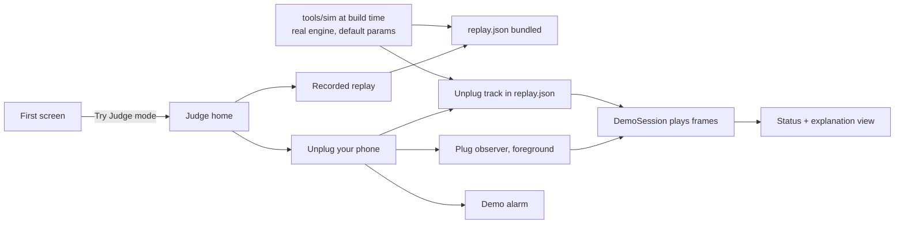
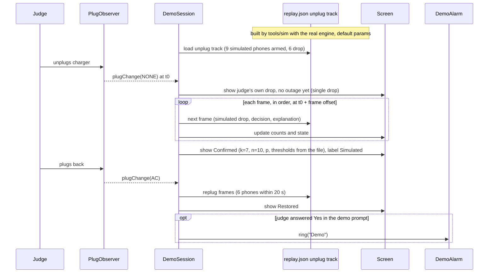
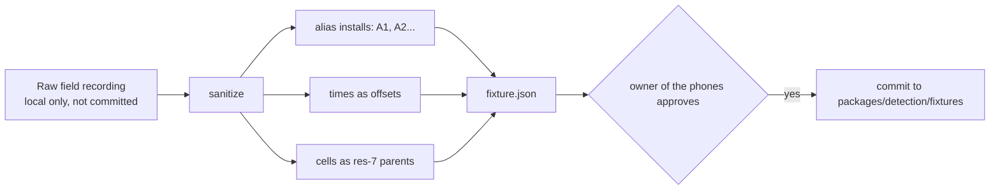

# Design: demo-mode

Status: APPROVED by delegation on 2026-11-14. Based on `requirements.md`. Tasks in `tasks.md`.

## 1. Overview

The demo session is a closed box: it reads only the replay file, plays its frames on its own clock, and draws its own Compose screens. The phone never runs the detection engine. The only real device features it touches are the battery observer and the alarm sound.

## 2. Verified facts and sources

| Fact | Source |
|---|---|
| A foreground observer can read plug state from the sticky `ACTION_BATTERY_CHANGED` intent (`EXTRA_PLUGGED`: AC 1, USB 2, wireless 4, dock 8). | https://developer.android.com/reference/android/os/BatteryManager |
| The engine is a pure function, so `tools/sim` can run it at build time with no server (`detection-engine` R1). | `.kiro/specs/detection-engine/requirements.md` |

To confirm with the docs servers: registering a battery-changed `BroadcastReceiver` in code from a foreground screen and unregistering it, and reading a JSON file from app assets with `AssetManager`. Unverified.

## 3. Components

| Component | Responsibility |
|---|---|
| `DemoSession` | Kotlin class. Owns the playback position, the clock, and the banner state. Reads only the replay file. Injected clock. Holds no engine. |
| `ScenarioGenerator` | In `tools/sim` (TypeScript, build time only). Given a seed, creates `N` simulated neighbors, their `ARMED` history before the drop, their drops with jitter, and their replugs, runs the real engine and writes the unplug track. All objects have `simulated: true`. |
| `PlugObserver` | Kotlin foreground receiver in the sensor package: `onPlugChange(type)`. No sensor job, no Outbox. |
| `ReplayPlayer` | Plays `replay.json` frames and the unplug track with speed control. |
| `DemoAlarm` | Calls the app's test alarm path with a "Demo" label. |
| `DemoScreens` | Jetpack Compose screens (approved 2026-11-14) with a `DemoViewModel`: Judge home, replay, unplug, explanation panel, banner. |

## 4. Unplug scenario

- The frames carry offsets from the judge's unplug. The judge's real unplug time is `t0`. `DemoSession` shows each frame at `t0` plus its offset on its own clock. No decision is computed on the phone.
- The scenario numbers come from a function `demoPlan(params)` in `tools/sim`, which finds the smallest set of simulated phones so that the engine's thresholds are met with a margin, so a change in parameters produces a new track and the test (DM4) still passes. It never changes the parameters.
- The judge's unplug is shown on screen before any simulated drop, so the order is visible: "Your phone lost power. Simulated neighbors lose power too. The engine counts 7 of 10 phones within 2 seconds."

## 5. Recorded replay

- The replay file is the one built by `web-and-area-pages` task 9 and has the type in that design (section 7), plus the unplug track (see section 7 below). The app includes it as an asset and reads it with `AssetManager` (unverified).
- The player reads `frames` in order, scaled by speed. It shows the state, the phones as dots in cells (res-7 groups after sanitizing), and the explanation for each decision.
- The "Your spot only" frame is explicit: one phone dot turns orange, the legend says "Only this phone lost power".

## 6. Fixtures and the sanitizer

- The raw recording is never committed. The sanitizer is a script in `tools/sim` with a test that scans output for forbidden shapes (install ID pattern, res-8 cell pattern, ISO dates).
- Fixture shape: `{ source, deviceCount, phones: [{alias, role}], events: [{alias, type, tMs, cellParent, ...}], labels: [...] }`. Same shape as the engine golden fixtures (`detection-engine` R17).
- The synthetic fixture is generated by `tools/sim` from the generators of the engine tests and labeled `SYNTHETIC`.

## 7. Isolation rules in code

- `DemoSession` reads only the replay file and imports no networking, Outbox, storage of real events, or sensor class. A Kotlin architecture unit test (JUnit 4, `./gradlew testDebugUnitTest`) fails if the compiled class refers to any of them.
- Storage is memory only. A test runs a full session and diffs all real stores (Outbox rows, timeline, labels, settings) before and after (DM3).
- The `DemoFlag` in the app (a plain in-process flag, set by `DemoSession`) suppresses only the "Power just went?" prompt; it is cleared when the screen closes or the app is backgrounded for more than 30 seconds.
- Every simulated event factory sets `simulated: true`. A lint-like test (`demo-label-check` hook script) fails if a factory in `tools/sim` builds an event without it. A Kotlin unit test fails if the app's loader accepts a replay file or track object without it.

## 8. Screens and copy

| Screen | Content |
|---|---|
| Judge home | Banner, three buttons: Watch a recorded outage, Unplug my phone, How it works. |
| Replay | Map of dots, state label, timeline, explanation, controls. |
| Unplug | Instruction "Unplug your charger" with plug state, then the live sequence, then the explanation. Demo prompt "Power just went? Yes, wake me when it's back / No". |
| How it works | Three lines: charging stops together, many phones in a few seconds is not chance, the math is shown. |

All text follows `copy.md`. The banner text is "Simulated replay" on the replay screen and "Simulated neighbors" on the unplug screen.

## 9. Error handling

| Case | Behavior |
|---|---|
| Phone not charging | Show "Plug in your charger first" and the simulate button. |
| Plug observer unavailable | Simulate buttons only. |
| Replay file missing or unreadable | Show an error text; the unplug scenario needs the same file, so it shows the same error and the simulate buttons are hidden. |
| Audio blocked | The demo alarm shows a notification only and a message. |
| App backgrounded mid-scenario | Pause the scenario; resume or restart on return. |
| Plan cannot reach Confirmed (params changed) | The plan builder returns "not reachable"; the replay build and its test fail, so no file ships. |
| Judge's phone also has a real sensor | Real events recorded as usual; prompt suppressed during the session. |
| Leaving mid-demo | State discarded. |

## 10. Testing strategy

Property IDs `DM1` to `DM7`. Vitest and fast-check for `tools/sim` and the replay build (DM2, DM4, DM6, DM7 build side). JUnit 4 for the app side (DM1, DM3, DM5, DM7 app side), reading the replay file and `packages/shared/fixtures/`.

| ID | Property | Requirement | Test |
|---|---|---|---|
| DM1 | Every simulated phone, event, decision and frame in the replay file carries `simulated: true`, and every screen state in a demo session includes the banner text. | R2 | `DM1_all_labeled` |
| DM2 | The engine parameters used to build the replay file equal the default parameters object exactly. | R4.4, R4.6 | `DM2_default_params` |
| DM3 | A full demo session leaves the Outbox, power-log, labels, subscriptions and install record unchanged. | R5 | `DM3_no_real_writes` |
| DM4 | For any seed and any jitter up to 2 s, the plan built by `tools/sim` reaches Confirmed within 5 s of the judge's unplug and Restored after the replugs, using the unmodified engine. | R4 | `DM4_plan_confirms_and_restores` |
| DM5 | A session shows exactly one non-simulated drop (the judge's), or none in simulate mode, and the file's drops are all simulated. | R5.6 | `DM5_one_real_drop` |
| DM6 | The sanitizer's output contains no install ID, absolute date or res-8 cell, for any raw fixture. | R6 | `DM6_sanitizer` |
| DM7 | The replay file included in the app equals the file served by the Worker (hash), and its decisions equal a fresh engine run. | R7 | `DM7_replay_in_sync` |

Other tests: `DemoSession` architecture test (reads only the replay file, no networking, Outbox, real-event storage or sensor class); screen state tests on the `DemoViewModel`; the device checklist runs the unplug scenario on 3 phones and records the time to Confirmed on screen; the `/judge-demo` slash command walks both the app and web paths.

Traceability: `docs/traceability.md`.
