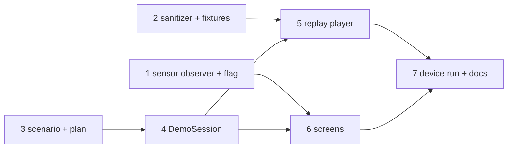

# Tasks: demo-mode

Rules: only real dependencies are listed. Tasks in the same wave run in parallel. A task is done only per `definition-of-done.md`. Commit after each, for example `feat(demo): plan always uses default params [spec:demo-mode task:3]`.

Highest reasoning effort for task 3. Plan mode first for tasks 5 and 6.

Depends on `detection-engine` (tasks 13, 16), `web-and-area-pages` (task 9), `onboarding` (task 3), `alerts-and-light-alarm` (task 4), `sensor-android` (task 9). No new dependency.

## Wave 1

- [x] 1. Amend `sensor-android` with `PlugObserver` (foreground receiver) and the `DemoFlag`, plus the Kotlin interface.
  - Depends on: `sensor-android` 9
  - Requirements: R4.2, R5.5
- [x] 2. Fixture schema and sanitizer in `tools/sim`, with a forbidden-shape scanner. Test DM6.
  - Depends on: `detection-engine` 16
  - Requirements: R6

## Wave 2

- [x] 3. `ScenarioGenerator` and `demoPlan(params)` in `tools/sim`: seeded neighbors, jitter, margin search, "not reachable" result, unplug track written into `replay.json` by the real engine. Tests DM2, DM4, DM5.
  - Depends on: `detection-engine` 13
  - Requirements: R4.3, R4.4, R4.6
- [x] 4. `DemoSession` (Kotlin): playback position of the unplug track, injected clock, labels on every object, architecture test (reads only the replay file). Tests DM1, DM3.
  - Depends on: 3
  - Requirements: R2, R5

## Wave 3

- [x] 5. `ReplayPlayer` and the replay Compose screen reading the replay asset. Test DM7 (with `web-and-area-pages` task 9).
  - Depends on: `web-and-area-pages` 9, 4
  - Requirements: R3, R7
- [ ] 6. Compose screens (Jetpack Compose, approved 2026-11-14) and `DemoViewModel`: Judge home, Unplug flow with the demo prompt and demo alarm, How it works, banner, leave and discard, entry from `onboarding` Welcome. Simulate fallback.
  - Depends on: 1, 4, `alerts-and-light-alarm` 4, `onboarding` 3
  - Requirements: R1, R4, R8

## Wave 4

- [ ] 7. Device run on 3 phones, recording time to Confirmed and Restored; traceability (DM1 to DM7); `docs/kiro-log.md`; update `/judge-demo` steering with the app path.
  - Depends on: 5, 6
  - Requirements: all

## Dependency graph

## Not in this spec
- The web replay page: `web-and-area-pages`.
- The real recorded fixture: produced by `field-telemetry` and the human's field test.
- Interactive what-if controls: not planned.
