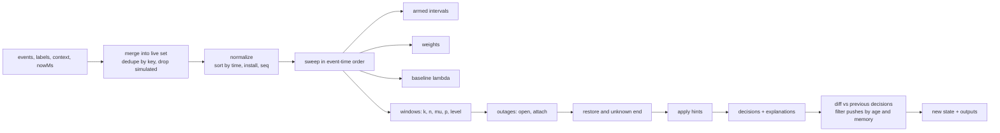
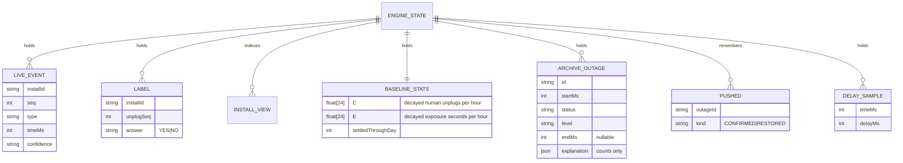
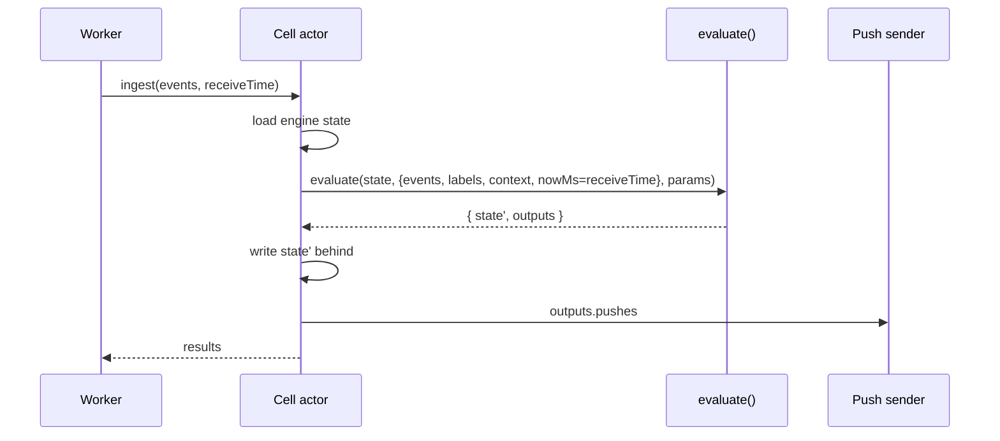
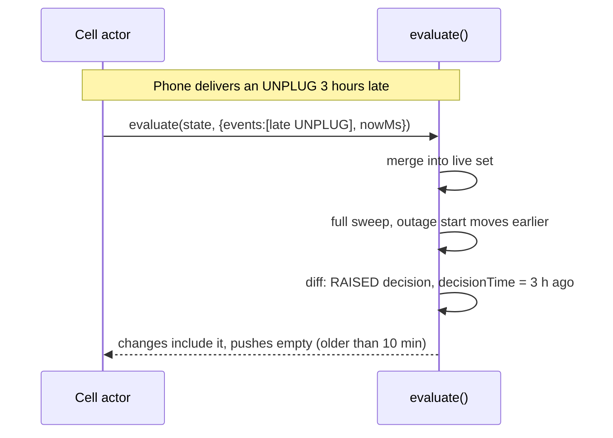

# Design: detection-engine

Status: APPROVED by delegation on 2026-11-14. Based on `requirements.md`. Tasks in `tasks.md`. The Correctness (property-based testing) pass runs in Kiro IDE.

## 1. Overview

`packages/detection` exports one function:

```ts
evaluate(state: EngineState, input: EngineInput, params: Params): { state: EngineState; outputs: EngineOutputs }
```

The central idea: **the decisions are a pure function of the retained event set, not of the order events arrived.** `evaluate` adds the new events to the set (de-duplicated by identity), then computes decisions from the whole live set by a sweep in event-time order. This gives P3, P4 and P8 by construction and makes late events trivial: they join the set and the sweep runs again.

An incremental implementation is allowed only if a property test (D1) proves it equals the full sweep. The first implementation is the full sweep, which is simple and fast enough because a cell has few detection events.



## 2. Verified facts and sources

The algorithm is the brief's Part G. Mathematical definitions:

- Poisson upper tail: `P(X >= k | mu) = 1 - sum_{i=0}^{k-1} e^{-mu} mu^i / i!`. Equivalent to the sum `sum_{i=k}^{inf} e^{-mu} mu^i / i!`, which is used for computation (section 7).
- fast-check API for generators and `fc.assert`, and Vitest API: confirm with the Context7 docs server before writing tests, and put the doc URL in a comment.

## 3. Parameters (`params.ts`)

All defaults and the reasoning are in ADR 0005.

```ts
type Params = {
  windowMs: 90_000;
  possible: { minK: 2; maxP: 0.05 };
  confirmed: { minK: 3; maxP: 0.001 };
  minArmedForConfirm: 3;
  weight: { cut: 0.5; u0: 8; lookbackMs: 86_400_000 };
  baseline: { priorLambdaPerSec: 1/1800; priorExposureSec: 36_000; dailyDecay: 0.9 };
  restore: { baseMs: 90_000; priorP95Ms: 60_000; minSamples: 20; minQuorum: 2 };
  unknownEndMs: 43_200_000;       // 12 h
  pushMaxAgeMs: 600_000;          // 10 min
  staleArmedMs: 604_800_000;      // 7 days
  horizonMs: 648_000_000;         // 7 days + 12 h, see section 8
  localOffsetMs: number;          // set per city; Lagos = +3_600_000
};
```

## 4. Algorithm (reference sweep)

Notation: events sorted by the total order `(timeMs, installId, seq)`.

### 4.1 Step by step

1. **Merge.** Add new events and labels to the live sets, keyed by identity. Events with `simulated` are counted into `ignoredSimulated` and not stored.
2. **Apply labels.** A label `NO` on an install's UNPLUG marks that UNPLUG as `human`. A label `YES` marks it `wake`. Labels attach by (install, unplug seq).
3. **Sweep drops in time order.** For each UNPLUG `e` that is not `human`:
   1. Compute `weight(install, e.time)` from the install's isolated unplugs in `(e.time - lookback, e.time - W]`.
   2. If weight < cut, the unplug is a noisy drop: it counts nowhere in this window, and it stays in the install's own isolated count.
   3. Otherwise it is an eligible drop.
4. **Windows.** For each eligible drop at time `t`:
   - `k` = number of distinct eligible installs with an eligible drop in `(t - W, t]`.
   - `armedAtStart` = eligible installs armed at `t - W` (from armed intervals, minus stale ones).
   - `n = |armedAtStart|`.
   - `lambda = lambdaFor(hour(t + localOffset), day(t + localOffset))`.
   - `mu = lambda * n * W_sec`, `p = tail(k, mu)`.
   - `level = CONFIRMED` if `k >= 3 && p < 0.001 && n >= 3`; else `POSSIBLE` if `k >= 2 && p < 0.05`; else none.
5. **Outages.** Walk windows in time order. A window with a level opens an outage if none is open. Otherwise it attaches. An outage's start is the earliest eligible drop in the first qualifying window. `d` is the number of distinct eligible installs that dropped while the outage was open. The outage level is the maximum window level.
6. **Restore.** For an open outage, collect REPLUGs from its dropped installs after the outage start, with time <= start + 12 h. Let `r = max(2, ceil(d/2))`. Slide a span of length `W_r` over those REPLUGs. The first span holding `r` distinct installs closes the outage as `RESTORED`. `restoredAt` = first REPLUG in the span. `evidenceAt` = the REPLUG that completed the quorum.
7. **Unknown end.** If no restore exists and `nowMs > start + 12 h`, the outage is `ENDED_UNKNOWN`.
8. **Hints.** For each open or restored outage, apply the hints from `context` to the area level (section 4.3).
9. **Spot states.** For each `wake` drop whose time lies in no outage, emit `SPOT_ONLY` until that install's next REPLUG.
10. **Decisions.** Build the list: outage opened (level and time), level raised (level and time), restored, ended unknown. Each carries its explanation.
11. **Pushes.** Compare decisions against `state.decisionsPushed`. Keep new CONFIRMED and RESTORED decisions whose `decisionTimeMs >= nowMs - 10 min`. Record them in the new state. POSSIBLE never pushes.

### 4.2 Weight, baseline, restore delay: well-founded in time

Each of these reads only data that ends before the moment being decided:

| Quantity | Reads | Why no circularity |
|---|---|---|
| weight(i, t) | i's isolated unplugs in `(t - 24h, t - W]` | An unplug older than one window has all the data it needs to be classified. |
| lambda(hour h, day D) | settled stats from days before D | Same-day data is never used for the same-day decision. |
| W_r for an outage starting at s | REPLUG delays with time < s | The outage's own REPLUGs are not in the sample. |

Because each value depends only on strictly earlier data, the sweep in event-time order is well defined, and a late event only forces a recompute from its own time forward (an optimization, not a requirement).

### 4.3 Hints

```
raise(level, hint, kElsewhere):
  if hint is none: return level
  next = Normal->Possible, Possible->Confirmed, Confirmed->Confirmed
  if next == Confirmed and max(k_here, kElsewhere) < 3: return Possible
  return next
```

Hints never change `k`, `n`, `mu` or `p` (R7.5). They are recorded as `raisedBy: 'NEIGHBOR' | 'LINKED' | 'MANUAL'` in the explanation.

## 5. Details

### 5.1 Labels

- `NO` ("No, I unplugged it"): the unplug is a human unplug. It is not a drop. It counts in the baseline numerator (R4.3) and in the install's isolated count (R3.5). The install's armed time keeps counting as exposure.
- `YES` ("Yes, wake me when it's back"): the unplug stays a normal drop. It enables `SPOT_ONLY` when the area has no outage (R8).
- A label that arrives after the unplug changes history. The sweep handles it like any late event.
- Labels are an input type of the engine. They are not in the ingest wire format yet; the `alerts-and-light-alarm` spec amends the ingest schema. Until then the label list is empty.

### 5.2 Baseline lambda

Two decayed sums per local hour of day `h`:

```
C_h = sum over past days d of  0.9^(D-1-d) * humanUnplugs(d, h)
E_h = sum over past days d of  0.9^(D-1-d) * exposureSeconds(d, h)
lambda_h(D) = (a0 + C_h) / (b0 + E_h)       a0 = b0 * priorLambda, b0 = 36,000 s
```

Exposure for `(d, h)`: for each eligible install's armed time inside that hour, excluding any span inside an outage of level Possible or Confirmed. This is an exponential moving average on the sufficient statistics. With a prior of 36,000 sensor-seconds (10 sensor-hours), one phone's first day barely moves lambda, so early phones cannot make the system trigger-happy.

Settled days are folded into `C_h` and `E_h`. Unsettled days (inside the horizon) are recomputed from events.

### 5.3 Weight

```
u(i,t) = count of install i's unplugs in (t - 24h, t - W] that are isolated
weight(i,t) = u0 / (u0 + u)     u0 = 8
weight < 0.5  <=>  u > 8
```

An unplug is isolated if it is `human`, or belongs to no outage of level Possible or Confirmed.

### 5.4 Restore delay p95

`schedulingDelayMs` values from REPLUG events with time before the outage start. Nearest-rank p95 on the sorted multiset. Fewer than 20 samples use the prior 60,000 ms. `W_r = 90,000 + p95`.

### 5.5 Time shift (P8)

`hour(t + localOffsetMs)` and `day(...)` define buckets. When times and the offset move together by the same constant, every bucket assignment stays the same, so decisions shift and nothing else changes. When a test shifts times alone by a constant that is not a multiple of 24 h, buckets move on purpose; that is not a violation of P8 as stated in R15. This reading needs the human's acknowledgement; if it is refused, the alternative is a flat baseline (no hour-of-day), which makes P8 hold for any shift but loses the daily pattern. See ADR 0005.

## 6. Data model



Types:

```ts
type EngineInput = {
  events: EngineEvent[];        // from ingest: { installId, seq, type, eventTimeMs, confidence, schedulingDelayMs?, simulated? }
  labels: Label[];
  context: { neighbors: { level: Level; maxK: number; linked: boolean }[]; manualReports: number };
  nowMs: number;
};
type EngineOutputs = {
  decisions: Decision[];        // full current list for the live horizon, stable order
  changes: Decision[];          // new or changed since the previous call
  pushes: Push[];
  areaStatus: { level: 'NORMAL'|'POSSIBLE'|'CONFIRMED'; outageId?: string; sinceMs?: number };
  spotStates: { installId: string; state: 'SPOT_ONLY'; sinceMs: number }[];
  rejected: { reason: string }[];
  ignoredSimulated: number;
};
type Decision = {
  outageId: string; kind: 'OPENED'|'RAISED'|'RESTORED'|'ENDED_UNKNOWN';
  level: 'POSSIBLE'|'CONFIRMED'; status: 'OPEN'|'RESTORED'|'ENDED_UNKNOWN';
  decisionTimeMs: number; startMs: number; restoredAtMs?: number;
  explanation: Explanation;
};
type Explanation = {
  k: number; n: number; excludedNoisy: number; lambdaPerSec: number; muValue: number; p: number; windowMs: number;
  thresholds: { possible: {minK: number; maxP: number}; confirmed: {minK: number; maxP: number} };
  raisedBy?: 'NEIGHBOR'|'LINKED'|'MANUAL';
  confidence: { high: number; low: number };
  restore?: { d: number; quorum: number; replugs: number; wrMs: number; p95SampleCount: number; p95Ms: number };
};
```

`installId` appears only in `LIVE_EVENT`, `LABEL` and `INSTALL_VIEW`. `ARCHIVE_OUTAGE`, decisions and explanations carry counts only (R13.2).

## 7. Numerics

`tail(k, mu)`:

```
if mu == 0: return k == 0 ? 1 : 0
term = exp(-mu + k*ln(mu) - lnGamma(k+1))     // log space, first term i = k
sum = 0; i = k
loop: sum += term; i += 1; term *= mu / i; stop when term < sum * 1e-16 and i > mu
return min(1, sum)
```

Summing upward avoids subtracting numbers close to 1, so values like 1e-12 keep full relative precision. Required accuracy: relative error below 1e-9 against a reference computed with high-precision arithmetic in a test (D4). `lnGamma(k+1)` is a table for small k and Stirling for large k.

## 8. Settling and bounds

- **Horizon** `H = 7 days + 12 h`. The ingest Worker rejects events older than 7 days, and an outage stays open at most 12 h, so nothing older than `H` can change a decision.
- **Settle step** (end of each `evaluate`): for each outage whose close time (`start + 12 h` for both restored and unknown-end outages, so the restore time never shortens how long it stays live) is older than `nowMs - H`, move it to `ARCHIVE_OUTAGE` with its explanation, and drop events older than `nowMs - H` after folding their day's counts and exposure into `BASELINE_STATS` and their REPLUG delays into `DELAY_SAMPLE` (cap 500, newest first).
- Settle uses `nowMs`, so it is a function of the clock input only.
- Size: 100 installs, 7.5 days, ~10 events a day each is 7,500 events at ~60 bytes serialized, about 0.5 MB; armed intervals add to that. The test (R16.6) checks 1 MB. The cell actor splits storage by install and by part (baseline, archive, live events).
- Equivalence (D5): evaluating with settling equals evaluating the same inputs without ever settling, for every decision whose time is inside the horizon.

## 9. Interfaces and integration

- **Called by** the cell actor in `workers/api` through `DetectionPort`. The engine does not know about Durable Objects.
- **Amendment to `event-ingest`:** the port must also receive `ARMED` and `DISARMED` state events, not only detection events, because armed intervals need them (task 1 of this spec, which edits `event-ingest` design section 9 and its task 5). State events in memory in the actor still follow the write-behind rule for their own bookkeeping; the engine keeps its own compact armed intervals inside its state and the actor writes that state behind.
- **Scope** is supplied by `area-cells`. For a sparse cell the actor passes the parent cell's events and state. The engine only sees a scope.
- **Context** for hints is assembled by the actor from other scopes.
- **Simulator** (`tools/sim`) emits events with `simulated: true`. The engine never stores them.





## 10. Error handling

| Case | Behavior |
|---|---|
| Malformed event (missing fields, NaN, non-integer time) | Skipped, listed in `outputs.rejected`. Others processed. |
| `nowMs` earlier than the latest event time by more than a day | Evaluate anyway with `nowMs` used only for unknown-end, push age and settle; add a `clockSkew` flag to outputs. No throw. |
| Event with an unknown type | Rejected as above. |
| Hint with NaN or negative values | Ignored with a rejected entry. |
| Empty input | Returns the same state and the same decisions. |
| State from an older schema version | `migrate(state)` function with a version number; unknown versions throw a typed error so the caller can rebuild from stored events. |
| Numerical underflow in `tail` | Result is 0, which is below any threshold; recorded as is. |
| Extreme sizes (more than 5,000 live events in one scope) | Evaluate anyway; the cell actor reports a warning counter. A real limit is set by measurement in the field test. |

## 11. Testing strategy

Property IDs `P1` to `P12` come from the brief and are exact. Extra engine properties are `D1` to `D6`. Test titles must contain the ID. Runner: Vitest and fast-check. The IDE Correctness pass generates and runs these.

### 11.1 Generators

| Generator | Produces |
|---|---|
| `humanUnplugs(rate, installs, span)` | Poisson unplugs at the baseline rate, with matching replugs later. |
| `trueOutage(installs, startMs, jitterMs <= 2000)` | UNPLUGs for a random subset of armed installs within jitter. |
| `generatorRestart(installs, spreadMs)` | REPLUGs spread over minutes, wider than `W_r`. |
| `inverterRestart(installs)` | Staggered REPLUGs just outside `W_r`. |
| `lateDelivery(events, delays)` | Same events in any order and with delays up to the horizon. |
| `duplicates(events)` | Repeats of random events. |
| `noisyInstall(count)` | An install with more than 8 isolated unplugs in 24 h. |
| `armedSet(n)` | `ARMED` events for n installs before a start time. |

### 11.2 Properties

| ID | Property | Requirement | Test |
|---|---|---|---|
| P1 | One UNPLUG alone never gives Possible or Confirmed. | R6.3 | `P1_single_unplug_never_alerts` |
| P2 | For n >= 3, any lambda, k >= 3 drops in one window with p < 0.001 gives Confirmed. | R6.1 | `P2_confirmed_when_k3_p_small` |
| P3 | Reordering or delaying the same events gives the same final decisions. | R2.3, R12.1 | `P3_order_and_delay_independence` |
| P4 | Duplicate events change nothing. | R2.2 | `P4_duplicates_change_nothing` |
| P5 | REPLUGs spaced wider than `W_r` never give a restore. | R10.4 | `P5_spread_replugs_never_restore` |
| P6 | A restore only follows a Possible or Confirmed outage. | R10.5 | `P6_restore_needs_outage` |
| P7 | Adding drops inside a window never lowers that window's level, history before the window fixed. | R6.4 | `P7_more_drops_never_lower` |
| P8 | Shifting all event times, `nowMs` and the local offset by a constant shifts all decisions by it and changes nothing else. | R15 | `P8_time_shift_invariance` |
| P9 | Simulated events change no state, history, statistics or pushes. | R14 | `P9_simulated_never_counts` |
| P10 | A device with weight < 0.5 is never one of the 3 drops that confirm. | R3.6 | `P10_noisy_never_confirms` |
| P11 | A scope with fewer than 3 armed sensors never shows Confirmed at its own level. | R5.6 | `P11_sparse_never_confirms` |
| P12 | No push for a decision whose event time is more than 10 minutes before `nowMs`. | R12.2 | `P12_no_stale_push` |
| D1 | An incremental implementation, if present, equals the full sweep on every input. | R1.3 | `D1_incremental_equals_sweep` |
| D2 | `tail(k, mu)` is in [0,1], decreasing in k, increasing in mu, and within relative error 1e-9 of a high-precision reference. | R5.4 | `D2_poisson_tail_accuracy` |
| D3 | Every decision has every explanation field, and recomputing p and level from the explanation reproduces the decision. | R13 | `D3_explanations_complete` |
| D4 | A label NO removes that unplug from k and adds it to the baseline count; a label YES changes no level. | R3.5, R4.3, R8 | `D4_labels` |
| D5 | Settling and archiving gives the same decisions as never settling, inside the horizon. | R16 | `D5_settle_equivalence` |
| D6 | Total pushes per (outage, kind) is at most 1 across any sequence of `evaluate` calls. | R12.3 | `D6_push_once` |

Property definitions have two proof obligations that the Correctness pass will probe hardest. First, P7 needs the "history before the window fixed" clause, because adding an isolated unplug earlier in the day can make an install noisy for later windows; this is a real effect of the weight rule and not a bug. Second, P3 needs "final decisions" to mean decisions evaluated at a `nowMs` later than every event time plus 12 hours. If the pass finds a counterexample, write the options in an ADR and ask the human; do not weaken the property.

### 11.3 Other tests

- Unit tests for `weight`, `lambdaFor`, `p95`, `tail`, window sweep, restore span, hints.
- Table tests built from the ADR 0005 table: minimum k for Possible and Confirmed at several n.
- **Golden fixtures** under `packages/detection/fixtures/`: recorded real outages from the field test. A replay test compares the full decision list. Large fixtures go in `fixtures/large/`.
- **Simulator contract:** the 30-phone simulated outage from `tools/sim` yields CONFIRMED within 10 s of event time of the last event (milestone 2 gate). This runs in CI.
- **Performance test:** the free Workers plan gives 10 ms CPU per request (https://developers.cloudflare.com/workers/platform/limits/). Whether a Durable Object call has the same budget must be confirmed with the Cloudflare docs server. A benchmark reports evaluation time for 100, 500 and 5,000 live events. Target: 500 live events in under 5 ms on the CI machine. If 500 events do not fit, build the incremental implementation, with D1 proving it equals the full sweep. The benchmark reports numbers; the field test supplies the real event counts per cell.

Traceability: `docs/traceability.md` links requirement, property, test and task. The `property-traceability` hook fails when any P1 to P12 has no test naming it.
