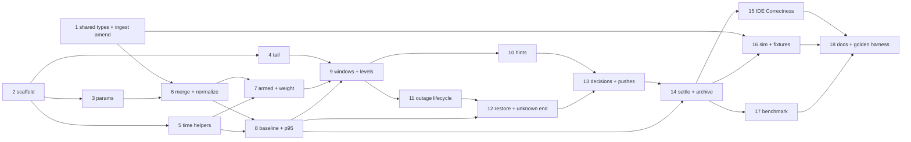

# Tasks: detection-engine

Rules: only real dependencies are listed. Tasks in the same wave run in parallel. A task is done only per `definition-of-done.md`. Commit after each, for example `feat(detection): Poisson tail [spec:detection-engine task:4]`.

Highest reasoning effort for every task in this spec. Checkpoint before tasks 9, 11, 12 and 14. Plan mode first for tasks 1, 2 and 14 (each touches more than 3 files). Confirm fast-check and Vitest APIs with the Context7 server and put the doc URL in a comment.

The `packages/detection` code is pure: no I/O, no clock, no randomness. Do not change a threshold in `params.ts` without the human (ADR 0005).

Kiro IDE is needed for task 15 (Correctness pass). Everything else can run in Kiro Web.

## Wave 1

- [x] 1. Shared types and the ingest amendment: add `EngineEvent`, `Label`, `Context`, `Decision`, `Explanation` to `packages/shared`. Amend `event-ingest` design section 9 and task 5 so `DetectionPort` also receives `ARMED` and `DISARMED` events. Update golden fixtures.
  - Depends on: `event-ingest` task 2
  - Requirements: R2, R13
- [x] 2. Scaffold `packages/detection` (TypeScript strict, Vitest, fast-check). Replace the placeholder `README.md` with the contract and a pointer to the spec.
  - Depends on: `event-ingest` task 1
  - Requirements: R1

## Wave 2 (needs 2)

- [x] 3. `params.ts` with every default from ADR 0005 and a validator that rejects impossible values (for example W <= 0, p outside 0..1).
  - Depends on: 2
  - Requirements: R1.4
- [x] 4. `tail(k, mu)` in log space with upward summation, plus the `lnGamma` helper. Tests D2 with a high-precision reference.
  - Depends on: 2
  - Requirements: R5.4
- [x] 5. Time helpers: local hour and day with a fixed offset, no environment time zone. Unit tests across day boundaries and negative offsets.
  - Depends on: 2
  - Requirements: R4.6, R15

## Wave 3 (needs 1, 3)

- [x] 6. Merge and normalize: identity de-duplication, total order, simulated filtering, malformed rejection, label attachment. Tests P4, P9 (input side).
  - Depends on: 1, 3
  - Requirements: R2, R14
- [x] 7. Armed intervals from events, stale expiry, and weights. Tests P10 (weight part), D4 (weight side).
  - Depends on: 6, 5
  - Requirements: R3
- [x] 8. Baseline: decayed counts and exposure per hour, `lambdaFor(hour, day)` using only earlier days, and p95 of delays with the prior.
  - Depends on: 6, 5
  - Requirements: R4, R10.1

## Wave 4 (needs 4, 7, 8)

- [x] 9. Windows and levels: k, n, mu, p, Possible and Confirmed, sparse cap. Tests P1, P2, P7, P11.
  - Depends on: 4, 7, 8
  - Requirements: R5, R6
- [x] 10. Hints: raise one level, never to Confirmed without k >= 3 anywhere, recorded in the explanation. Unit tests.
  - Depends on: 9
  - Requirements: R7

## Wave 5 (needs 9)

- [x] 11. Outage lifecycle: open, attach, stable identity, level history, `d`. Tests for identity stability under reordering.
  - Depends on: 9
  - Requirements: R9
- [x] 12. Restore and unknown end: `W_r`, quorum, span search, evidence and restored times, 12 h rule, late evidence. Tests P5, P6.
  - Depends on: 11, 8
  - Requirements: R10, R11

## Wave 6 (needs 10, 12)

- [x] 13. Decisions, explanations, change diff, push filter and memory. Tests P12, D3, D6.
  - Depends on: 10, 12
  - Requirements: R12, R13
- [x] 14. Settle and archive, state migration function, and the state-size test. Tests D5.
  - Depends on: 13, 8
  - Requirements: R16

## Wave 7 (needs 14)

- [ ] 15. **Kiro IDE.** Run Analyze Requirements and the Correctness pass. Assemble the whole-engine property suite P3 and P8 with all generators from design 11.1. Fix findings through ADRs and never by weakening a property. Record the result in `requirements.md` and `docs/kiro-log.md`.
  - Depends on: 14
  - Requirements: R2.3, R12.1, R15
- [x] 16. Fixture format and a 30-phone outage generator in `tools/sim`, every event marked `simulated: true`. Contract test: confirmed within 10 s of the last event. Add the `demo-label-check` hook script.
  - Depends on: 1, 14
  - Requirements: R14, R17
- [x] 17. Benchmark for 100, 500 and 5,000 live events, and a report in `docs/adr/0005` addendum. If 500 events exceed the budget, open a follow-up task for the incremental implementation (D1).
  - Depends on: 14
  - Requirements: R1

## Wave 8

- [ ] 18. Golden fixture replay harness (empty until the field test produces a fixture), `packages/detection/README.md` final text, `docs/traceability.md` update for P1 to P12 and D1 to D6, `docs/kiro-log.md`.
  - Depends on: 15, 16, 17
  - Requirements: R17

## Dependency graph

## Not in this spec
- Choosing the scope and pooling sparse cells and linked cells: `area-cells`.
- Sending pushes: `alerts-and-light-alarm`.
- Running the engine on the phone. The engine runs only in the Worker and in `tools/sim`. `tools/sim` writes `replay.json`, which the app (`demo-mode`) and the web page play.
- The label wire format ("Yes" and "No" answers): `alerts-and-light-alarm` amends `event-ingest`.
- Showing the five states: `web-and-area-pages`.
