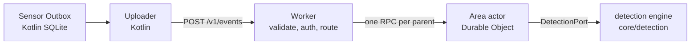
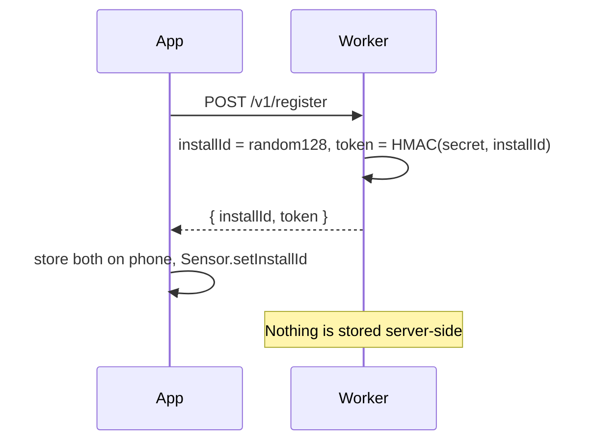
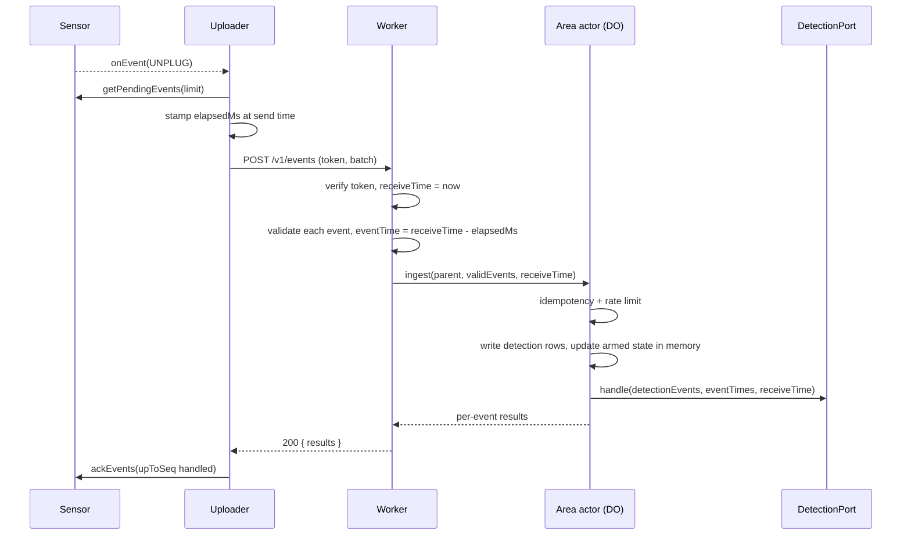
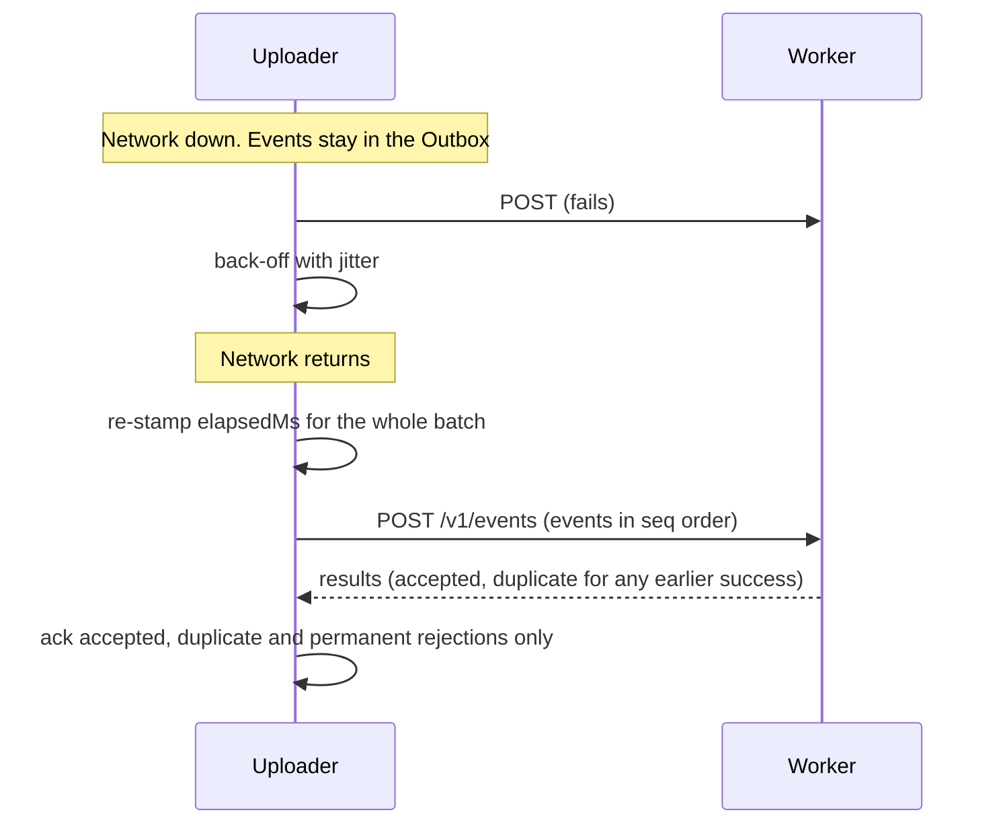
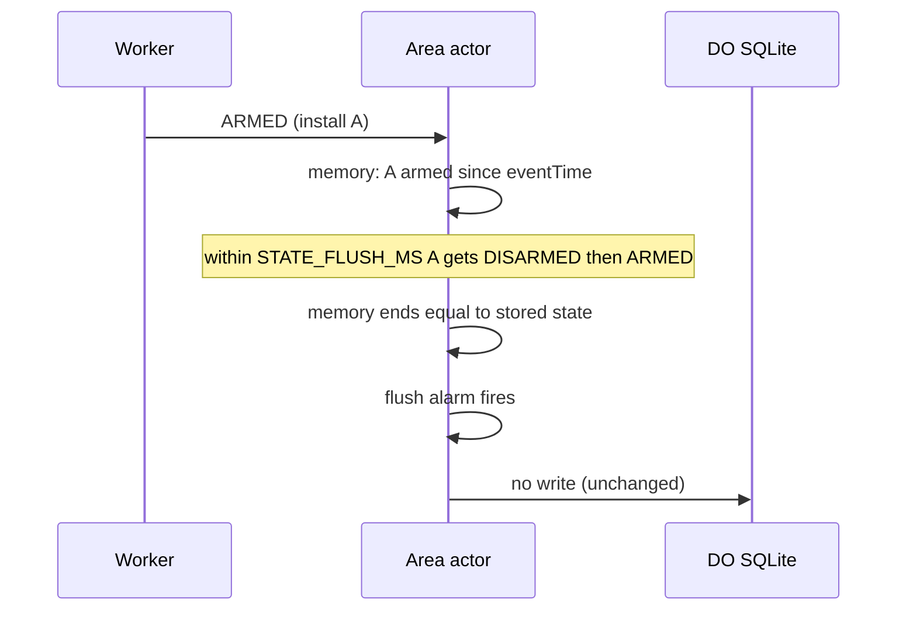
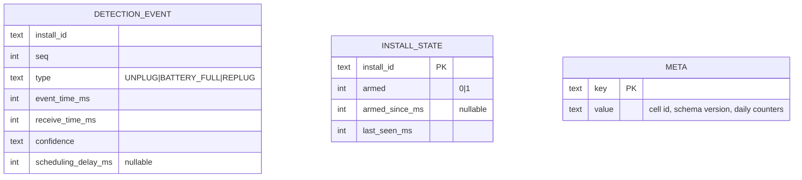

# Design: event-ingest

Status: APPROVED by delegation on 2026-11-14. Based on `requirements.md`. Tasks in `tasks.md`.

## 1. Overview

> AMENDED 2026-11-14 by `area-cells` (ADR 0006): the "cell actor" below is the **area actor**, one per res-7 parent, holding its seven res-8 cells. Events are grouped by parent, the `DETECTION_EVENT` and `INSTALL_STATE` tables gain a `cell` column, and idempotency stays (install, seq) within the actor. Ingest task 1 of `area-cells` applies this to the code plan.



- The **Worker** is stateless. It authenticates, validates each event, computes event time, groups events by res-7 parent, and calls each area actor once.
- The **area actor** owns idempotency, rate limiting, armed state and stored detection events for one res-7 parent. It calls the engine through `DetectionPort`.
- The **Uploader** lives in `android/outage` (Kotlin, injectable transport and clock) so JUnit can drive it with a fake transport. The event schema and API shapes are covered by contract fixtures in `core/shared/fixtures/`, read by the Worker tests (Vitest) and the app tests (JUnit). The H3 cell on the phone comes from `com.uber:h3` (needs human approval, ADR 0012).

## 2. Verified platform facts

| Fact | Source |
|---|---|
| Free plan allows only SQLite-backed Durable Objects. Free limits per day: 100,000 DO requests, 13,000 GB-s duration, 100,000 rows written, 5 million rows read. Deletes count as rows written. Each `setAlarm()` counts as one row written. | https://developers.cloudflare.com/durable-objects/platform/pricing/ |
| Workers Free: 100,000 requests/day, 10 ms CPU per request, 50 subrequests per request, 1,000 to internal services. | https://developers.cloudflare.com/workers/platform/limits/ |
| Each DO RPC method call is one billed DO request. | pricing page footnote 1 |
| Idle DOs eligible for hibernation are not billed for duration. | pricing page |

To confirm with the Cloudflare docs server before implementing: SQLite-backed class declaration (`new_sqlite_classes` migration), `ctx.storage.sql` API, alarm API, WebCrypto HMAC in Workers, and the per-source rate-limiting options available on the free plan.

## 3. Budget model (free tier)

Daily limits are shared by all users, so every request and row is a cost.

| Resource | Daily cap | Design response |
|---|---|---|
| Worker requests | 100,000 | State events piggyback on detection events or wait for a maximum wait (R9.2). |
| DO requests | 100,000 | One RPC per cell per request, not per event (R7.2). |
| Rows written | 100,000 | Detection events are rows. Armed state is write-behind and skipped when unchanged (R11). |
| CPU per request | 10 ms | Hand-written validator, no schema library, one HMAC per request. |

Rough sizing, only to check the approach is viable. Assume 30 phones with `ARMED`/`DISARMED` churn every 10 minutes (unconfirmed, ADR 0001) and 5 detection events per phone per day. Without write-behind that is about 30 × 288 = 8,640 rows/day. With write-behind, short gaps that recover inside the flush interval write nothing. Detection events are about 150 rows/day. Both fit with a large margin. At 10× the phones the naive design would pass 80,000 rows/day; write-behind keeps it far below. These are estimates and will be replaced by field data.

## 4. Starting values (tunables in `web/config.ts`)

These are operational limits, not detection thresholds. Change them freely, record changes in the log.

| Name | Value | Why |
|---|---|---|
| `MAX_BATCH_EVENTS` | 100 | Bounds CPU for one request. |
| `MAX_BODY_BYTES` | 32,768 | Same. |
| `MAX_ELAPSED_MS` | 604,800,000 (7 days) | From the brief. |
| `BUCKET_CAPACITY` | 30 events | Covers a burst after an offline period. |
| `BUCKET_REFILL_MS` | 20,000 per event (about 180/hour) | Far above real event rates. |
| `STATE_FLUSH_MS` | 60,000 | Collapses short gaps into no write. |
| `STATE_MAX_WAIT_MS` (client) | 900,000 (15 min) | Armed state reaches the server regularly. |
| `IDEMPOTENCY_WINDOW` | last 256 seq per install per cell | Bounded memory (R5.4). |
| `RETENTION_MS` | 30 days | Matches the 30-day area history. |
| `REGISTER_PER_SOURCE_PER_HOUR` | 10 | Limits mass registration. |
| `WRITE_BUDGET_SHED_FRACTION` | 0.8 of the daily row limit | Drop state events before the cap. |

## 5. Wire format

```ts
// core/shared/src/ingest.ts
type WireEvent = {
  installId: string;                 // 128-bit random, base32
  seq: number;                       // integer >= 0
  type: 'ARMED'|'UNPLUG'|'BATTERY_FULL'|'REPLUG'|'DISARMED';
  elapsedMs: number;                 // integer, ms since the event, computed at send time
  cell: string;                      // H3 res 8 index, hex
  confidence: 'HIGH'|'LOW';
  timeQuality: 'OK';                 // anything else is never sent
  stopReason?: string; reason?: string;
  schedulingDelayMs?: number|null; batteryPct?: number; plugType?: string;
};
type EventsRequest  = { installId: string; events: WireEvent[] };
type EventResult    = { seq: number; status: 'accepted'|'duplicate'|'rejected'; code?: RejectCode; permanent?: boolean };
type EventsResponse = { results: EventResult[]; retryAfterMs?: number };
```

AMENDED 2026-11-14 by `alerts-and-light-alarm`: the `type` union also includes `'LABEL'` with `refSeq: number` and `answer: 'YES'|'NO'` (strict schema, I8 updated). `LABEL` is uploaded promptly, stored as a row, and passed to the area actor as an engine `Label`.

Headers: `Authorization: Bearer <installToken>`. No cookies. The Worker never reads or logs IP or user agent.

Token: `token = base64url(HMAC-SHA256(secret, installId))`. Verification is a constant-time compare.

## 6. Sequences

### 6.1 Registration



### 6.2 Upload of a detection event



### 6.3 Offline then catch-up



### 6.4 State events and write-behind



## 7. Data model (per area actor, SQLite)



- `DETECTION_EVENT` primary key is (`install_id`, `seq`). That key is the idempotency record, so no second table is needed. Rows older than `RETENTION_MS` are deleted by an alarm (deletes count as rows written, so the pruning job runs once a day).
- `INSTALL_STATE` is flushed on `STATE_FLUSH_MS`, only for installs that changed.
- Token buckets and the recent-seq window for state events live in memory only. A DO restart makes them lenient, never stricter.
- State events (`ARMED`, `DISARMED`) are not stored as rows. Their idempotency is handled by comparing event time: an older state event never overwrites a newer one (last-writer-by-event-time).

## 8. Error handling

| Failure | Behavior |
|---|---|
| Bad JSON, oversize body | HTTP 400 / 413, no results. |
| Missing or wrong token | HTTP 401 for the whole request. Nothing processed. |
| One event invalid | That event `rejected` with permanent code. Others processed. |
| Area actor unavailable (exception) | Those events `rejected` with `UNAVAILABLE` (transient). The Uploader keeps and retries them. |
| Rate limit | Excess events `RATE_LIMITED` (transient), with `retryAfterMs`. State events are dropped before detection events. |
| Daily write budget near cap | State events dropped as `RATE_LIMITED`. Detection events kept. |
| Free daily limit hit anyway | Cloudflare returns errors. The Uploader treats non-2xx as transient and backs off. The app still works locally (Light Alarm needs no network). |
| Secret missing | Worker answers 500 on register and events. A startup check logs a clear message without printing the value. |
| Clock jump in receive time | Event time follows the Worker clock. A regression would show in the explanation data. |
| Delete during an upload | The token is rejected afterward, so late retries do nothing. |

## 9. Interfaces

```ts
// web/api/ingest/ports.ts
interface DetectionPort {
  handle(cell: string, events: IngestedEvent[], receiveTimeMs: number): void | Promise<void>;
}
type IngestedEvent = {
  installId: string; seq: number;
  type: 'ARMED'|'DISARMED'|'UNPLUG'|'BATTERY_FULL'|'REPLUG';
  eventTimeMs: number; confidence: 'HIGH'|'LOW';
  schedulingDelayMs: number | null;
};
```

AMENDED 2026-11-14 by the `detection-engine` spec: `DetectionPort.handle` also receives `ARMED` and `DISARMED` state events, because the engine rebuilds armed intervals from them. The type below gains `ARMED | DISARMED` and an optional `simulated` marker is never passed (ingest rejects it). The detection spec decides what happens next. Until it exists, a `NoopDetectionPort` records events only, so ingest can be built and tested alone.

```kotlin
// android/outage (Kotlin), shape only
interface Transport { fun post(req: EventsRequest, token: String): Result }   // EventsResponse or HttpError
interface OutboxPort { fun getPending(limit: Int): List<SensorEvent>; fun ack(upToSeq: Long) }
class Uploader(outbox: OutboxPort, transport: Transport, clock: Clock, rng: Random, config: UploaderConfig) { fun flush() }
```

## 10. Residual risks

- **Sybil attack.** Server-signed IDs and the per-source register limit raise the cost of faking 3 phones, but do not prevent it. Detection weights (devices with weight below 0.5 are excluded) and cross-cell checks are the second defense. Play Integrity would be stronger but is an external service; not adopted (zero budget, human approval required).
- **Upload latency bias.** Event time subtracts `elapsedMs` from receive time, so upload latency (network RTT, usually under a second) shifts a phone's event time later. It is not corrected. It is small against W = 90 s. The field test can measure it.
- **Stale armed state.** A phone that dies silently stays armed in server memory. The area-cells spec must expire armed state using `last_seen_ms`. It only inflates n, which makes detection harder, never easier.

## 11. Testing strategy

Property IDs `I1` to `I9` belong to this spec. Each test title names its ID. They use Vitest and fast-check. They relate to detection properties P3, P4, P9.

| ID | Property | Requirement | Test |
|---|---|---|---|
| I1 | For any receive time and valid `elapsedMs`, event time = receive time − `elapsedMs`, and it is independent of any phone wall-clock field. | R3 | `I1_event_time_formula` |
| I2 | Sending the same (install, seq) any number of times, in any batching, yields one stored event and the same final state (supports P4). | R5 | `I2_idempotent_any_batching` |
| I3 | `elapsedMs` below 0, non-integer, or above 7 days is always rejected; 0 and exactly 7 days are accepted. | R4 | `I3_elapsed_bounds` |
| I4 | The token bucket never exceeds capacity, and a detection event is never dropped while a state event is admitted. | R6 | `I4_bucket_invariants` |
| I5 | One invalid event never changes the results of other events in the batch. | R8 | `I5_batch_isolation` |
| I6 | Events marked `simulated` or with `timeQuality` not `OK` never reach cell state or `DetectionPort` (supports P9). | R9.7, R10, R4.3 | `I6_excluded_events` |
| I7 | The Uploader sends in seq order, acks only handled events, and for any pattern of transport failures ends with every event delivered exactly once at the server. | R9 | `I7_uploader_convergence` |
| I8 | Any extra field in an event is rejected, and no wire event field can carry a location or a wall-clock time. | R1 | `I8_strict_schema` |
| I9 | For any batch and state flush timing, the stored armed state equals the last state event by event time, and unchanged state causes no write. | R11 | `I9_write_behind_state` |

Other tests: token verify and constant-time compare; register stores nothing; delete removes all rows for an install in listed cells and invalidates the token (R12); counters hold no install IDs (R13); the Worker (Vitest) and the app (JUnit) both parse the contract fixtures in `core/shared/fixtures/`; I7 runs in JUnit with a seeded random failure pattern over a fake transport; end-to-end test using Miniflare or `wrangler dev` locally (confirm tooling with the docs server).

Traceability: `docs/traceability.md` links requirement, property, test and task.
