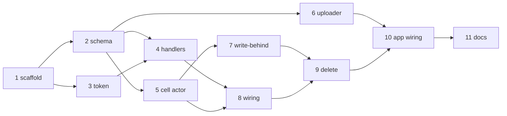

# Tasks: event-ingest

Rules: only real dependencies are listed. Tasks in the same wave run in parallel. A task is done only per `definition-of-done.md`. Commit after each, for example `feat(ingest): strict schema [spec:event-ingest task:2]`.

Highest reasoning effort for tasks 5, 6 and 8 (Durable Object). Plan mode first for tasks 1 and 9 (each touches more than 3 files). Confirm every Cloudflare and H3 API with the docs servers before use and put the doc URL in a comment.

Stack dependencies already named in the brief (TypeScript, Vitest, fast-check, Wrangler, h3-js) are not new. Ask the human before adding anything else, and do not add a schema validation library.

## Wave 1 (no dependencies)

- [ ] 1. Scaffold `packages/shared` (TypeScript strict, Vitest, fast-check) and `workers/api` (Wrangler, SQLite-backed DO migration, `config.ts` with the tunables). Root scripts for typecheck, lint and test.
  - Requirements: R1.4, R11.6

## Wave 2 (needs 1)

- [ ] 2. Strict wire schema and hand-written validator in `packages/shared` (`UNKNOWN_FIELD`, `BAD_CELL` via H3 helper, `BAD_ELAPSED`, `TIME_LOST`, `SIMULATED_REJECTED`). Tests I3, I8.
  - Depends on: 1
  - Requirements: R1, R4, R10.1
- [ ] 3. Install token: HMAC-SHA-256 mint and constant-time verify with WebCrypto. Tests for tamper, wrong secret.
  - Depends on: 1
  - Requirements: R2.2, R2.3, R2.6

## Wave 3 (needs 2, 3)

- [ ] 4. Worker handlers: `POST /v1/register` (per-source limit, no storage, no IP logging), request parsing, size limits, event-time computation, per-cell grouping, response assembly. Tests I1, I5.
  - Depends on: 2, 3
  - Requirements: R2, R3, R7.1, R7.2, R8, R2.4
- [ ] 5. Cell actor core: SQLite schema, idempotency by primary key, token bucket with detection-first policy, `DetectionPort` (receives detection and state events, per the `detection-engine` amendment) with `NoopDetectionPort`. Tests I2, I4, I6.
  - Depends on: 2
  - Requirements: R5, R6, R7.3, R7.4, R10
- [ ] 6. Uploader in `packages/shared`: ordering, batching, back-off with jitter, send-time `elapsedMs`, ack policy, exclusion of simulated and LOST events. Tests I7.
  - Depends on: 2
  - Requirements: R9

## Wave 4 (needs 4, 5)

- [ ] 7. Write-behind armed state: in-memory `INSTALL_STATE`, flush alarm, no write when unchanged, last-writer-by-event-time, budget shedding with the daily counter. Test I9.
  - Depends on: 5
  - Requirements: R11
- [ ] 8. Wire Worker to cell actors: one RPC per cell, `UNAVAILABLE` handling, retention alarm (30 days, daily). Integration test against local Wrangler or Miniflare.
  - Depends on: 4, 5
  - Requirements: R7, R8, R12.3

## Wave 5 (needs 7, 8)

- [ ] 9. Delete-my-data: `POST /v1/delete` removes rows and memory state in listed cells; token invalidated through a small revocation set with a 30-day lifetime so no per-install row is kept forever. Counters without personal data. Needs a decision recorded in ADR 0003 on revocation storage.
  - Depends on: 7, 8
  - Requirements: R12, R13

## Wave 6 (needs 6, 9)

- [ ] 10. Wire the Uploader into `apps/mobile` with the real transport and the `outage-sensor` module (after `sensor-android` task 9 exists). Registration flow on first start.
  - Depends on: 6, 9 and `sensor-android` task 9
  - Requirements: R2.1, R9

## Wave 7

- [ ] 11. Update `docs/traceability.md` (I1 to I9), `docs/kiro-log.md`, and `workers/api/README.md` including the exact human step `wrangler secret put INSTALL_TOKEN_SECRET`. Record measured free-tier usage from a local load run.
  - Depends on: 10
  - Requirements: all

## Dependency graph

## Not in this spec
- Detection logic and what `DetectionPort` does: `detection-engine`.
- Armed-state expiry and cell pooling: `area-cells`.
- Telemetry upload (the Sensor's armed-time data): `field-telemetry`.
