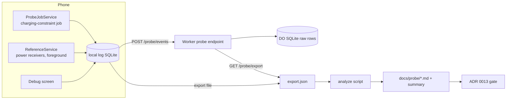
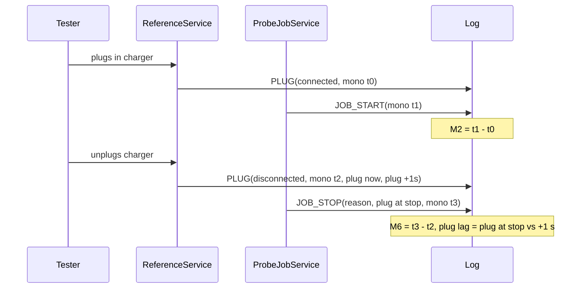

# Design: feasibility-probe (Quick Spec)

Status: Quick Spec, 2026-11-14. Based on `requirements.md`.

## 1. Overview



Deliberately small: no state machine, no classification, no Outbox, no registration. Raw rows only.

## 2. Verified facts and sources

The probe exists because these are documented as uncertain:

| Fact | Source |
|---|---|
| Stop reason is meant for logging and diagnostics, not critical decisions. Other stop reasons include timeout, device state, quota, app standby. | https://developer.android.com/reference/android/app/job/JobParameters |
| Jobs may be stopped after about 10 minutes; start and stop delays of 30 to 55 seconds are reported in the community. | https://stackoverflow.com/questions/77599145/ , https://stackoverflow.com/questions/48110961/ |
| Battery exemption: `isIgnoringBatteryOptimizations`, direct request restricted by Play policy (sideload allowed). | https://developer.android.com/training/monitoring-device-state/doze-standby |
| Inexact and exact alarm facts and notification permissions used elsewhere. | https://developer.android.com/training/scheduling/alarms |

To confirm with the docs servers: `JobInfo.Builder.setExpedited` with `setRequiresCharging`, the plug-type constants, `ACTION_POWER_CONNECTED` delivery, `canUseFullScreenIntent`, `UsageStatsManager.getAppStandbyBucket`.

## 3. Components

| Component | Notes |
|---|---|
| `ProbeJobService` | `onStartJob` returns true and stays running. `onStopJob` logs, then returns true to reschedule (and schedules explicitly). Logs the stop reason from `getStopReason()` when API 31+. |
| `ReferenceService` | Foreground service, type `specialUse` with a property, dynamic receivers for connected, disconnected and battery changed. Logs plug state now and after 1 s. |
| `ProbeLog` | SQLite table `log(id, kind, mono_ms, wall_ms, boot_count, fields_json)`, no extra libraries. |
| `ProbeUploader` | Kotlin batch upload to the Worker with `HttpURLConnection` on a background thread, retry, export to file. |
| `MainActivity` | One Activity with programmatic Views (no layout libraries) and the controls in R4. |
| `AlarmTest` | Button that rings alarm audio after a delay from a background-started context, for M9. |
| `analyze` | TypeScript script with pure functions, tested with Vitest on fixtures. |
| Worker `/probe/*` | One DO with SQLite: `INSERT` rows, export. Token check. |

## 4. Log schema

```
kind: JOB_START | JOB_STOP | PLUG | BATTERY | NOTE | ALARM_TEST | SESSION | UPLOAD
fields (JSON): { stopReason, stopReasonName, plug, plugAfter1s, batteryPct, batteryStatus, bucket,
                 exempt, jobId, maker, brand, androidSdk, charging, isInteractive, source: 'JOB'|'RECEIVER' }
```

All times: `mono_ms = SystemClock.elapsedRealtime()`, `wall_ms = System.currentTimeMillis()`, plus `boot_count`. Wall time is for the human's reading of the log only.

## 5. Measurement method



| ID | How |
|---|---|
| M1 | Armed ms = sum of (JOB_START to the next JOB_STOP) while charging; charging ms from PLUG and BATTERY events; ratio per session. |
| M2 | 20 replugs: unplug, wait 20 s, plug in, record t1 − t0. Repeat at idle ≥ 30 min (M10) and at 100%. |
| M3 | Leave the phone plugged until 100% for 30 minutes, then watch job stops and broadcasts; then unplug at 100% and compare. |
| M4 | Run 12 hours before the exemption; apply the maker's steps; run 12 hours again. Record each setting changed in NOTE rows. |
| M5 | Count stops by reason over 12 hours; gap = next start minus stop. |
| M6 | As in the sequence above, 20 unplugs, screen off. |
| M7 | Reference logger only, 20 unplugs each at: screen on; screen off 30 min idle; battery 100%. |
| M8 | Try `setExpedited(true)` with the charging constraint. Log the exception or the behaviour. |
| M9 | Press the test: the app goes to background and is swiped away, screen off, replug. Did audio start, how long after replug. |
| M11 | Plug each source, read plug type. |
| M12 | Log the call result on start. |
| M13 | Time 20 requests to the Worker on each network. |
| M14 | Log both sources at each stop and compare. |

Each condition gets a label (`cond`) typed by the tester in a NOTE row, so the analysis can group. The note forms the analysis must parse (`cond:`, `setting:`, `step:`, `problem:`) are defined in `docs/probe-checklist.md` section 3. `UPLOAD` rows carry `durationMs` and `network` (M13). The app counts, per job stop, whether the sticky battery intent and `BatteryManager` disagree on plug or level (M14).

## 6. Analysis outputs

Per device file `docs/probe/YYYY-MM-DD-<alias>.md`:

- Device line: maker, Android version, bucket, exemption, conditions run, duration.
- M1 table by condition; M2 table with p50, p95 and n; stop-reason counts; gap histogram; M3 to M14 findings with the raw numbers.
- A "gate check" block: armed at least 90%, p95 at most 60 s, pass or fail or not measured.

`docs/probe/summary.md`: all devices side by side, the gate verdict, and a list of open questions answered or still open for ADR 0001 and ADR 0004.

## 7. Error handling

| Case | Behavior |
|---|---|
| App killed by the OS | The next start logs `SESSION(kind=restart)` and the gap since the last row. The analysis counts the gap as unarmed. |
| Reboot | `boot_count` changes; the analysis starts a new segment. |
| Network down | Rows queue in SQLite; export file available. |
| Log table large | Rows are small; a 24-hour session is under 10,000 rows. |
| Expedited job rejected | The exception text is logged for M8, and the normal job continues. |
| Alarm audio blocked | `ALARM_TEST` logs the exception or "no audio started". |
| Wrong token | Upload fails; local log is unaffected. |

## 8. Testing strategy

The probe is throwaway, so tests focus on the analysis, which produces the numbers that decide the project:

| Test | What it checks |
|---|---|
| `analyze_armed_ratio` | Synthetic logs with known intervals give the exact armed ratio. |
| `analyze_nearest_rank` | Percentiles equal a reference. |
| `analyze_segments` | Reboots and restarts split segments, gaps count as unarmed. |
| `analyze_pairing` | Each JOB_START pairs with the right PLUG(connected) within a limit; unpaired starts are reported, not guessed. |
| `analyze_gate` | Gate verdicts for pass, fail, not enough data. |

On-device checks follow `docs/probe-checklist.md`, which this spec creates with the steps of section 5.

Traceability: `docs/traceability.md` lists the probe tests as `PR1` to `PR5`.
