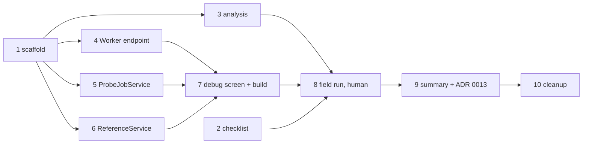

# Tasks: feasibility-probe (Quick Spec)

Rules: this is the first code in the repo, so the usual rule applies: commit after each task, tests pass, push to `main`. The probe code is throwaway (`tools/probe/`); the docs and ADR it produces are not.

Highest reasoning effort for tasks 2 and 3 (Kotlin sensor). Checkpoint before tasks 2 and 3. Plan mode first for task 1. Confirm every Android and Cloudflare API with the docs servers and put the doc URL in a comment.

Ask the human before adding any dependency beyond the ADR 0012 toolchain (Kotlin, Gradle, the Android Gradle plugin), TypeScript, Vitest and Wrangler. Human actions: set the Worker secret `PROBE_TOKEN` (`wrangler secret put PROBE_TOKEN`), download the APK from the GitHub Release that the Actions workflow publishes, install it on the test phones.

## Wave 1

- [x] 1. Scaffold `tools/probe/android` (Kotlin, Gradle, plain Views), `tools/probe/worker` (Wrangler, one SQLite-backed Durable Object), and `tools/probe/analyze` (Vitest), plus `.github/workflows/android.yml` that builds and tests the APK and publishes it to a GitHub Release. Root scripts for typecheck, lint, test. Plan mode first.
  - Requirements: R1 to R5
- [x] 2. `docs/probe-checklist.md`: the step-by-step tester script for M1 to M14 with a log sheet for each device, and the phone matrix table.
  - Requirements: R6, R8.3

## Wave 2 (needs 1)

- [x] 3. Analysis library: log parsing, segments, armed ratio, pairing, nearest-rank percentiles, gate verdict, Markdown writer. Tests PR1 to PR5 on synthetic logs.
  - Depends on: 1
  - Requirements: R5, R6
- [x] 4. Worker endpoint: `POST /probe/events`, `GET /probe/export`, token check, raw rows. Tests with a local Wrangler run.
  - Depends on: 1
  - Requirements: R3

## Wave 3 (needs 1)

- [x] 5. Kotlin `ProbeJobService`, `ProbeLog`, scheduling, reschedule on stop, stop reason, plug and battery facts, standby bucket, exemption, expedited attempt (M8).
  - Depends on: 1
  - Requirements: R1, R6
- [x] 6. Kotlin `ReferenceService` with receivers, plug after one second, notification, switch; `AlarmTest`; full-screen intent check.
  - Depends on: 1
  - Requirements: R2, R6

## Wave 4 (needs 5, 6, 4)

- [x] 7. Debug screen, uploader, export file, notes, live armed ratio, all in plain Views. The workflow from task 1 builds the APK; the human downloads and installs it. Must also provide what section 8 of `docs/probe-checklist.md` lists: `UPLOAD` rows with duration and network type, a mismatch counter for M14, the expedited and full-screen lines, and `NOTE` rows stored exactly as typed.
  - Depends on: 4, 5, 6
  - Requirements: R3, R4

## Wave 5 (human runs the checklist)

- [ ] 8. Field run: the human runs the checklist on every available phone (including Tecno or Infinix, before and after exemption). Export, then run the analysis.
  - Depends on: 3, 7
  - Requirements: R6

## Wave 6

- [ ] 9. Write `docs/probe/summary.md` and ADR 0013 (gate result and chosen path); update ADR 0001 and ADR 0004 with measured facts; list decisions for the human. If the gate fails, stop and write the options ADR.
  - Depends on: 8
  - Requirements: R8
- [ ] 10. Remove the probe Worker endpoint and token, or record that the human did; decide whether `tools/probe/` is deleted or archived; update `docs/kiro-log.md`.
  - Depends on: 9
  - Requirements: R7.4

## Dependency graph

## Not in this spec
- The real sensor module: `sensor-android`, which starts only after the gate passes (or after the fallback decision).
- Station mode design changes: they follow from the probe results in a new ADR if needed.
