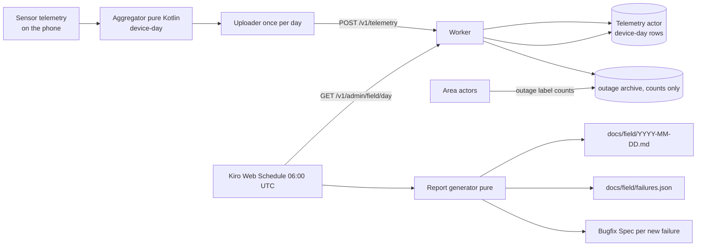
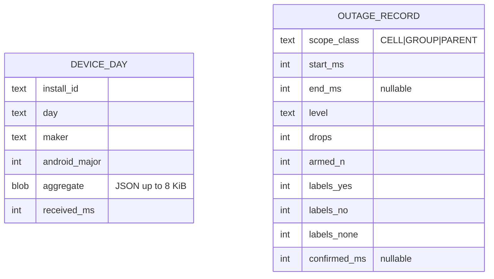
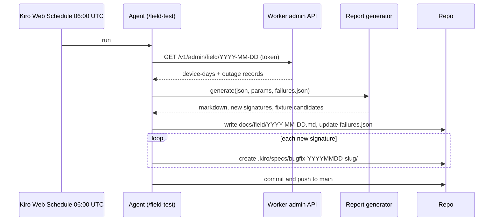

# Design: field-telemetry

Status: APPROVED by delegation on 2026-11-14. Based on `requirements.md`. Tasks in `tasks.md`.

## 1. Overview



- The **aggregator** runs on the phone. It is a pure Kotlin class in the app's telemetry package, tested with JUnit 4 (`./gradlew testDebugUnitTest`) without a device. The `DeviceDay` shape, its strict validator and the metric functions live in `packages/shared` (TypeScript, server side), and the **report generator** lives in `tools/field` (TypeScript). Both sides read the same `DeviceDay` examples in `packages/shared/fixtures/`, so the Kotlin output and the server schema cannot drift apart.
- The **scheduled run** is a Kiro Web agent run, using `/field-test`. It calls the generator, writes files, and files Bugfix Specs. It never edits app code.

## 2. Verified facts and sources

| Fact | Source |
|---|---|
| Durable Objects Free: SQLite only, 100,000 rows written per day, 5 GB storage. One row per device-day fits easily. | https://developers.cloudflare.com/durable-objects/platform/pricing/ |
| Workers Free: 10 ms CPU and 50 subrequests per request. The admin endpoint reads aggregates in one actor call and returns a day. | https://developers.cloudflare.com/workers/platform/limits/ |
| The Kiro Web Schedule and its secret handling, and the Bugfix Spec file layout, must be confirmed in the Kiro docs (introspect the Kiro docs, do not guess). | https://kiro.dev/docs/ |

To confirm: how a Kiro Web Schedule stores a prompt and secrets, the Bugfix Spec document names and sections, and whether a scheduled run may commit to `main`.

## 3. Phone side

### Aggregate

The type is written in TypeScript in `packages/shared` for the server schema. The Kotlin aggregator produces JSON of the same shape.

```ts
type DeviceDay = {
  v: 1;
  installId: string;
  day: string;                          // local date, 'YYYY-MM-DD'
  maker: 'tecno'|'infinix'|'itel'|'samsung'|'xiaomi'|'pixel'|'other';
  androidMajor: number;
  mode: { normalMs: number; stationMs: number };
  chargingMs: number; armedMs: number;
  gaps: { reason: string; count: number; lenHistMs: number[] }[];   // histogram buckets, fixed edges
  delayJobMs: number[]; delayReceiverMs: number[];                  // cap 64 each, newest
  replugToRingMs: number[];                                         // cap 16
  prompts: { shown: number; yes: number; no: number; timeout: number };
  alarms: { expected: number; rung: number };
  writeFailures: number;
  standby: Record<string, number>;
  exemption: boolean;
  stopReasons: Record<string, number>;
};
```

- Built from the Sensor's local telemetry tables (`sensor-android` R10). Local day boundaries use the phone's offset; the day string is the only time sent.
- Sent once after local midnight, and again at most once if the day closed with new data; the server keeps the last.
- No cell, no timestamps within the day, no model name.

## 4. Server side



- `DEVICE_DAY` primary key (`install_id`, `day`). A second upload overwrites the first (idempotent).
- `OUTAGE_RECORD` is written by the area actor when an outage closes or its labels change. It holds counts only and no install IDs, no cell. Retention 90 days.
- The admin endpoint `GET /v1/admin/field/:day` requires `Authorization: Bearer <FIELD_READ_TOKEN>`; it returns the device-days for that UTC day range and the outage records, with install IDs replaced by per-request aliases (`D1`, `D2`, in a stable order for that day). The alias map is not stored.
- Delete-my-data removes the install's `DEVICE_DAY` rows.

## 5. Metrics and classification

```
armedRatio(device-day) = armedMs / chargingMs                (null if chargingMs < 1 h)
nearestRank(p, xs)     = sorted(xs)[ceil(p/100 * n) - 1]
p95 shown only when n >= 20, else "not enough data"
alarmRate              = rung / expected                      (null if expected == 0)

outageClass(o):
  if o.level != CONFIRMED: not classified
  if o.labels_yes >= 1: CONFIRMED_TRUE
  else if o.labels_no >= 1 and o.labels_yes == 0 and o.labels_none == 0: FALSE_ALARM
  else INCONCLUSIVE
```

A false alarm needs at least one label and every label "No". An outage with a mix of "No" and unlabeled drops is inconclusive. A miss is a "Yes" label whose unplug the engine covered with no outage. The area actor records misses as `MISS` records with the armed count of the scope at that moment; the Worker never stores which install.

## 6. Failure signatures and Bugfix Specs



Checks that make a signature (`check:maker:androidMajor:mode`):

| check | rule |
|---|---|
| `ARMED_LOW` | armed ratio below 0.9 on any device-day with at least 1 h charging |
| `ARMED_CRITICAL` | below 0.5 |
| `DELAY_SLOW` | scheduling delay p95 above 60 s (n >= 20) |
| `ALARM_MISSED` | expected alarms greater than rung |
| `FALSE_ALARM` | any false alarm in the day |
| `MISS` | a miss with at least 3 armed phones in scope |
| `WRITE_FAIL` | write failures above 0 |
| `FGS_BLOCKED` | station foreground start blocked |
| `UPLOAD_GAP` | an opted-in device with no aggregate for more than a day |

Bugfix Spec skeleton created by the run:

```
.kiro/specs/bugfix-YYYYMMDD-<slug>/
  bugfix.md   # Current behavior (the numbers), Expected behavior, Unchanged behavior
  design.md   # left empty for the human to approve a fix approach
  tasks.md    # left empty
```

- The run fills only the current-behavior numbers and the expected-behavior statement from the gate. It does not propose code.
- `failures.json` entry: `{ signature, firstSeen, lastSeen, count, spec }`.

## 7. Report file layout

```
# Field report YYYY-MM-DD
Gate status (milestone 1): ... Kill criterion: ...
## Devices (aliases)         table: alias, maker, Android, mode, charging h, armed ratio
## Gates                     table: check, value, threshold, status
## Metrics by class          armed ratio, gaps, delays p50/p95, replug-to-ring, alarm rate
## Outages                   table: start (UTC), level, scope, drops/n, labels, class
## False alarms and misses
## New failures              links to bugfix specs
## Fixture candidates        day, device count, export command
## Parameters in use         values from params.ts
```

No install IDs and no cells appear.

## 8. Error handling

| Case | Behavior |
|---|---|
| Fetch fails | A note file `docs/field/YYYY-MM-DD.md` states "Data not fetched", no Bugfix Spec. |
| No opted-in devices | Report says so, with the gate "not measurable". |
| Aggregate over 8 KiB | Rejected by the Worker; the phone drops oldest samples and retries. |
| Duplicate upload | Last write wins. |
| Clock change on a phone | Day string may shift; the report flags a device-day with more than 26 hours of charging as suspect. |
| Failure signature file corrupt | The run stops, writes a note, files nothing. |
| Scheduled run cannot hold a secret | The human runs `/field-test` manually; same procedure. |
| Schedule fires twice | The report is overwritten with identical content; no new specs, since signatures are known. |
| Token leaked | The human rotates `FIELD_READ_TOKEN`; the endpoint rejects the old one. |

## 9. Testing strategy

Property IDs `F1` to `F8`. Vitest and fast-check for the Worker, `packages/shared` and `tools/field`. JUnit 4 for the phone aggregator (F1 client part, F2 client part), which also reads the `DeviceDay` fixtures from `packages/shared/fixtures/`.

| ID | Property | Requirement | Test |
|---|---|---|---|
| F1 | The aggregator output has no location, cell, model, timestamp within the day or any field outside the schema, for any sensor telemetry input (Kotlin test) and the schema rejects anything else (TypeScript test); size is at most 8 KiB. | R1, R2 | `F1_aggregate_privacy_and_size` |
| F2 | Uploading the same device-day any number of times leaves one row, equal to the last upload. | R2.5, R3 | `F2_upload_idempotent` |
| F3 | `nearestRank` equals a reference, p95 is hidden below 20 samples, and the armed ratio is null below one hour of charging. | R4 | `F3_percentiles_and_ratio` |
| F4 | Outage classification matches the table for every combination of label counts. | R5 | `F4_outage_classes` |
| F5 | The generated Markdown for any input contains no install ID pattern, cell pattern or alias map, and is identical for identical input. | R6 | `F5_report_pure_and_clean` |
| F6 | A known signature never creates a second Bugfix Spec; a new one creates exactly one and adds it to `failures.json`. | R8 | `F6_signature_dedup` |
| F7 | Every gate status follows the thresholds, including "not enough data". | R4.3, R10 | `F7_gate_statuses` |
| F8 | The admin endpoint rejects a missing or wrong token and never returns install IDs. | R7.5, R6.6 | `F8_admin_auth_and_aliases` |

Other tests: schedule record file exists and states the time and prompt; Worker schema rejects extra fields (I8 style); a simulated week of telemetry builds seven reports and the right Bugfix Specs; the generator's golden Markdown files.

Traceability: `docs/traceability.md`.
