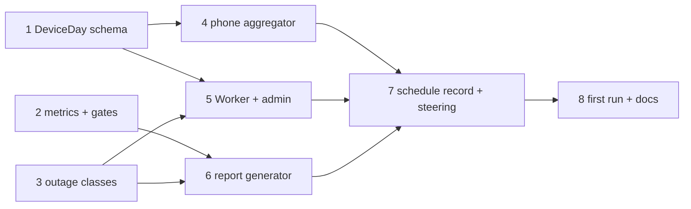

# Tasks: field-telemetry

Rules: only real dependencies are listed. Tasks in the same wave run in parallel. A task is done only per `definition-of-done.md`. Commit after each, for example `feat(field): outage classes [spec:field-telemetry task:4]`.

Highest reasoning effort: default. Plan mode first for task 6. Confirm Kiro Schedule and Bugfix Spec formats with the Kiro docs and put the URL in a comment.

Depends on `sensor-android` (tasks 6, 10), `event-ingest` (tasks 2, 4), `area-cells` (task 9), `onboarding` (task 3), `detection-engine` (task 13). No new dependency.

## Wave 1

- [x] 1. Shared schema `DeviceDay` and the strict validator in `packages/shared`; contract fixtures in `packages/shared/fixtures/` read by both TypeScript and Kotlin tests. Test F1 (schema part).
  - Depends on: `event-ingest` 2
  - Requirements: R1, R2, R3.4
  - Done: schema, validator and fixtures in `packages/shared`. The Kotlin test that reads `fixtures/telemetry/` is part of task 4.
- [x] 2. Metric functions: `nearestRank`, armed ratio, gap histogram helpers, gate evaluation. Tests F3, F7.
  - Depends on: `event-ingest` 1
  - Requirements: R4, R10
- [ ] 3. Outage classification and label counting rules; `OUTAGE_RECORD` and `MISS` in the area actor outputs. Test F4.
  - Depends on: `area-cells` 9, `detection-engine` 13
  - Requirements: R5

## Wave 2

- [ ] 4. Phone aggregator and daily uploader in Kotlin (JUnit 4), using opt-in from onboarding. Tests F1, F2 (client part).
  - Depends on: 1, `sensor-android` 6, `sensor-android` 10, `onboarding` 3
  - Requirements: R1, R2
- [ ] 5. Worker: `POST /v1/telemetry`, telemetry actor, `GET /v1/admin/field/:day` with token and per-request aliases, delete-my-data support. Tests F2 (server part), F8.
  - Depends on: 1, 3, `event-ingest` 4
  - Requirements: R3, R6.6, R7.5

## Wave 3

- [ ] 6. Report generator in `tools/field`: JSON to Markdown, signatures, fixture candidates, `failures.json` updates. Import the Bugfix Spec skeleton writer (`planBugfix`) from `.kiro/skills/field-report/scripts/new-bugfix.mjs` and run `.kiro/skills/field-report/scripts/check-report.mjs` on every generated file, instead of writing them again. Tests F5, F6 (the skill's own tests already cover the skeleton and the report check). Golden Markdown files.
  - Depends on: 2, 3
  - Requirements: R6, R8, R9

## Wave 4

- [ ] 7. Schedule record `.kiro/schedules/field-test.md`, the `/field-test` steering update (replace the manual steps with the exact procedure and commands), and the human instructions to create the schedule and secret. Schedule-run dry test with a recorded day.
  - Depends on: 5, 6
  - Requirements: R7

## Wave 5

- [ ] 8. First real run after the first field day: verify the report, tune nothing without the human, update `docs/traceability.md` (F1 to F8), `docs/kiro-log.md`.
  - Depends on: 7
  - Requirements: all

## Dependency graph

## Not in this spec
- Fixture sanitizing and approval: `demo-mode`.
- Opening code fixes: done by a human-approved Bugfix Spec, not by this job.
- Crew bot and its heartbeat: a separate optional item.
