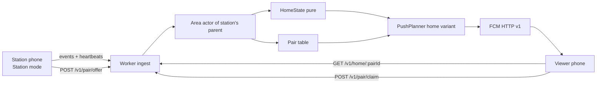
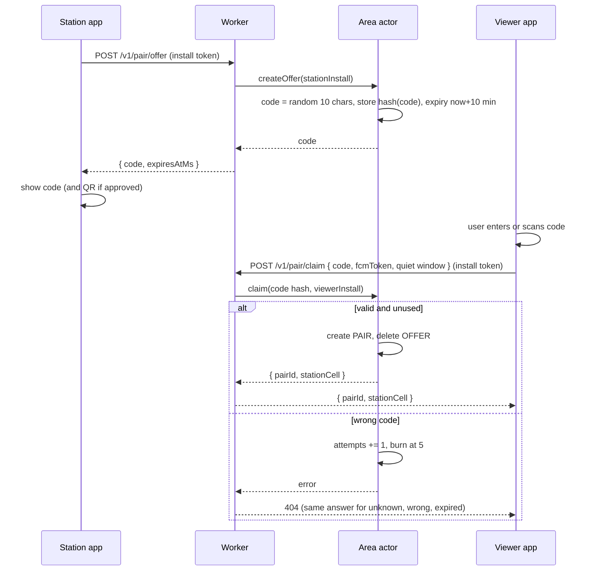
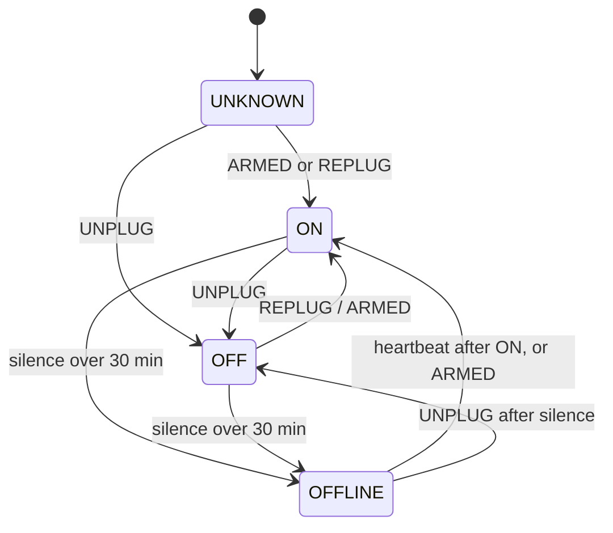
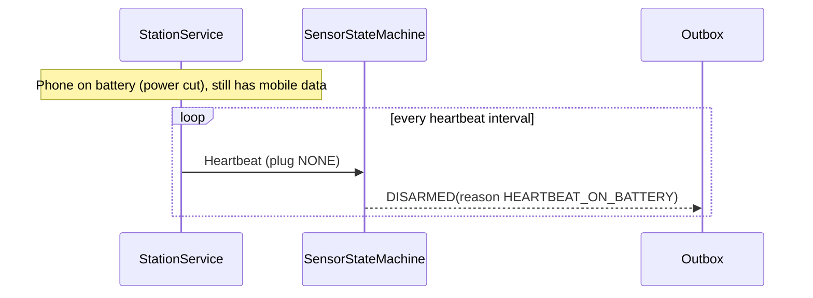
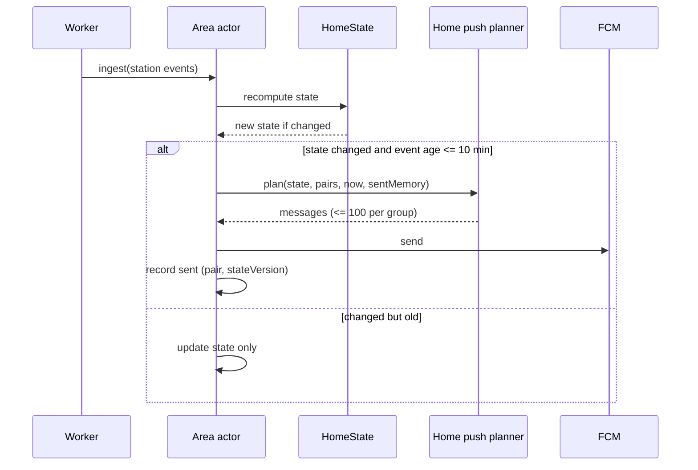
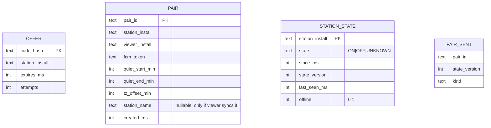

# Design: home-watch

Status: APPROVED by delegation on 2026-11-14. Based on `requirements.md`. Tasks in `tasks.md`.

## 1. Overview



Home Watch lives in the same area actor as the station's events. It adds three small parts: pairing, `HomeState` (pure) and a push variant.

## 2. Verified facts and sources

| Fact | Source |
|---|---|
| Each Durable Object has one alarm. `setAlarm()` counts as one row written. | https://developers.cloudflare.com/durable-objects/platform/pricing/ (alarm row note), alarm API page to confirm |
| FCM HTTP v1 send limits and error codes are as in `alerts-and-light-alarm` design section 2. | https://firebase.google.com/docs/reference/fcm/rest/v1/ErrorCode |

To confirm with the docs servers: the Durable Object alarm API (single alarm, rescheduling), and the QR display and camera scan library choices if the human approves them (needs human approval, ADR 0012).

## 3. Pairing



Rules:
- The code is checked against a hash. The Worker needs to find the offer from the code alone, so the offer table is indexed by `hash(code)`. The claim comes through any actor, so the Worker must know which actor holds the offer. The code therefore carries the station's parent: the first 2 characters encode the res-7 parent shard (a lookup in a small table the Worker keeps in memory built from the code alphabet and a hash of the parent). To keep this simple and private, the QR and the manual flow also carry the **station cell**, and the manual flow asks the viewer to confirm the area name. Task 2 decides the exact scheme and records it in an ADR. The requirement is: the claim reaches the right actor without a global table.
- A global table would need a single Durable Object; for a field test that is acceptable (one global `PairingDirectory` actor with a few hundred rows at most), but the area-cells design avoids global singletons. See the option list in ADR 0009.
- Claim and offer answers use one error for every failure.

## 4. Station state

```
homeState(events of the station in event-time order, lastSeenMs, nowMs):
  state = UNKNOWN, since = null
  for e in events:
    if e.type == 'UNPLUG'                       -> state = OFF, since = e.time
    if e.type in ('REPLUG','ARMED') and state != ON -> state = ON, since = e.time
  # 'ARMED' while ON keeps since; DISARMED(HEARTBEAT_ON_BATTERY) while OFF keeps since
  if nowMs - lastSeenMs > 30 min -> OFFLINE, lastKnown = { state, since }
  else -> { state, since }
```

- Only the station's own events matter. The function uses the whole stored station event list (a bounded window) and is pure.
- `lastSeenMs` is the latest receive time of any station message (including heartbeats).
- `BATTERY_FULL` and `DISARMED` (other reasons) do not change power state. A station on a detection plug that gets `BATTERY_FULL` stays `ON`.
- Late events: recompute from the stored events; the state is the same for any order (H2).



`OFFLINE` is a view over `ON` or `OFF`, not a replacement of the last power state. After the station is heard again, events that happened during silence update the state, so a station that went `OFF` while its router was down shows `OFF since X` after it reconnects.

## 5. Heartbeat on battery



- Added to `station-mode` R5.5 and `sensor-android` event reasons. The engine must ignore `HEARTBEAT_ON_BATTERY` for armed intervals and gaps (the phone is already unarmed after the `UNPLUG`). The state-machine task covers this.
- A station without mobile data cannot upload during the blackout. After power returns, its events arrive late and the state is corrected. The app tells users: "A SIM card with data lets Home Watch tell you right away."

## 6. Offline detection and the single alarm

The area actor multiplexes one alarm over: state flush (ingest), unknown-end timers (area-cells), receipt checks (alerts), station silence (this spec).

```
nextWake = min(flushDue, earliestUnknownEnd, receiptCheckDue, earliestStationSilenceDue)
onAlarm():
  for each due timer: run it
  for each paired station: if now - lastSeen >= 30 min and not yet OFFLINE -> set OFFLINE, push
                           else due = lastSeen + 30 min
  setAlarm(nextWake)
```

- Station silence is re-evaluated only when the alarm fires, so heartbeats never touch the alarm.
- A `setAlarm` call costs one row written; the multiplexer sets the alarm only when `nextWake` changes by more than 1 minute.

## 7. Push path



- Same FCM sender and token cleanup as `alerts-and-light-alarm`.
- Sent memory key: (pair, `stateVersion`), where `stateVersion` = the event time of the change.
- Texts (English): "Home: power off since 2:14 p.m.", "Home: power is back since 2:41 p.m.", "Home station is offline". Time is rendered on the viewer's phone from `data.sinceMs`, so the push body carries a short text and the data field the exact time. A server-rendered time would need the viewer's time zone; the subscription already stores a UTC offset for quiet hours, so the body uses it.
- Channels: `alerts` for `OFF` and `ON`, `alerts-quiet` for `OFFLINE` and for quiet hours.

## 8. Data model



- `STATION_STATE` exists only for stations with at least one pair.
- `last_seen_ms` is written at most every 10 minutes and on state change.
- All rows for an install are removed on delete-my-data.

## 9. Error handling

| Case | Behavior |
|---|---|
| Wrong, expired or used code | One generic 404. Attempts counted, offer burned at 5. |
| Claim reaches the wrong actor | Generic 404; the scheme in ADR 0009 prevents it. |
| Viewer exceeds 5 stations or station exceeds 5 viewers | 409 with a plain message. |
| Station moves to a new cell or parent | Pair rows follow the install; the state keeps working because station events carry the install. The new parent's actor needs the pair rows: a move triggers pair migration (the same removal request as area-cells R5.3 carries pairs). |
| Station Station-mode turned off | State becomes `OFFLINE` after 30 minutes. |
| Viewer token invalid (`UNREGISTERED`) | Pair kept but push disabled; the viewer app still shows state. After 7 days of failures, the pair is removed. |
| Late old events | State updated, no push (R5.6). |
| Duplicate events | State and sent memory are idempotent. |
| Silence while the station is `OFF` | `OFFLINE` shows last known `OFF since X`. |
| FCM auth error (service-account key rejected) | Counter raised; human action (Firebase). |
| DO eviction | State rebuilt from stored station events and persisted `STATION_STATE`. |

## 10. Testing strategy

Property IDs `H1` to `H8`, Vitest and fast-check (server side). The viewer and station screens in the Kotlin app have JUnit 4 tests on their `ViewModel`s, reading the pair and home-state shapes from `packages/shared/fixtures/`.

| ID | Property | Requirement | Test |
|---|---|---|---|
| H1 | Silence of more than 30 minutes yields `OFFLINE` and never `OFF` by itself; less yields the event-derived state. | R2.4, R2.5 | `H1_offline_never_off` |
| H2 | The state is the same for any order, batching and duplication of the station's events. | R2.6, R2.7 | `H2_state_order_independent` |
| H3 | `BATTERY_FULL`, other `DISARMED` reasons and `HEARTBEAT_ON_BATTERY` never change power state or "since". | R2.2, R2.3, R3 | `H3_non_power_events_ignored` |
| H4 | The area outage level never changes the station state. | R2.8 | `H4_state_independent_of_area` |
| H5 | A pairing code works once, only before expiry, and burns after 5 failures; every failure gives the same answer. | R1.2, R1.5 | `H5_pairing_rules` |
| H6 | Each state change produces at most one push per pair, none for old events, and heartbeats produce none. | R5, R8.3 | `H6_push_once_per_change` |
| H7 | The multiplexed alarm fires at the earliest due timer, never later than the station silence limit plus one alarm granularity, and re-arms only when it changes. | R6 | `H7_alarm_multiplexer` |
| H8 | Deleting data from either side leaves no pair, offer or push token for that install. | R1.10, R7.4 | `H8_delete_removes_pairs` |

Other tests: the viewer wording for each state and time zone; a scenario in `tools/sim` (station goes off, router down, reconnects 2 hours later, state corrected); a 60-second push-latency measurement in the device checklist; FCM sender reuse tests from `alerts`; Kotlin tests that parse the pair and home-state fixtures from `packages/shared/fixtures/`.

Traceability: `docs/traceability.md`.
