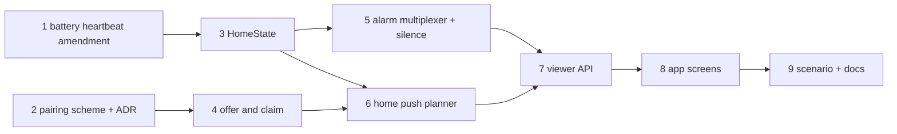

# Tasks: home-watch

Rules: only real dependencies are listed. Tasks in the same wave run in parallel. A task is done only per `definition-of-done.md`. Commit after each, for example `feat(home): offline never off [spec:home-watch task:3]`.

Highest reasoning effort for tasks 2, 3 and 5. Checkpoint before task 5. Plan mode first for tasks 2 and 6.

Depends on `station-mode` (tasks 2, 5), `event-ingest` (tasks 4, 5), `area-cells` (task 9), `alerts-and-light-alarm` (tasks 5, 7). QR libraries are blocked until the human approves them; build code entry first.

## Wave 1

- [x] 1. Amend `station-mode` and `sensor-android` for the battery heartbeat: `DISARMED` with reason `HEARTBEAT_ON_BATTERY`, state-machine rule that it changes no armed interval, shared fixtures. Update `station-mode` R5.5 text and tests T6, T7 for the new case.
  - Depends on: `station-mode` 2
  - Requirements: R3
- [x] 2. Pairing routing scheme and ADR 0009 (options: parent code prefix, global `PairingDirectory` actor). Code alphabet and attempts rule in `packages/shared` with tests H5 (pure part).
  - Depends on: `area-cells` 1
  - Requirements: R1

## Wave 2

- [x] 3. `HomeState` pure function and the station event window. Tests H1, H2, H3, H4.
  - Depends on: 1, `detection-engine` 1
  - Requirements: R2
- [x] 4. Offer and claim endpoints, hash storage, attempts, one generic error, limits, remove pair. Test H5, H8 (pair part).
  - Depends on: 2, `event-ingest` 4
  - Requirements: R1, R7

## Wave 3

- [x] 5. Alarm multiplexer in the area actor and station silence handling, last-seen writes every 10 minutes, `STATION_STATE` table. Test H7.
  - Depends on: 3, `area-cells` 9
  - Requirements: R6, R8
- [x] 6. Home push planner variant, sent memory, quiet hours, age rule, reuse of the FCM sender. Test H6.
  - Depends on: 3, 4, `alerts-and-light-alarm` 7
  - Requirements: R5

## Wave 4

- [x] 7. Viewer API `GET /v1/home/:pairId` with auth, cached by 10 s per pair, response shape, cleanup of dead tokens.
  - Depends on: 5, 6
  - Requirements: R4, R7
- [x] 8. App Compose screens and `ViewModel`s (Jetpack Compose, approved 2026-11-14): pair from station, enter code on viewer, home card, station name, state wording, offline age, remove pair, SIM-data hint. Optional QR if approved.
  - Note (ADR 0009 review): the station UI must list every pair with a remove action. A dead viewer keeps its seat in the 5-viewer cap until the station removes it, and station-side remove is the fallback when a viewer loses its pair list.
  - Depends on: 7, `station-mode` 6
  - Requirements: R1, R4, R9

## Wave 5

- [ ] 9. Scenario test in `tools/sim` (router down, late reconnect), push latency check on devices, traceability (H1 to H8), `docs/kiro-log.md`, `docs/probe-checklist.md`.
  - Depends on: 8, `detection-engine` 16
  - Requirements: all
  - Status 2026-11-23: scenario (`tools/sim/test/home-scenario.test.ts`), traceability H1 to H8, kiro-log and the checklist section are done. Open: the push latency check on devices, which needs Firebase Messaging in the app (ADR 0045) and the human with two phones.

## Dependency graph

## Not in this spec
- Multiple homes per viewer beyond the 5-station limit: not planned.
- Station battery level reporting: not specified.
