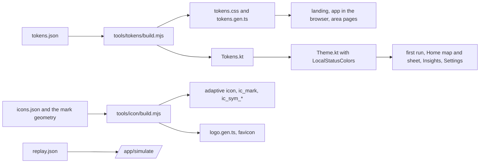
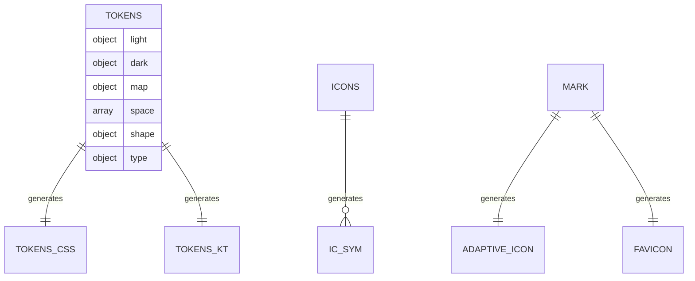

# Design: material-redesign

Status: APPROVED by the human on 2026-11-24. Revised the same day by ADR 0051: the map is a rotating globe, one dark palette, a new mark, no Material skill. Based on `requirements.md`. Tasks in `tasks.md`. Decisions: ADR 0048, 0049, 0050.

## 1. Overview



## 2. First run and landing on the map

```mermaid
sequenceDiagram
    participant U as User
    participant F as FirstRunScreen
    participant G as ShellGraph
    participant L as LocationSource
    participant S as Spot
    U->>F: Use my location
    F->>G: completeFirstRun (consent)
    F->>U: system dialog: approximate location
    U->>F: allow
    F->>G: locateSpot()
    G->>L: readOnce (coarse, one fix)
    G->>S: resolve(map, lat, lng, mocked)
    S-->>G: cell and area name
    G->>G: saveSpot(cell only); position dropped
    F->>U: notifications dialog (API 33+)
    F->>U: Home map centred on the spot, snackbar "Your spot is set to Yaba"
```

## 3. Data model



- `light` and `dark`: every Material 3 colour role, plus `normal`, `possible`, `confirmed`, `restored` with `on-`, `-container`, `on-...-container`.
- `map`: the vivid map fills per state and the no-data colour, per mode.
- No new wire field, no new stored value on the phone. The spot is the existing onboarding cell.

## 4. Screens

- **Android Home:** `BottomSheetScaffold`; content is `MapScreen` under the status bar with `LocalMapBottomInset` = sheet peek; sheet is `HomeContent`.
- **Web `/app/simulate`:** server-rendered app (`appScreen`) inside a phone frame on wide screens; `/simulate.js` adds first run, pan and zoom, the sheet, the replay, Insights, Settings, the notification and the Light Alarm.
- **Landing:** static; its hero is `appScreen({ live: false })`.

## 5. Correctness properties and tests

| ID | Property | Test |
|---|---|---|
| MD1 | Every Material 3 role and status colour in `tokens.json` appears unchanged in the CSS and in Kotlin, in both modes. | node:test `tokens.test.mjs` |
| MD2 | The generated icon files are current, the mark is inside the 66 dp safe circle, and the themed layer is one colour. | node:test `icon.test.mjs` |
| MD3 | The bar is Insights, Home, Settings on the phone and on the web, and the app opens on Home. | JUnit `MaterialShellTest`, Vitest `web-app.test.ts` |
| MD4 | First run asks only coarse location and notifications, location is optional, and only a real, unmocked cell is stored. | JUnit `MaterialShellTest` |
| MD5 | The app in the browser reads only the replay, never the public index, and is labelled simulated. | Vitest `web-replay.test.ts` (W6), `web-app.test.ts` |
| MD6 | Store buttons appear only for configured links, and unsafe links are dropped. | Vitest `web-app.test.ts` |
| MD7 | No page loads from another origin or has an inline style attribute; the app in the browser stays under 150 KB. | Vitest `web-app.test.ts`, `web-kit.test.ts` |
| MD8 | `/app`, `/app/insights` and `/app/settings` redirect to `/app/simulate`. | Vitest `web-app.test.ts` |
| GL1 | The point under the globe's camera is drawn at the centre; the far side is hidden; north is up, east is right. | JUnit `GlobeMathTest` |
| GL2 | A flight starts and ends on its cameras and takes the short way round. | JUnit `GlobeMathTest` |
| GL3 | A tap hits the block it is in; a drag never tips over the pole. | JUnit `GlobeMathTest` |
| GL4 | Land dots fade out at street level, and the phone and the web read the same geo files. | JUnit `GlobeMathTest`, Vitest `web-app.test.ts` |

## 6. Testing strategy

Generated files and geometry are checked by node:test. Web pages by Vitest on the rendered HTML, and by screenshots with Playwright at 390 x 844 and 1366 x 860 in light and dark, playing the whole blackout. Android by JUnit on the sources and models, `lintDebug` and `assembleDebug`; screens on a device in the Kiro IDE pass.

## 7. Error handling

- Location denied, timed out, mocked, or outside the map: no cell is stored, Home opens, the snackbar says the spot can be chosen in Settings.
- Map fails to load: the existing cache and offline banner, or the empty message.
- Replay fails to load on the web: the spot card says it could not load and the button becomes "Try again".
- A store link that is not `http(s)`: the button is left out.
