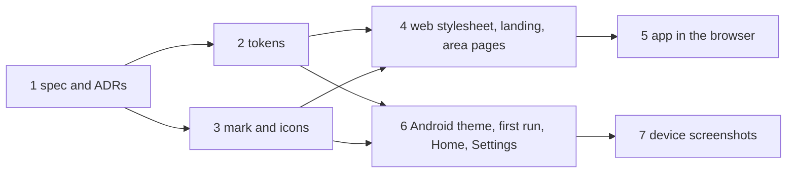

# Tasks: material-redesign

Rules: a task is done only per `definition-of-done.md`. No new dependency (ADR 0048).

## Dependency graph

## Wave 1: decisions

- [x] 1. Spec, ADRs 0048 to 0050, steering and README updates.

## Wave 2: shared design

- [x] 2. Material 3 `tokens.json` (light, dark, status, map, type, shape, space), `tools/tokens/build.mjs`, generated CSS and Kotlin, test MD1.
  - Depends on: 1
- [x] 3. The mark and the shared icon set: `tools/icon/build.mjs`, adaptive icon, `ic_mark`, `ic_sym_*`, `logo.gen.ts`, `/favicon.svg`, test MD2.
  - Depends on: 1

## Wave 3: platforms

- [x] 4. Web stylesheet in Material 3 tokens, landing page with store buttons, area pages on the shared stylesheet, tests MD6 and MD7.
  - Depends on: 2, 3
- [x] 5. The app in the browser at `/app/simulate`, `/app` redirects, tests MD3 (web), MD5, MD8.
  - Depends on: 4
- [x] 6. Android `Theme.kt` and `LocalStatusColors`, full-screen map with sheet, first run with location, bar order, grouped Settings, tests MD3 (JUnit) and MD4.
  - Depends on: 2, 3

## Wave 4: checks

- [ ] 7. Device screenshots and a TalkBack pass of first run, Home, Insights and Settings in light and dark (needs a phone or emulator; the Kiro IDE pass).
  - Depends on: 6
