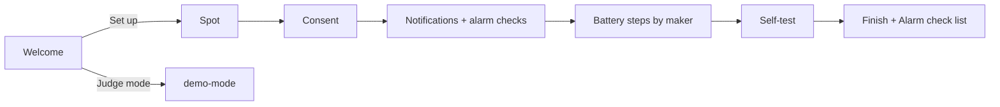
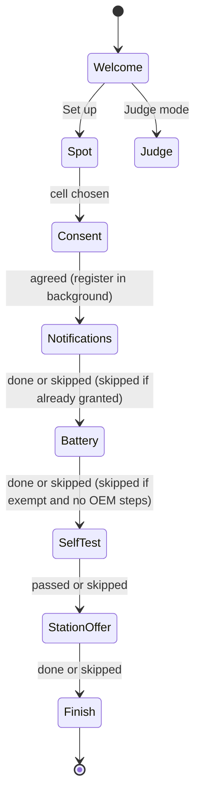
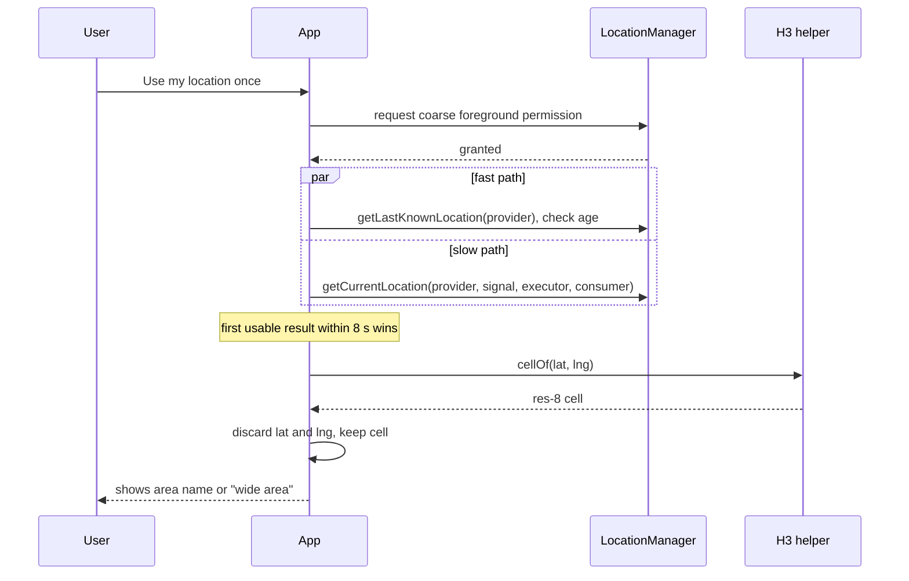
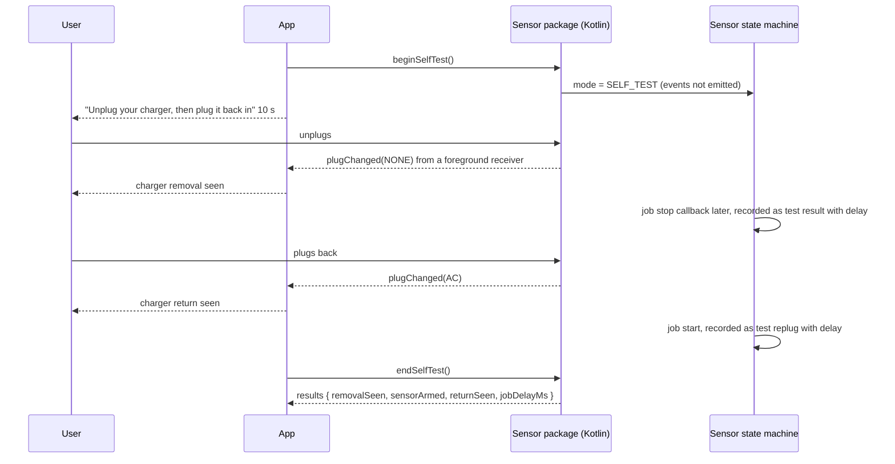

# Design: onboarding

Status: APPROVED by delegation on 2026-11-14. Based on `requirements.md`. Tasks in `tasks.md`.

## 1. Overview



A small state machine (`OnboardingFlow`, a pure Kotlin class with no Android types) decides the next step from the facts: consent given, permissions granted, exemption state, previous skips. Screens are thin Jetpack Compose screens (approved 2026-11-14) driven by an `OnboardingViewModel`. State is stored on the phone after every step (R1.5).

## 2. Verified platform facts

| Fact | Source |
|---|---|
| `ACTION_REQUEST_IGNORE_BATTERY_OPTIMIZATIONS` lets the user add the app to the exemption list directly. Google Play policy restricts it to apps whose core function is hurt. `ACTION_IGNORE_BATTERY_OPTIMIZATION_SETTINGS` opens the general list. `PowerManager.isIgnoringBatteryOptimizations()` reports the state. | https://developer.android.com/training/monitoring-device-state/doze-standby |
| `LocationManager.getLastKnownLocation(provider)` returns a cached location or null and may be old (API 1, needs coarse or fine location permission). `LocationManager.getCurrentLocation(provider, cancellationSignal, executor, consumer)` asks for one fresh fix (API 30; may take seconds indoors). | https://developer.android.com/reference/android/location/LocationManager |
| Android 14 full-screen intent check: `NotificationManager.canUseFullScreenIntent()`. | https://developer.android.com/about/versions/14/behavior-changes-14 |

To confirm with the docs servers (unverified): the runtime permission request for coarse-only location (`ACCESS_COARSE_LOCATION`) and `POST_NOTIFICATIONS` from a Compose screen, `NotificationChannel` creation, a mock-location check on `Location` (`isFromMockProvider`, newer `isMock`), `Build.MANUFACTURER` and `Build.BRAND` values on Tecno, Infinix and itel phones, and the manifest entry for `REQUEST_IGNORE_BATTERY_OPTIMIZATIONS`. On API 26 to 29 there is no `getCurrentLocation`; the fallback is the last known location or the map pick (unverified).

## 3. Flow state machine



Persisted record: `{ step, consentVersion, consentAtMs, cell, areaName, postcodePrefix, diagnosticsOptIn, skips: [], stepTimesMs: {} }`. The cell is stored; coordinates never are (O2).

Re-onboarding is the same machine. Steps whose facts are already true (permission granted, exempt) are skipped. A fresh install always starts at Welcome because nothing persists across installs.

## 4. Spot selection



- If the location is flagged as mock, the app asks "Is this your area?" with the chosen name.
- "Pick on the map": neighborhood list from the catalog (`web-and-area-pages` task 3), then a hex grid of the cells around the neighborhood centre, drawn on a Compose canvas, tap to choose. The hex grid is drawn locally from the H3 cell boundary (`com.uber:h3`, needs human approval, ADR 0012); no tiles, no network.
- The area name comes from the catalog. For a cell with no catalog name the label is "Your area".

## 5. Maker detection and the OEM guide

File: `core/shared/src/oem-guide.json`, used by the app and the `oem-battery-guide` skill. A Gradle task copies it into the app assets at build time; there is no second copy in git (ADR 0012). The app reads it with hand-written JSON parsing (kotlinx-serialization needs human approval, ADR 0012).

Shape (written as a type for reading; the app has matching Kotlin data classes):

```ts
type OemGuide = {
  version: number;
  makers: {
    id: 'tecno' | 'infinix' | 'itel' | 'samsung' | 'xiaomi' | 'pixel' | 'other';
    match: { manufacturer: string[]; brand: string[] };   // lower-case contains
    steps: { title: string; steps: string[]; settingsAction?: string }[];
    checklist: { id: string; text: string }[];            // autostart, background limits, lock in recents
    source: string;                                       // URL
    verified: { device: string; android: string; date: string }[]; // may be empty
  }[];
};
```

- Matching is table-driven. Tecno, Infinix and itel are different brands; each has its own entry even if the steps match, so verification is per brand.
- `verified` empty means the app shows "General steps. Names may differ on your phone." and the Kiro skill treats the entry as a to-do.
- Exemption check uses the native `isIgnoringBatteryOptimizations` call in the Kotlin sensor package. Autostart and background limits have no API; the checklist is user-confirmed and recorded in diagnostics.
- Opening settings: try the direct request when the build includes the permission; otherwise open the settings list; if neither opens, show the written path.

## 6. Self-test



- The foreground receiver gives instant feedback. The job-based result arrives later and is shown as a "sensor delay" number.
- While `SELF_TEST` is active the state machine records test results in diagnostics and emits nothing to the Outbox (R8.2). It also suppresses the prompt and the alarm.
- A timeout of 20 seconds ends the test with a problem message and a retry.
- If the delay is over 60 seconds, the warning says the restore time shown to the user may be late on this phone.

## 7. Screens (copy follows `copy.md`)

| Step | Primary action | Secondary | Notes |
|---|---|---|---|
| Welcome | Set up my phone | Try Judge mode | One sentence pitch. |
| Spot | Use my location once | Pick on the map | Area name shown after. |
| Consent | I agree | Read more | Plain list, diagnostics switch. |
| Notifications | Allow notifications | Not now | Reason in one line. |
| Battery | Open battery settings | Skip | Numbered steps for the maker, checklist. |
| Self-test | Start | Skip | Countdown, three ticks. |
| Station | Make this a station | Not now | Two lines of explanation. |
| Finish | Done | Follow my area | Alarm check list. |

## 8. Data model

Phone only. A key-value record `onboarding` (above) in `SharedPreferences`, plus a `consent` record `{ version, atMs }`. Sensor SQLite database: a `diagnostics` table gains `self_test_results` and `battery_checklist`. No server data except the registration of `event-ingest`.

## 9. Error handling

| Case | Behavior |
|---|---|
| Location permission denied or timeout | Offer the map pick. |
| No catalog area for the position | Use "Your area" and the raw cell; still works. |
| Registration fails | Continue; background retry; the Alarm check list shows "Not registered yet". |
| Notification permission denied | Continue and explain: no prompt; the Light Alarm still rings. |
| Battery settings intent cannot open | Show the written path. |
| Self-test sees nothing | Retry or skip. |
| App killed mid-step | Resume the same step. |
| User changes the clock | Step times in diagnostics may look odd; no effect on the flow. |
| Back button | Goes to the previous step without losing choices. |

## 10. Testing strategy

Property IDs `O1` to `O8`, JUnit 4 (`./gradlew testDebugUnitTest`) with seeded random generators for the flow machine and helpers. The OEM guide file is also checked by the skill's validator in Node.

| ID | Property | Requirement | Test |
|---|---|---|---|
| O1 | From any persisted state, the machine proceeds to a valid next step, never skips Consent before registration, and ends at Finish for any sequence of skips. | R1, R4.3 | `O1_flow_machine` |
| O2 | After any spot path, nothing persisted or logged contains a latitude or longitude; only the cell. | R3.3, R12.2 | `O2_no_coordinates_stored` |
| O3 | No registration call or event upload happens before consent. | R4.3, R5.3 | `O3_no_register_before_consent` |
| O4 | Maker matching is total: every manufacturer and brand string maps to exactly one maker entry, with "other" as default; Tecno, Infinix and itel never match each other. | R7.1 | `O4_maker_matching` |
| O5 | An OEM entry without verification always shows the "General steps" label, and the guide file validates: steps, source, checklist. | R7.3, R7.4 | `O5_guide_labels` |
| O6 | Self-test results never appear in the Outbox or in any upload payload. | R8.2, R8.6 | `O6_self_test_isolated` |
| O7 | Interrupting and resuming at any step restores the same step and choices. | R1.5 | `O7_resume` |
| O8 | Re-onboarding with all permissions granted shows only Spot, Consent and Finish. | R10 | `O8_reonboarding_skips` |

Other tests: the time budget as a unit test over recorded step times (reports, never fails the build); screen state tests on the `OnboardingViewModel`; a device checklist for the 60-second run with a stranger (milestone 3 gate), per-maker battery steps, self-test on each phone.

Traceability: `docs/traceability.md`.
