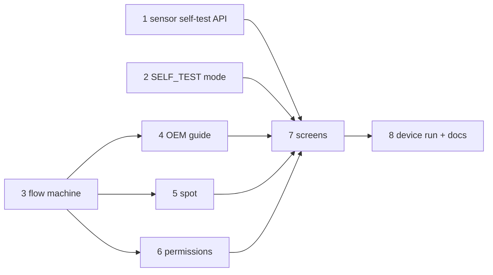

# Tasks: onboarding

Rules: only real dependencies are listed. Tasks in the same wave run in parallel. A task is done only per `definition-of-done.md`. Commit after each, for example `feat(onboarding): flow machine [spec:onboarding task:3]`.

Highest reasoning effort for task 2 (self-test in the state machine). Checkpoint before task 2. Plan mode first for tasks 1 and 7.

Depends on `sensor-android` (tasks 4, 7, 9), `event-ingest` (tasks 3, 4, 10), `alerts-and-light-alarm` (tasks 4, 8), `station-mode` (task 6), `area-cells` (task 2), `web-and-area-pages` (task 3, the catalog). `expo-location` needs the human's approval before use.

## Wave 1

- [ ] 1. Amend `sensor-android` for `beginSelfTest`, `endSelfTest`, the foreground `plugChanged` event, and `isIgnoringBatteryOptimizations`, plus diagnostics fields. Update R11 of that spec and the JS contract.
  - Depends on: `sensor-android` 9
  - Requirements: R7.6, R8.2
- [ ] 2. State machine support for `SELF_TEST` mode: record results, emit nothing, suppress prompt and alarm. Tests O6 (native side).
  - Depends on: `sensor-android` 4, `alerts-and-light-alarm` 3
  - Requirements: R8.2, R8.6
- [ ] 3. `OnboardingFlow` pure machine, persisted record, resume, re-onboarding skips. Tests O1, O3, O7, O8.
  - Depends on: `event-ingest` 3
  - Requirements: R1, R4, R5, R10

## Wave 2

- [ ] 4. OEM guide file, schema validator and maker matching. Tests O4, O5. Initial entries marked unverified, with source URLs found with the docs search tools.
  - Depends on: 3
  - Requirements: R7.1 to R7.4, R7.9
- [ ] 5. Spot module: coarse location, first-result-wins within 8 seconds, cell only, mocked check, map pick with hex grid from the catalog. Tests O2.
  - Depends on: 3, `area-cells` 2, `web-and-area-pages` 3
  - Requirements: R3, R12
- [ ] 6. Permissions module: notification permission, channel creation order, full-screen check, alarm volume check, Alarm check list data.
  - Depends on: 3, `alerts-and-light-alarm` 4
  - Requirements: R6

## Wave 3

- [ ] 7. Screens and navigation for all steps, self-test screen with the three results, Station offer, Finish, copy strings, accessibility labels, per-step timing record.
  - Depends on: 1, 2, 4, 5, 6, `station-mode` 6
  - Requirements: R1, R2, R7, R8, R9, R11

## Wave 4

- [ ] 8. Device run: a stranger sets up in under 60 seconds and gets a Light Alarm with no help (milestone 3 gate). Per-maker battery steps verification updates the guide's `verified` entries. Traceability (O1 to O8), `docs/kiro-log.md`, `docs/probe-checklist.md`.
  - Depends on: 7
  - Requirements: all

## Dependency graph

## Not in this spec
- Demo screens: `demo-mode`.
- Station pairing screens: `home-watch`.
- The `oem-battery-guide` Agent Skill: written in the skills step; it reads the same JSON file.
