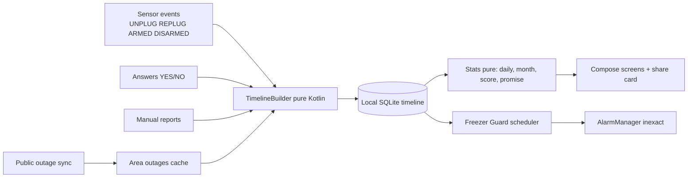
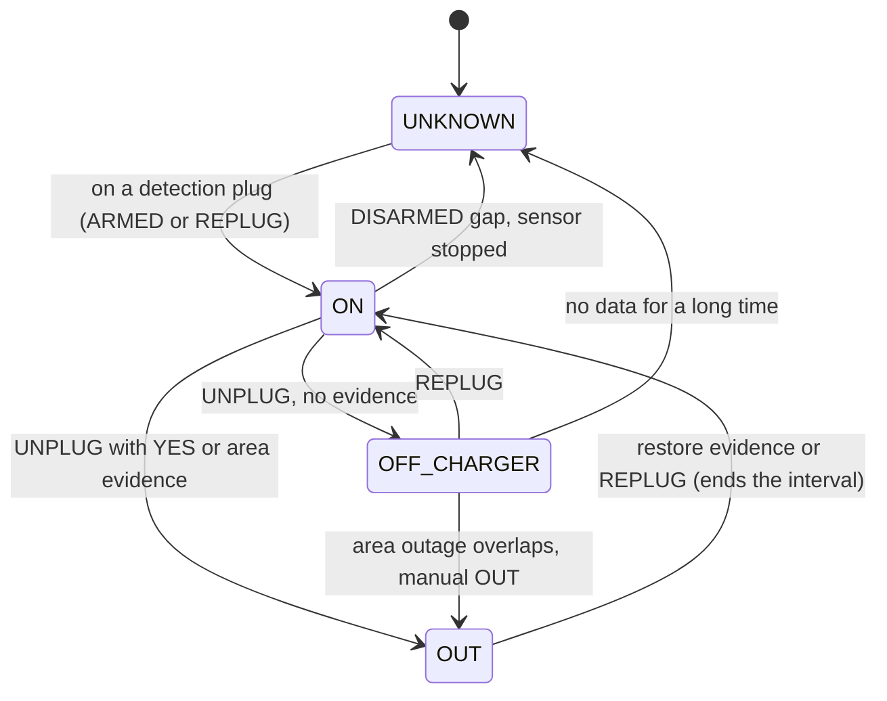
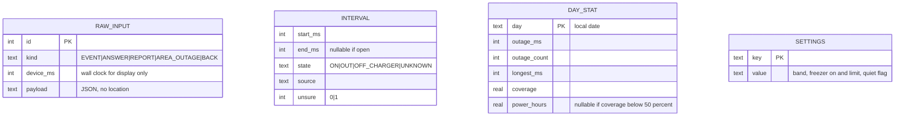
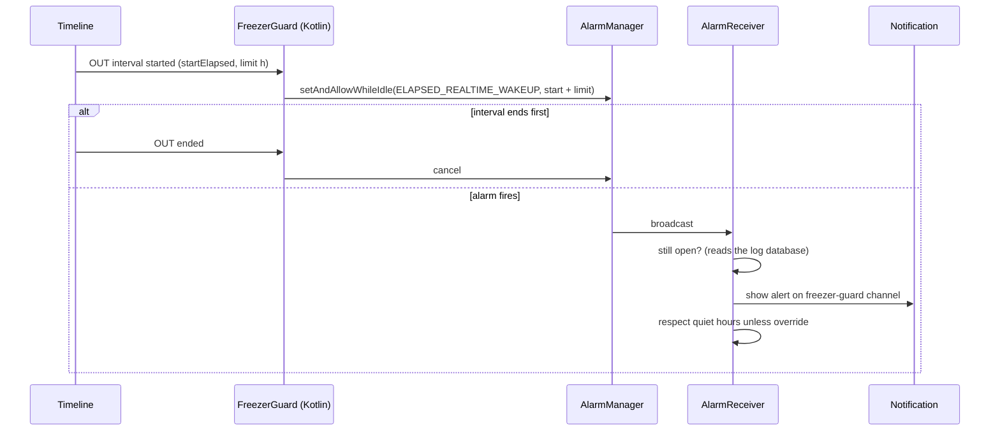
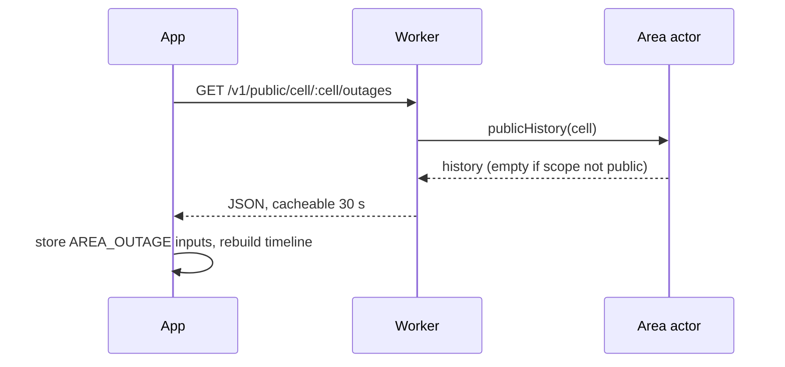

# Design: power-log

Status: APPROVED by delegation on 2026-11-14. Based on `requirements.md`. Tasks in `tasks.md`.

## 1. Overview



- `TimelineBuilder` and `Stats` are pure Kotlin classes in the app's log package, with no Android types. They take events and a clock and return intervals and numbers, so JUnit 4 tests (`./gradlew testDebugUnitTest`) cover them, including seeded random orderings. The screens are Jetpack Compose screens (needs human approval, ADR 0012) driven by a `PowerLogViewModel`.
- Storage is plain `SQLiteOpenHelper` (`android.database.sqlite`): the sensor's database or a second local database (decided in task 2). Room needs human approval (ADR 0012). It is separate from the Outbox, so ack and upload never change the log.
- Freezer Guard uses `AlarmManager` and a `BroadcastReceiver` because the Sensor job does not run when the phone is unplugged.

## 2. Verified platform facts

| Fact | Source |
|---|---|
| `setAndAllowWhileIdle()` is an inexact alarm: it never fires before the trigger time and on Android 12+ fires within one hour of it unless battery saver or Doze applies. Exact alarms need `SCHEDULE_EXACT_ALARM`, which is denied by default on new Android 13+ installs; `USE_EXACT_ALARM` is only for calendar and alarm-clock apps. | https://developer.android.com/training/scheduling/alarms , https://developer.android.com/about/versions/14/changes/schedule-exact-alarms |
| Nigeria's service bands: A 20 h, B 16 h, C 12 h, D 8 h, E 4 h minimum per day (public reports; not the regulator's text). | https://www.icirnigeria.org/explainer-here-is-why-there-is-improvement-in-power-supply/ |

To confirm with the docs servers: `AlarmManager.canScheduleExactAlarms`, the `ELAPSED_REALTIME_WAKEUP` alarm type, receiver registration for the alarm intent, `Intent` for the exact-alarm settings page, and the `SQLiteOpenHelper` migration API (`onUpgrade`). All unverified. Verify NERC band wording against NERC publications.

## 3. Timeline model



Rules:
- Intervals do not overlap, and they cover time without holes by using `UNKNOWN`.
- When area evidence arrives late, the `OFF_CHARGER` interval is rewritten to `OUT`. This is a pure rebuild from stored raw inputs, so a rewritten interval is the same as if the evidence had been there from the start.
- Ends: the earliest of area restore, manual "Power is back", or `REPLUG`. An end after 12 hours with only a `REPLUG` is marked `UNSURE`.
- Raw inputs (events, answers, reports, cached area outages) are kept and the timeline is rebuilt from them. So the timeline is a pure function of the inputs (PL1).

## 4. Data model



`INTERVAL` and `DAY_STAT` can be rebuilt from `RAW_INPUT`. The stored copies are a cache. `device_ms` is wall clock on the phone and is never uploaded (R1.3).

## 5. Statistics

```
for each local day d:
  outage_ms     = sum of OUT overlap with d
  known_ms      = sum of (ON + OUT) overlap with d
  coverage      = known_ms / 86_400_000
  power_hours   = coverage >= 0.5 ? (86_400_000 - outage_ms) / 3_600_000 : null
  longest_ms    = max length of an OUT interval clipped to d
  outage_count  = number of OUT intervals that start in d

month M:
  days   = days with power_hours != null
  score  = days.length >= 7 ? round(100 * mean(power_hours) / 24) : null
promise (band b, hours h_b):
  below  = days where power_hours < h_b
  avg    = mean(power_hours)  -> compared with h_b
```

Day length at daylight changes uses local midnight to local midnight, so a day can have 23 or 25 hours; the formula uses the actual day length. Nigeria has no daylight time; the code still handles it.

## 6. Freezer Guard



- The alarm uses the monotonic clock. After a reboot alarms are lost; the receiver on boot does not re-register (a reboot ends the outage assumption, as in alerts R4.2). The app says so.
- Exact alarm is used only when the user has granted the special access and `canScheduleExactAlarms()` is true.
- The alert is a normal high-importance notification, not the Light Alarm. In quiet hours it is delivered silently unless the override is on.
- Copy: "Power has been off for {n} hours. Check your freezer." with a note under the setting: "This can arrive later than your limit when the phone is saving battery."

## 7. Manual reports and sync

- `REPORT` event: `{ type: 'REPORT', kind: 'OUT', cell, elapsedMs, ... }` added to the strict schema (like `LABEL`). Only `OUT` is uploaded. "Power is back" is local.
- The area actor counts distinct installs with an `OUT` report in the last 10 minutes for a scope and passes the number to the area-cells hint (R8). A report alone never confirms an outage; the engine rule needs k >= 3 drops somewhere.
- `GET /v1/public/cell/:cell/outages?days=30` returns the public history of the spot's scope (area-cells public view). Returns empty when the scope is not public.



## 8. Share card

- Fixed layout: Light Score, hours of power, outage count, "estimate, N days", link. No location or name.
- Image share (task 9): draw the card to a `Bitmap` with the platform `Canvas` and open the share sheet with an `Intent` and a `FileProvider` (AndroidX core). Unverified; the human decides before it is built. Without it: share a text message with the same facts through `Intent.ACTION_SEND` (unverified).

## 9. Error handling

| Case | Behavior |
|---|---|
| Event arrives twice | Raw input keyed by event seq; second ignored. |
| Area evidence arrives before the unplug is recorded | Stored as raw input; applied on rebuild. |
| Clock change on the phone | Display times may shift. Intervals are still ordered by recorded order. A warning appears if wall clock goes backwards by more than a day. |
| Phone off for days | `UNKNOWN`. No fake outage. |
| Sync fails | Use cache. |
| Notification permission denied | Freezer Guard shows in-app status and a warning; the alarm still fires but the alert may not show. |
| Limit changed during an outage | Reschedule from the interval start. |
| Day with coverage below 50% | Hours of power hidden; coverage shown. |
| Share fails | Show the text fallback. |

## 10. Testing strategy

Property IDs `PL1` to `PL9`. JUnit 4 tests with seeded random inputs for `TimelineBuilder` and `Stats`; the Freezer Guard receiver logic in JVM tests where possible. The upload payload shape (PL8) is checked against the fixtures in `packages/shared/fixtures/`.

| ID | Property | Requirement | Test |
|---|---|---|---|
| PL1 | The timeline is a pure function of the raw inputs: any order of delivery or duplicates gives the same intervals. | R1, R2 | `PL1_timeline_pure` |
| PL2 | Intervals never overlap and cover all time with `UNKNOWN` filling gaps. | R1.2 | `PL2_intervals_cover_time` |
| PL3 | An unlabeled unplug never becomes `OUT` without area or manual evidence. | R2.2, R2.4 | `PL3_no_outage_without_evidence` |
| PL4 | Daily outage hours plus power hours equal day length when coverage is at least 50%, and power hours are null below it. | R3 | `PL4_daily_stats` |
| PL5 | The Light Score is null below 7 qualifying days, and equals the rounded mean otherwise. | R4 | `PL5_light_score` |
| PL6 | The promise comparison never produces text with the words refund, compensation or claim, and is always labeled estimate. | R5 | `PL6_promise_copy` |
| PL7 | Freezer Guard schedules only for `OUT`, cancels when it ends, and fires at most once per interval. | R6 | `PL7_freezer_guard_lifecycle` |
| PL8 | No `device_ms` or location appears in any uploaded payload (`REPORT`). | R1.3, R8.2 | `PL8_no_wall_clock_upload` |
| PL9 | The share card text and image data contain no location, area name or install ID. | R8 | `PL9_share_card_privacy` |

Other tests: band config validates and has sources; a 400-day performance test for stats; a rebuild-from-raw equality test; screen state tests on the `PowerLogViewModel`; device checklist for the alarm timing (screen off, Doze), reporting how late the alert arrives.

Traceability: `docs/traceability.md`.
