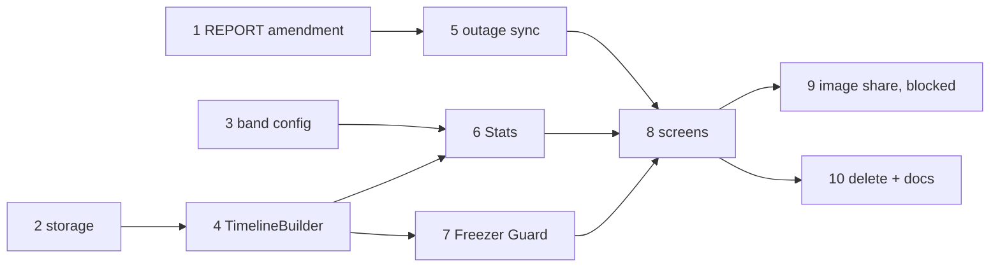

# Tasks: power-log

Rules: only real dependencies are listed. Tasks in the same wave run in parallel. A task is done only per `definition-of-done.md`. Commit after each, for example `feat(log): daily stats [spec:power-log task:4]`.

Highest reasoning effort for tasks 3 and 6. Checkpoint before task 6. Plan mode first for task 2 and 8.

Depends on `sensor-android` (task 9), `alerts-and-light-alarm` (tasks 1, 4), `area-cells` (task 8), `event-ingest` (task 4). The image share card is blocked until the human decides; do the text fallback first. Jetpack Compose is approved (2026-11-14).

## Wave 1

- [ ] 1. Amend the schemas for `REPORT` events (kind `OUT`): sensor types, ingest strict schema and tests, contract fixtures in `packages/shared/fixtures/`, and the area actor's report counter feeding the hint.
  - Depends on: `event-ingest` 2, `area-cells` 6
  - Requirements: R7.4, R7.5
- [ ] 2. Choose and set up local storage (the sensor's SQLite database or a second one, plain `SQLiteOpenHelper`) and the `RAW_INPUT` store with migrations. Record the choice in an ADR. Room needs human approval (ADR 0012).
  - Depends on: `sensor-android` 9
  - Requirements: R1
- [ ] 3. Band config file with sources and checked date, plus a validator and the copy strings in the string pack.
  - Depends on: `alerts-and-light-alarm` 2
  - Requirements: R5.5

## Wave 2

- [ ] 4. `TimelineBuilder` (Kotlin, JUnit 4): raw inputs to intervals, rebuild, evidence rules, `UNSURE` ends. Tests PL1, PL2, PL3.
  - Depends on: 2
  - Requirements: R1, R2, R7.2
- [ ] 5. Public outage endpoint and the phone-side sync with cache. Tests for empty result when not public.
  - Depends on: 1, `area-cells` 8
  - Requirements: R9

## Wave 3

- [ ] 6. `Stats` (Kotlin, JUnit 4): daily, month, Light Score, promise comparison. Tests PL4, PL5, PL6.
  - Depends on: 4, 3
  - Requirements: R3, R4, R5
- [ ] 7. Freezer Guard native scheduler and receiver, quiet-hours behavior, exact-alarm option, settings, copy. Tests PL7. Device checks in `docs/probe-checklist.md`.
  - Depends on: 4, `alerts-and-light-alarm` 4
  - Requirements: R6

## Wave 4

- [ ] 8. Compose screens and `PowerLogViewModel`: now, today, 30 days, month, open outage, band picker, Freezer Guard settings, "Power is out" and "Power is back" taps with the rate limit. Share card text fallback. Tests PL8, PL9.
  - Depends on: 5, 6, 7
  - Requirements: R7, R8, R10

## Wave 5

- [ ] 9. (Blocked until the human decides how the image is built) Image share card.
  - Depends on: 8
  - Requirements: R8
- [ ] 10. Delete-my-data for the timeline, traceability (PL1 to PL9), `docs/kiro-log.md`.
  - Depends on: 8
  - Requirements: R1.6

## Dependency graph

## Not in this spec
- Cost estimate (generator hours x fuel use x price) and usual-pattern prediction: stretch features, written as their own specs only if time allows.
- The "Power's back" live-count moment: part of `web-and-area-pages` and `home-watch` stretch.
