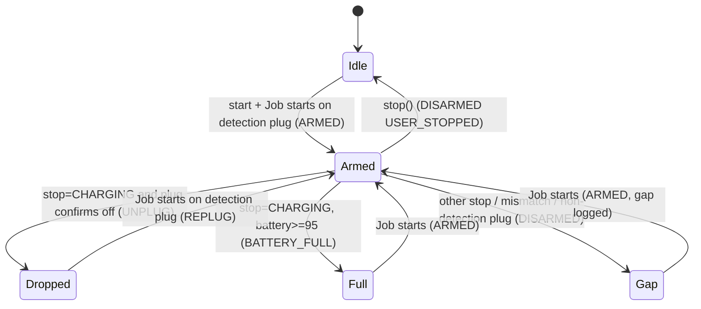
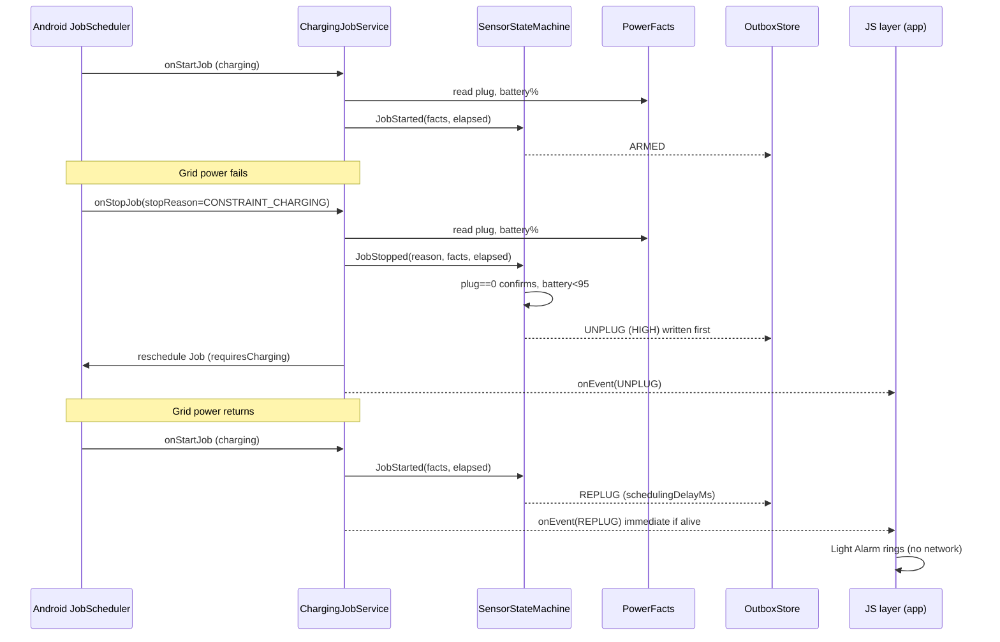
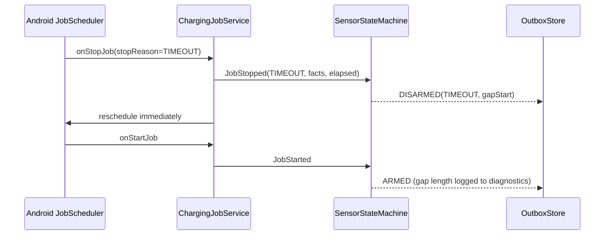
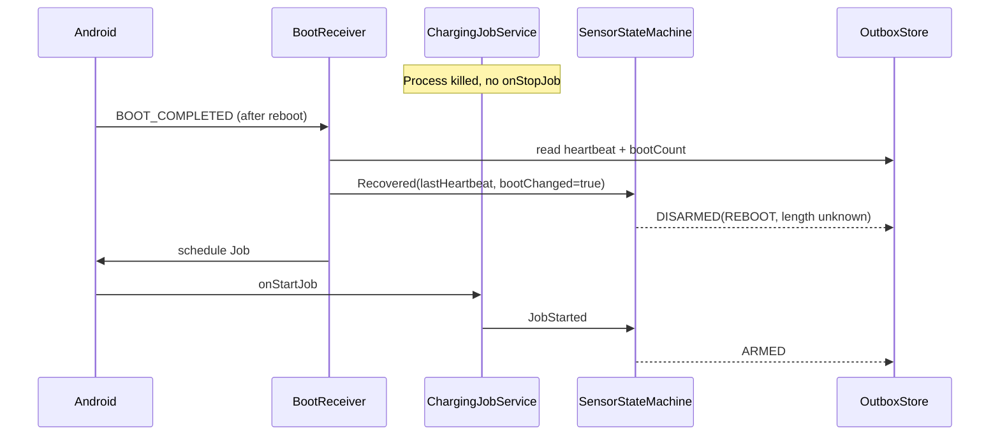
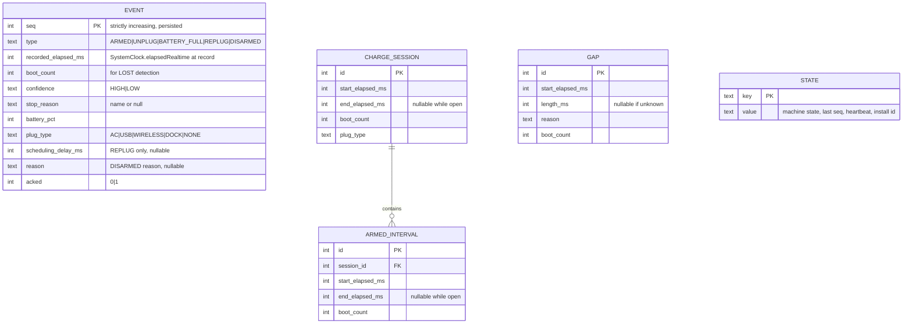

# Design: sensor-android

Status: APPROVED by delegation on 2026-11-14. Based on `requirements.md`. Tasks in `tasks.md`.

## 1. Overview

The Sensor treats the Job's stop as the signal. A JobScheduler job with `setRequiresCharging(true)` runs while the phone charges. When charging stops, Android calls `onStopJob`. When charging resumes, Android calls `onStartJob`. The Sensor turns those two callbacks into events.

Three concerns are kept apart so each is testable:

| Layer | Responsibility | Android deps | Test |
|---|---|---|---|
| `SensorStateMachine` | Pure Kotlin. Input: lifecycle facts. Output: events and actions (reschedule, etc.). | none | JVM unit tests |
| Android adapters | `ChargingJobService`, `PowerFacts` (battery + plug), `Scheduler`, `OutboxStore` (SQLite), boot receiver | yes | instrumented, and the field probe |
| `OutageSensorModule` | Expo Module bridge, typed JS API | Expo Modules | JS contract test |

The pure core takes a `Clock` and a `Facts` snapshot as arguments, which keeps `kotlin-check` fast and removes timing flakiness.

Station mode (foreground service) will add a second driver that feeds the same state machine from a dynamic `ACTION_POWER_DISCONNECTED` receiver. That is out of scope here (OQ2); the state machine is built so it can be plugged in.

## 2. Verified platform facts

Each is confirmed against official docs; the URL goes in the code comment where used.

| Fact | Source |
|---|---|
| `JobParameters.getStopReason()` exists from API 31. `STOP_REASON_CONSTRAINT_CHARGING` = 6, `STOP_REASON_CANCELLED_BY_APP` = 1. | https://developer.android.com/reference/android/app/job/JobParameters |
| Docs say apps should not rely on the stop reason for critical decisions; use is meant for logging and diagnostics. | same |
| Other stop reasons include `TIMEOUT`, `DEVICE_STATE`, `QUOTA`, `APP_STANDBY`, `BACKGROUND_RESTRICTION`, `USER`. | same |
| Plug constants: `BATTERY_PLUGGED_AC`=1, `USB`=2, `WIRELESS`=4, `DOCK`=8. Read via `Intent.ACTION_BATTERY_CHANGED` extras `EXTRA_PLUGGED`, `EXTRA_LEVEL`, `EXTRA_SCALE`. | https://developer.android.com/reference/android/os/BatteryManager |
| Jobs can be stopped after about 10 minutes; since Android 12 they may run longer when the system is not busy. Start and stop delays of 30 to 55 s are reported in the field. | https://stackoverflow.com/questions/77599145/ , https://stackoverflow.com/questions/48110961/ (community sources; confirm in the probe) |

To verify with the docs MCP before the implementing task: `Settings.Global.BOOT_COUNT`, `JobInfo.Builder.setPersisted` and `RECEIVE_BOOT_COMPLETED` rules, `onStopJob` return-value semantics, and whether an expedited job may carry the charging constraint.

## 3. Key design decisions

1. **Job stays running.** `onStartJob` returns `true` and never calls `jobFinished`. If it finished, no stop callback would arrive when charging ends.
2. **Timeouts are expected.** About every 10 minutes Android may stop the job with `TIMEOUT`. The Sensor reschedules and logs a short `DISARMED` gap. This lowers armed time and is the main risk for the 90% gate. The probe measures it. See ADR 0001.
3. **Corroborate, do not trust.** On a charging-constraint stop, read the plug state. Only `plugged == 0` (or plug moved to a non-detection type) confirms the unplug (R3.3).
4. **Record first, then act.** `onStopJob` writes the record to SQLite before rescheduling (R2).
5. **Module owns sequence numbers**, so events exist when JS is dead (R9.1).
6. **Event times come from elapsed time only.** The module stores `recordedElapsedMs` and `bootCount`, and computes `elapsedMs = now − recordedElapsedMs` when JS reads. Across a reboot the time is `LOST` (R9.4).
7. **No new dependencies.** SQLite through `android.database`, JSON through the platform. Test with JUnit4 plus seeded random loops (OQ4).

## 4. State machine



Notes:
- `Dropped` keeps the pending drop so a later `REPLUG` can be paired. It survives process death in the Outbox state row.
- `Gap` always reschedules. It never waits for a user action.
- Waiting states (`Dropped`, `Full`, `Gap`) correspond to the phone being off power or the Job being queued; the Job is scheduled in all of them.

## 5. Sequences

### 5.1 Grid power fails and returns



### 5.2 Non-charging stop (gap)



### 5.3 Process death and reboot



The heartbeat is written on every start and every stop, and at most once per minute while running (cadence open for the probe; it must not hurt battery).

## 6. Decision table for a stop

Inputs: `stopReason` (null below Android 12), `plugged` now, `batteryPct`.

| stopReason | plugged now | battery | Result | Confidence |
|---|---|---|---|---|
| CONSTRAINT_CHARGING | 0 (unplugged) | < 95 | UNPLUG | HIGH |
| CONSTRAINT_CHARGING | 0 | >= 95 | BATTERY_FULL | HIGH |
| CONSTRAINT_CHARGING | USB or wireless | any | DISARMED `NON_DETECTION_PLUG` | HIGH |
| CONSTRAINT_CHARGING | AC or dock | any | DISARMED `STOP_REASON_MISMATCH` | HIGH |
| other reason | any | any | DISARMED(reason) | HIGH |
| null (Android < 12) | 0 | < 95 | UNPLUG | LOW |
| null | 0 | >= 95 | BATTERY_FULL | LOW |
| null | non-detection | any | DISARMED `NON_DETECTION_PLUG` | LOW |
| null | AC or dock | any | DISARMED `UNKNOWN_CAUSE` | LOW |

A real unplug can be reported before the plug state updates. If the probe shows the plug state lags the stop callback, add a short bounded re-read of the plug state before deciding. The delay value is a probe finding and would need your approval (it affects detection timing).

## 7. Data model

SQLite database `outage_sensor.db`, created with `android.database.sqlite`.



JS-facing event (what `getPendingEvents` returns):

```ts
type SensorEvent = {
  seq: number;
  type: 'ARMED' | 'UNPLUG' | 'BATTERY_FULL' | 'REPLUG' | 'DISARMED';
  elapsedMs: number;          // time since the event, computed at read time
  timeQuality: 'OK' | 'LOST'; // LOST after reboot; telemetry only
  confidence: 'HIGH' | 'LOW';
  stopReason: string | null;
  batteryPct: number;
  plugType: 'AC' | 'USB' | 'WIRELESS' | 'DOCK' | 'NONE';
  schedulingDelayMs: number | null;
  reason: string | null;
};
```

The install ID and H3 cell are added by the JS layer when it builds the ingest payload. This keeps the Kotlin module free of location data (R9.6). The shared type lives in `packages/shared` and the Kotlin type must match it.

Retention: events and telemetry older than 7 days are deleted on start and on ack (R9.5, R10.5).

## 8. Interfaces

```ts
// modules/outage-sensor/src/index.ts
start(): Promise<{ state: SensorState }>;
stop(): Promise<void>;
setInstallId(id: string): Promise<void>;
getPendingEvents(limit: number): Promise<SensorEvent[]>;
ackEvents(upToSeq: number): Promise<void>;
getTelemetry(periodMs: number): Promise<{ chargingMs: number; armedMs: number; armedRatio: number; replugDelaysMs: number[] }>;
getDiagnostics(): Promise<Diagnostics>;
addListener('onEvent', cb): Subscription;
deleteAllData(): Promise<void>;
```

Kotlin core (pure):

```kotlin
data class Facts(val plug: Plug, val batteryPct: Int, val standbyBucket: Int?)
sealed interface Input { JobStarted, JobStopped(reason: Int?), Recovered(bootChanged: Boolean), UserStopped }
data class Output(val events: List<EventDraft>, val reschedule: Boolean)
class SensorStateMachine(clock: Clock) { fun step(input: Input, facts: Facts): Output }
```

## 9. Error handling

| Failure | Behavior |
|---|---|
| SQLite write fails in `onStopJob` | Reschedule anyway, bump `diagnostics.writeFailures`, keep an in-memory event for the current process (R2.3). |
| `getStopReason` unavailable or throws | Treat as Android < 12 path, `LOW` confidence. |
| Battery intent returns null | Treat plug as unknown. Emit `DISARMED UNKNOWN_CAUSE`, never `UNPLUG`. |
| JobScheduler `schedule()` returns failure | Retry once immediately; record a gap with reason `SCHEDULE_FAILED`; retry again on the next app start and boot. |
| Duplicate `start()` | No-op (R11.3). |
| Corrupt database | Move aside, create fresh, record `DB_RESET` gap. Sequence resumes from a timestamp-seeded floor, so `(installId, seq)` never repeats. |
| Reboot | Events from before the reboot get `timeQuality = LOST`. |
| JS dead when event happens | Event stays in Outbox. Drained on next JS start. |
| Outbox grows without network | Capped by the 7-day retention. |

## 10. Risks and the probe

These map to the milestone-1 gate and to Part K.

| Risk | Measure in probe | Fallback |
|---|---|---|
| Armed time below 90% from timeout gaps | armed ÷ charging over a day on one stock phone | ADR 0001 options |
| Plug-in to job-start delay too large | 20 replugs, p95 (gate: 60 s) | widen W_r in detection; Station mode |
| OEM killers (Tecno, Infinix) | armed ratio before and after battery exemption | Station mode foreground service |
| 100% battery while plugged | observe stop behavior at 100% | R3.2 rule; verify |
| Plug state lags stop callback | log plug state at stop vs 1 s later | bounded re-read (needs approval) |

## 11. Testing strategy

Sensor-level properties use IDs `S1`..`S8`, separate from the detection `P1`..`P12`. Each Kotlin test names its ID in the test name. Tests run in plain JUnit4 with seeded random sequences (seed printed on failure). No new dependency.

| ID | Property | Requirement | Test |
|---|---|---|---|
| S1 | Reason and facts are recorded before the reschedule action is returned. | R2.1 | `S1_records_before_reschedule` |
| S2 | `UNPLUG` is only emitted when the plug state confirms unplugged. | R3.1, R3.3, R3.4 | `S2_unplug_requires_unplugged_facts` |
| S3 | A stop at battery >= 95 never yields `UNPLUG`. | R3.2 | `S3_full_battery_is_not_unplug` |
| S4 | Every `REPLUG` follows an `UNPLUG` with no `REPLUG` between; `BATTERY_FULL` then start gives `ARMED`. | R4.1, R4.4 | `S4_replug_pairs_with_unplug` |
| S5 | Any stop that is not a confirmed charging-constraint drop returns `reschedule = true` and a `DISARMED`. | R5.1, R3.3 | `S5_other_stops_reschedule` |
| S6 | USB or wireless plugs never produce `ARMED`, `UNPLUG` or `REPLUG`. | R6.2, R6.4 | `S6_non_detection_plugs_silent` |
| S7 | Sequence numbers are strictly increasing and unique across simulated restarts. | R9.1 | `S7_seq_monotonic_across_restarts` |
| S8 | Android < 12 events are always `LOW`; Android >= 12 `HIGH` only when reason and facts agree. | R7 | `S8_confidence_rules` |

Other tests:

| Area | Test | Requirement |
|---|---|---|
| Time | `elapsedMs` computed at read time; cross-boot events `LOST` | R9.2 to R9.4 |
| Outbox | ack removes up to seq; 7-day retention | R9.5 |
| Telemetry | armed ratio with synthetic intervals | R10 |
| Bridge | JS contract test of the typed API against a fake native module | R11 |
| Device | probe checklist run on real phones (not CI) | R1, R5, R8 |

Cross-package: the `tools/sim` event generator must produce `SensorEvent` shapes equal to the shared type, and `event-ingest` contract tests use the same fixtures. `docs/traceability.md` links requirement, property, test and task.

## 12. Decisions taken (2026-11-14)

1. ADR 0001: option 1 (reschedule on timeout) accepted for the probe only.
2. Android < 12 supported at `LOW` confidence. Station mode is its own spec. Pre-reboot events are telemetry only. JUnit4 only, no new test dependency.
3. No plug-state re-read until probe data justifies it, through a new ADR.
