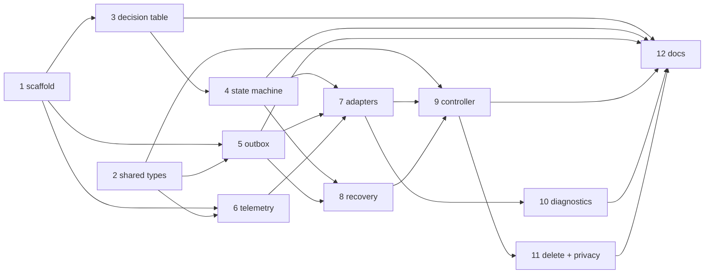

# Tasks: sensor-android

Rules: only real dependencies are listed. Tasks in the same wave can run in parallel. A task is done only per `definition-of-done.md`. Commit after each task, for example `feat(sensor): decision table [spec:sensor-android task:3]`.

Highest reasoning effort for tasks 3, 4, 7, 8. Create a checkpoint before tasks 4, 7, 8. Verify every Android API with a docs server first and put the URL in a code comment.

Dependencies approved by ADR 0012 (Kotlin, Gradle, the Android Gradle plugin, AndroidX core, JUnit 4) are not new. Ask the human before adding anything else.

> **Amended 2026-11-23 (ADR 0032).** Order: tasks 1 to 6, then the receiver service (station-mode tasks 2 to 5), then task 7 as the job backup, then 8 to 12. Task 9 wires both drivers.

## Wave 1 (no dependencies)

- [x] 1. Scaffold the `sensor` package in `apps/android` (Gradle project, JVM unit-test source set using JUnit 4; the project itself comes from the app scaffold, reuse the probe's Gradle settings). Needs a Plan mode pass first (touches more than 3 files).
  - Requirements: R11
- [x] 2. Add the `SensorEvent`, `SensorTelemetry` and `Diagnostics` types to `packages/shared`, matching design section 7.
  - Requirements: R9, R10, R11

## Wave 2 (needs 1, plus 2 where noted)

- [x] 3. Pure core, part 1: `Plug` classification, `Confidence`, and the stop decision table as a pure function. Tests S2, S3, S6, S8.
  - Depends on: 1
  - Requirements: R3, R6, R7
- [x] 5. `OutboxStore` on SQLite: assigned persisted sequence, `ack`, 7-day retention, boot-count `LOST` marking, corrupt-DB reset. Test S7 and time/outbox tests.
  - Depends on: 1, 2
  - Requirements: R2.2, R9, R12.2
- [x] 6. Telemetry store: charge sessions, armed intervals, gaps, armed ratio, plug-in to start delay, 7-day cap.
  - Depends on: 1, 2
  - Requirements: R10

## Wave 3

- [x] 4. Pure core, part 2: `SensorStateMachine` transitions (ARMED, UNPLUG, BATTERY_FULL, REPLUG, DISARMED, gaps, recovery, user stop). Tests S1, S4, S5.
  - Depends on: 3
  - Requirements: R1, R2, R3, R4, R5, R11.2

## Wave 4

- [x] 7. (Job backup, after the receiver service exists.) Android adapters: `PowerFacts` (battery intent), `Scheduler` (one stable Job ID, idempotent), `ChargingJobService` (stay running, record before reschedule), `BootReceiver`.
  - Depends on: 4, 5, 6
  - Requirements: R1, R2, R3, R4, R5, R8.1, R8.2
- [x] 8. Heartbeat and recovery: detect process death and reboot, record `PROCESS_DEATH` and `REBOOT` gaps.
  - Depends on: 4, 5
  - Requirements: R5.3, R5.4, R9.4

## Wave 5

- [x] 9. `SensorController` (`start`, `stop`, `setInstallId`, `getPendingEvents`, `ackEvents`, `getTelemetry`, `getDiagnostics`, listener). JVM unit test against fake adapters. Immediate hand-off of `REPLUG` to the Light Alarm in the same process.
  - Depends on: 7, 8, 2
  - Requirements: R4.3, R11
- [x] 10. Diagnostics: Android version, manufacturer, standby bucket, battery-exemption state, stop-reason counts, recent gaps.
  - Depends on: 7
  - Requirements: R8.4, R10.4

## Wave 6

- [x] 11. `deleteAllData` and the privacy check: no microphone, accelerometer or location permission in the manifest; erase Outbox, telemetry and install ID.
  - Depends on: 9
  - Requirements: R9.6, R12

## Wave 7

- [x] 12. Update `docs/traceability.md` (statuses and task IDs for S1 to S8), `docs/kiro-log.md`, and `apps/android/README.md`. The device checklist `docs/probe-checklist.md` for the feasibility probe already exists (not a CI test).
  - Depends on: 3, 4, 5, 9, 10, 11
  - Requirements: all

## Dependency graph

## Not in this spec
- Station mode foreground service: `station-mode` spec.
- Event upload, rate limiting and server time: `event-ingest` spec.
- Weighting of `LOW` confidence events: `detection-engine` spec.
