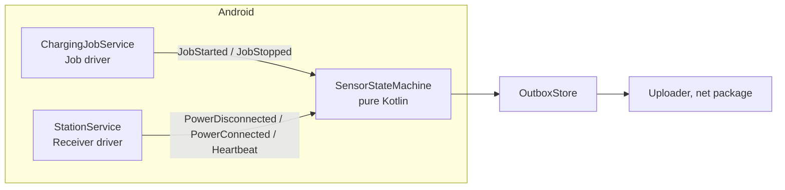
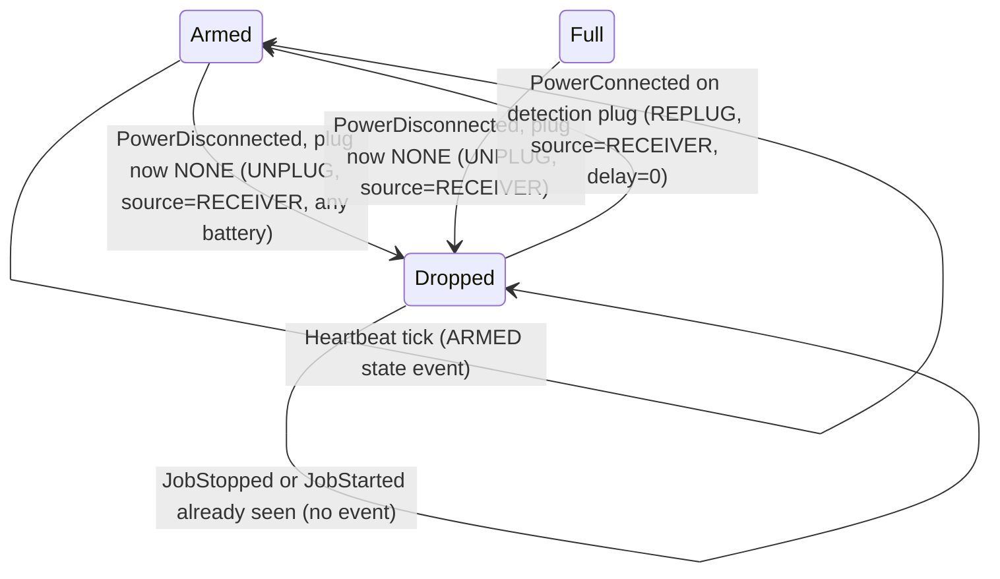
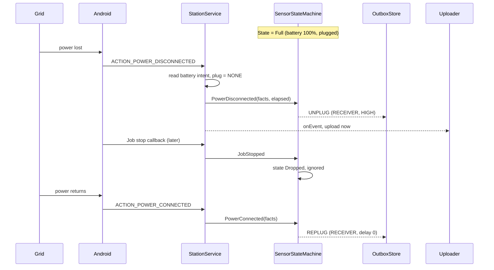
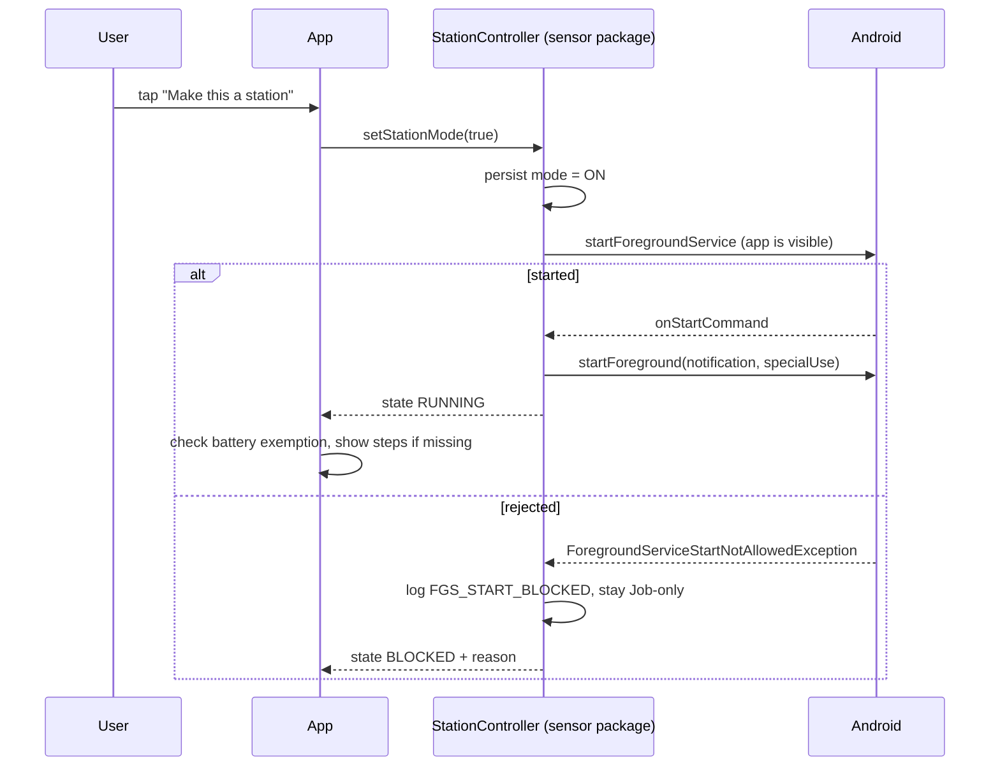
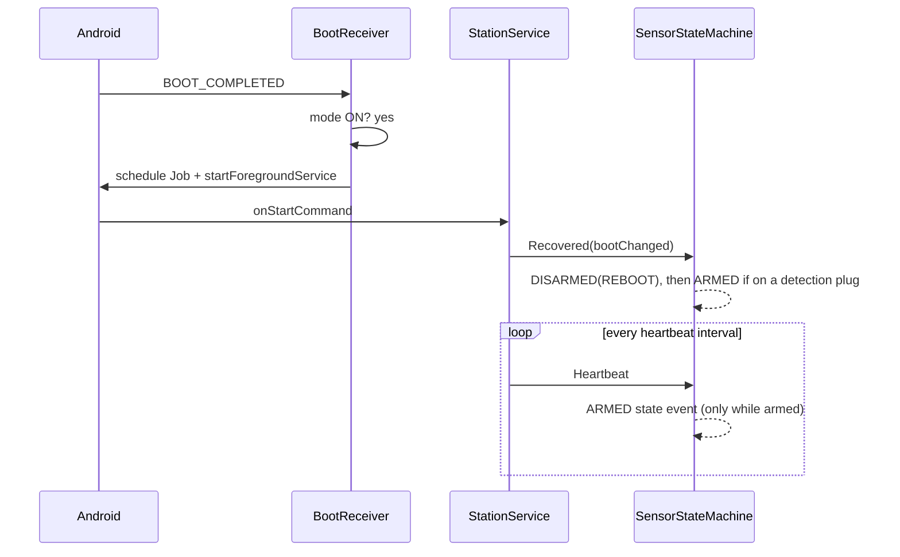

# Design: station-mode

Status: APPROVED by delegation on 2026-11-14. Based on `requirements.md`. Tasks in `tasks.md`.

## 1. Overview

Station mode adds a second driver to the `SensorStateMachine` defined in `sensor-android`. The state machine stays pure Kotlin. The new driver feeds it two new inputs, `PowerDisconnected` and `PowerConnected`.

Both drivers write to the same Outbox through the same state machine, so de-duplication, sequence numbers and ordering come from one place.

## 2. Verified platform facts

| Fact | Source |
|---|---|
| `specialUse` foreground service type has no runtime prerequisites. The manifest needs `FOREGROUND_SERVICE_SPECIAL_USE` and a `<property android:name="android.app.PROPERTY_SPECIAL_USE_FGS_SUBTYPE">` use-case description. Play Console reviews the description; sideloaded APK distribution does not go through that review. | https://developer.android.com/develop/background-work/services/fgs/service-types |
| `dataSync` services on Android 15 targets get 6 hours per 24 hours, then `onTimeout`. Not suitable for a 24/7 station. | https://developer.android.com/about/versions/15/behavior-changes-15 |
| `BOOT_COMPLETED` receivers cannot launch `dataSync`, `camera`, `mediaPlayback`, `phoneCall`, `mediaProjection` or `microphone` services. `specialUse` is not on the list. | same |
| `systemExempted` needs special roles (device owner, exact-alarm permission, etc.). Not usable. | service-types page |

To confirm with the docs server before implementing: manifest declarations and `startForeground(id, notification, type)` signature, `ACTION_POWER_CONNECTED` / `ACTION_POWER_DISCONNECTED` delivery to dynamic receivers, `onTimeout` for `specialUse`, `START_STICKY` behaviour, the foreground-start exemptions for `BOOT_COMPLETED`, the Android 13 notification permission and notification-channel importance rules, and the manifest entries for a foreground service and a receiver in `apps/android`.

## 3. Key design decisions

1. **Plug state is observed, not inferred.** The Receiver driver reads `EXTRA_PLUGGED` from the battery intent after each power broadcast. Plugged to unplugged is a real disconnect at any battery level. See ADR 0004.
2. **Job stays as backup.** The Job driver keeps running in Station mode. When the OS kills the service, the Job may still observe the unplug.
3. **One state machine, two inputs.** The `Full` state accepts `PowerDisconnected`. See section 4.
4. **Dedupe by state, not by time.** A second report of the same transition arrives in a state that no longer accepts it, so it emits nothing. No time window is needed, so no new threshold.
5. **Heartbeat is an `ARMED` state event.** It reuses the existing wire type. The ingest Worker already treats state events as write-behind, so a heartbeat costs one request, not a row. See `event-ingest` ADR 0002. In Station mode the Uploader's state-event maximum wait is the heartbeat interval (10 min) and not the normal 15 min, so the worst case for the server to notice silence is one interval plus upload retry, well under 30 min. Cost: about 144 Worker requests and 144 cell-actor requests per station per day, against 100,000 daily caps. Stations are few, so this fits; revisit if station counts grow past a few hundred.
6. **Direct Boot is not supported.** The service starts after the first unlock. A phone that reboots during a blackout is unarmed until someone unlocks it; this is recorded as a `REBOOT` gap.

## 4. State machine amendments

Added transitions (existing ones are in `sensor-android` design section 4):

Rules:
- `Dropped` ignores a late `JobStopped`. This gives exactly one `UNPLUG` when both drivers fire (R4.2).
- `Dropped` plus `JobStarted` on a detection plug emits `REPLUG` only if no `REPLUG` was emitted by the Receiver driver for the same drop. Otherwise it is ignored (R4.3).
- In `Armed`, a `JobStopped(CONSTRAINT_CHARGING)` while the plug state is still a detection plug and battery is 95 or more gives `BATTERY_FULL` and moves to `Full`, as today. The Receiver driver stays active in `Full`.
- `Heartbeat` is accepted only in `Armed` (R5.4).
- Mode changes are not inputs. They start or stop the service; they do not change state (R1.2, R4.5).

The state machine takes a `Source` on each event draft. No other logic differs by source.

## 5. Sequences

### 5.1 Power cut on a full spare phone

### 5.2 Enable Station mode

### 5.3 Reboot and heartbeat

## 6. Components

| Component | Responsibility |
|---|---|
| `StationService` | Foreground service. Creates the notification channel and notification. Registers the power receiver. Runs the heartbeat. Returns `START_STICKY`. |
| `PowerReceiver` | Dynamic receiver. On each broadcast reads `PowerFacts` and sends `PowerConnected` or `PowerDisconnected` to the state machine. |
| `StationModeStore` | Persists the mode flag in the `STATE` table (`sensor-android` data model). |
| `BootReceiver` (extended) | On boot starts the Job, and the service when the mode is ON. |
| `AndroidManifest.xml` | Declares the service with `specialUse` and its property, the permissions and the receiver, in `apps/android`. |
| `StationController` | Kotlin API used by the app screens: `setStationMode(enabled)` and `getStationState()` returning `StationState(enabled, running, blockedReason?)`. |

## 7. Data model changes

Small additions to the `sensor-android` model:

- `EVENT.source` text `RECEIVER|JOB`, default `JOB`.
- `CHARGE_SESSION.mode` text `NORMAL|STATION`.
- `STATE` keys: `station_enabled`, `station_blocked_reason`, `last_heartbeat_elapsed_ms`.

Wire and shared types gain optional `source: 'RECEIVER' | 'JOB'`, added to the strict schema allow-list in `event-ingest`. It carries no personal data. Field reports use it to compare restore delays by driver.

Notification text (fixed strings, no variables): title "Outage station", body "Watching your power". Action: "Stop station". The strings live in a resource file, with the Pidgin pack optional later.

## 8. Error handling

| Failure | Behavior |
|---|---|
| `ForegroundServiceStartNotAllowedException` | Record `FGS_START_BLOCKED`, stay Job-only, report `BLOCKED` to the app screens. No retry loop (R9.2). |
| Service killed by OS | `START_STICKY` restart if the OS allows. Gap recorded `PROCESS_DEATH`. |
| `onTimeout` callback | Stop and restart the service, record `FGS_TIMEOUT` (R6.4). |
| Broadcast received but plug still a detection plug | No `UNPLUG`. Count `STATION_BROADCAST_MISMATCH` (R3.6). If the probe shows this lag is common, add the bounded re-read through a new ADR, not here. |
| Notification permission denied | Service runs. Diagnostics `NOTIFICATION_HIDDEN`. App shows an explanation. |
| Battery exemption missing | App shows the OEM steps and keeps Station mode on. Armed time shows the effect. |
| Receiver registered twice | Registration is guarded by a flag in the service. |
| Reboot before first unlock | No start until unlock. Gap `REBOOT`. |

## 9. Risks and probe items

| Risk | Measure | Fallback |
|---|---|---|
| Power broadcasts delayed or dropped in Doze | Unplug a station at 100%; time from physical unplug to event, 20 times, screen off, 30 min idle | Hold a partial wake lock only if data shows misses (R9.3) |
| Battery intent lags the broadcast | Log plug state at broadcast vs 1 s later | New ADR for a bounded re-read |
| OEM kills the foreground service | Armed time per maker, with and without exemption | OEM guide; document unsupported phones |
| Some phones do not report plug change at 100% | Check Tecno, Infinix, itel, Samsung | Mark phone in diagnostics; Job driver only |

Station mode's own armed-time target is not set here. The probe measures it, and the human sets the number.

## 10. Testing strategy

Station properties use IDs `T1` to `T7`. Kotlin JVM unit tests (JUnit 4) with seeded random sequences, as in `sensor-android` (no new dependency). Test names include the ID.

| ID | Property | Requirement | Test |
|---|---|---|---|
| T1 | For any interleaving of Receiver and Job reports of the same real unplug, exactly one `UNPLUG` is emitted. | R4.2 | `T1_single_unplug_any_interleaving` |
| T2 | `PowerDisconnected` with plug `NONE` from `Armed` or `Full` emits `UNPLUG` at any battery level 0 to 100. | R3.2 | `T2_receiver_unplug_any_battery` |
| T3 | `PowerDisconnected` while facts still show a detection plug emits nothing and increments the mismatch counter. | R3.6 | `T3_mismatch_emits_nothing` |
| T4 | `REPLUG` is only emitted after an `UNPLUG`, and exactly once per drop across both drivers. | R3.3, R4.3 | `T4_single_replug_per_drop` |
| T5 | Mode on/off at any point in a random event stream does not change emitted events and keeps sequence numbers strictly increasing (supports S7). | R1.2, R4.5 | `T5_mode_changes_are_silent` |
| T6 | With a fake clock, while armed, heartbeats are produced at the configured interval and never while not armed. | R5 | `T6_heartbeat_cadence` |
| T7 | Heartbeat interval times 3 is at most 30 minutes for any configured value allowed by the config validator. | R5.2 | `T7_heartbeat_vs_silence_limit` |

Other tests: manifest check (no `dataSync`, only listed permissions, no mic/location) as a script run by the `verify-on-stop` hook; JVM unit test for `StationController` (`setStationMode` and `getStationState`) with a fake service launcher; device checklist in `docs/probe-checklist.md` for R1, R2, R6 and the probe items above.

Traceability: `docs/traceability.md`.
