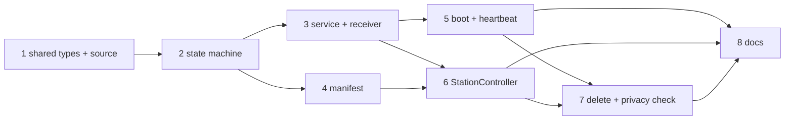

# Tasks: station-mode

Rules: only real dependencies are listed. Tasks in the same wave run in parallel. A task is done only per `definition-of-done.md`. Commit after each, for example `feat(station): receiver unplug at any battery [spec:station-mode task:3]`.

Highest reasoning effort for tasks 2, 3, 4. Checkpoint before tasks 2 and 3. Plan mode first for task 1 and task 3 (each touches more than 3 files). Confirm every Android API with the docs servers and put the doc URL in a comment.

> **Amended 2026-11-23 (ADR 0032).** These tasks are now the primary sensor path and run before `sensor-android` task 7 (job backup). Task 6 also starts the service by default after first run. Task 1 and task 2 can start as soon as `sensor-android` tasks 2 and 3 exist, with the pure core as the contract.

This spec depends on `sensor-android` (tasks 4, 5, 7, 9) and `event-ingest` (task 2). Do not start a task here until its dependency exists. No new dependency is needed.

## Wave 1 (needs sensor-android task 4 and event-ingest task 2)

- [ ] 1. (deferred, ADR 0034) Amend shared types: add optional `source` to `SensorEvent` and the ingest wire schema and its strict allow-list; add `mode` to charge sessions in the sensor data model doc. Update golden fixtures.
  - Depends on: `sensor-android` task 2, `event-ingest` task 2
  - Requirements: R3.4, R6.3

## Wave 2

- [x] 2. Extend `SensorStateMachine`: inputs `PowerDisconnected`, `PowerConnected`, `Heartbeat`; the `Full -> Dropped` and `Dropped` ignore rules; `Source` on drafts. Tests T1 to T7 (pure parts: T1 to T5, T6, T7 with a fake clock).
  - Depends on: 1, `sensor-android` task 4
  - Requirements: R3, R4, R5

## Wave 3

- [x] 3. `StationService`, `PowerReceiver`, notification channel and strings, `StationModeStore`, guarded receiver registration, `START_STICKY`, `onTimeout` handling, blocked-start handling.
  - Depends on: 2, `sensor-android` task 7
  - Requirements: R1, R2, R3, R6, R9
- [x] 4. Manifest entries in `android/outage` (service with `specialUse` and its property, permissions, receiver) and a manifest check script.
  - Depends on: 2
  - Requirements: R2.1, R10.2

## Wave 4

- [x] 5. Boot restore and heartbeat scheduling: extend `BootReceiver`; run heartbeat inside the service while armed; reuse `Recovered` input.
  - Depends on: 3
  - Requirements: R1.3, R5, R6.1
- [x] 6. `StationController` (`setStationMode`, `getStationState`), diagnostics `stationMode`, `NOTIFICATION_HIDDEN`, `FGS_START_BLOCKED`; JUnit 4 test with a fake service launcher.
  - Depends on: 3, 4, `sensor-android` task 9
  - Requirements: R1.5, R2.4, R8.1

## Wave 5

- [x] 7. Delete-my-data support for Station mode (stop service, clear flags) and the privacy manifest check in `verify-on-stop`.
  - Depends on: 5, 6, `sensor-android` task 11
  - Requirements: R10

## Wave 6

- [x] 8. Update `docs/traceability.md` (T1 to T7), `docs/kiro-log.md`, `docs/probe-checklist.md` (Station section: unplug at 100%, Doze, OEMs, boot), and `android/outage/README.md`.
  - Depends on: 5, 6, 7
  - Requirements: all

## Dependency graph

## Not in this spec
- QR pairing and the "Station offline after 30 minutes" display: `home-watch`.
- Onboarding screens and per-maker text: `onboarding` and the `oem-battery-guide` skill.
- Armed-state expiry on the server: `area-cells`.
