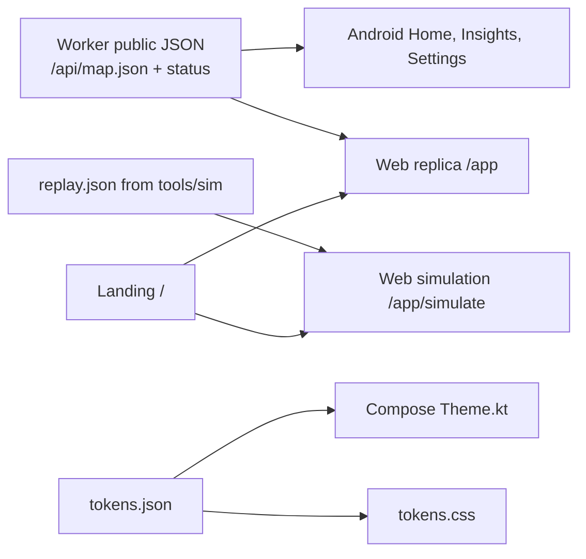
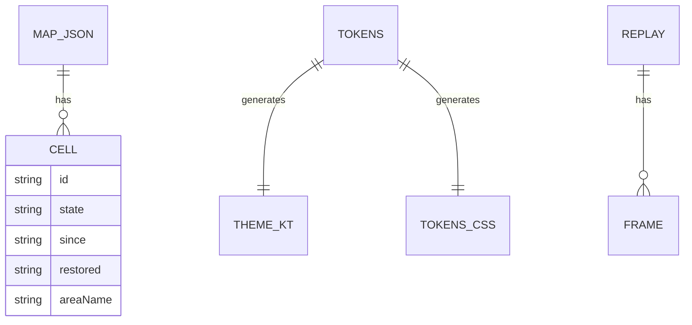
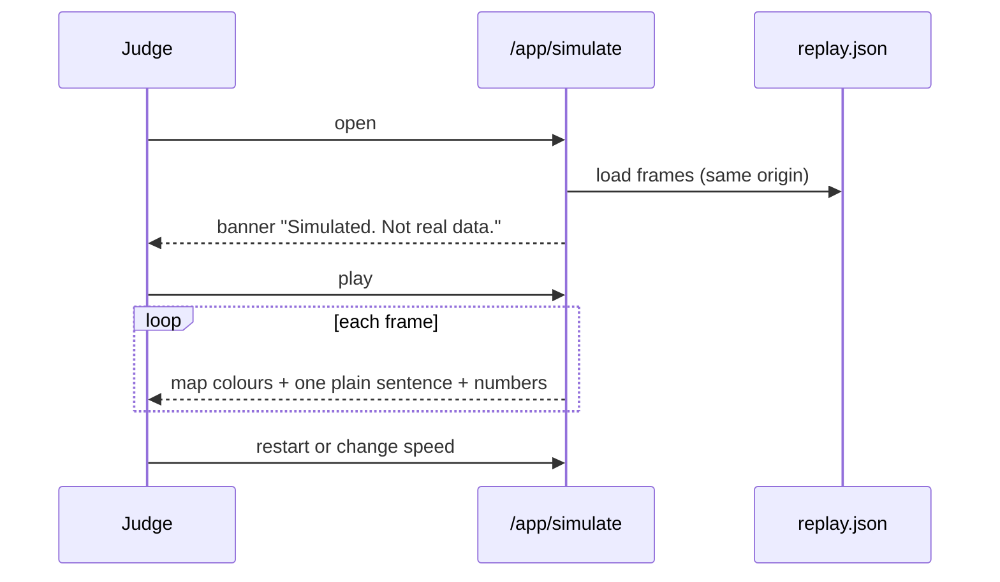

# Design: ux-redesign

Status: APPROVED by delegation on 2026-11-22. Based on `requirements.md`. Tasks in `tasks.md`. Decisions: ADR 0026, 0027, 0028.

## 1. Overview

One information architecture and one token file feed both clients. The Worker is the only source of real data. The simulation reads only the recorded replay.

## 2. Screens

### First run (app only)
One screen: logo, one sentence ("Your phone charger tells us when the power goes."), one button "OK, start". It asks for notification permission where the OS requires it, starts the sensor, and opens Home. Battery steps, Home Watch and the area choice become setup cards in the Home feed.

### Home
- Top: map card (about 45% of the height on a phone). It shows the user's cell with an outline and the ring of cells around it, centred and close. Pan and pinch open the larger city map. A legend sits under the map.
- Below: the feed. Items, newest first: spot status line ("Power on since 2:14 p.m."), recent outages near you, setup cards (battery, Home Watch, area), a link "See all areas" which opens the area list.
- Empty: "No phones reporting here yet" with the button "Watch a blackout" on the web.

### Insights
Light Score ring, outage tiles, bars with the band promise line, heatmap, longest outages, 12 week line, promise card. The Power Log list sits at the bottom as "Every outage".

### Settings
Sections: Alerts and alarm, Home Watch, Keep it running (battery), Area and tariff band, Language, Privacy and Delete my data, About.

### Dock
Three items, icon plus label, 56 dp high, 48 dp tap targets: Home, Insights, Settings. On the web at 1280 px wide the dock becomes a left rail with the same three items and the content is centred at a 960 px maximum.

## 3. Route map

| Route (web) | Page | Data |
|---|---|---|
| `/` | Landing | none (static, scripts optional) |
| `/app` | Replica Home | `/api/map.json` real |
| `/app/insights` | Replica Insights | area history real, or empty |
| `/app/settings` | Replica Settings | static text, nothing stored |
| `/app/simulate` | Simulation | replay file, labelled |
| `/area/<slug>` | Area page | unchanged, 404 until `checkedBy` |
| `/judge` | redirect 301 to `/app/simulate` | none |

The replica tabs are routes, so each has a URL and works with the back button. A small script swaps panels without a reload where it can. Without scripts, the links load the next page.

## 4. Data model

- `MAP_JSON` is the existing contract (`packages/shared/src/map.ts`). No new field and no count.
- `TOKENS` is `packages/shared/design/tokens.json`: colours (4 states, neutral, surface, text, accent), type scale, spacing, radii, hex stroke and pattern names.
- `tokens.css` and the Kotlin colour constants are written from `tokens.json` by `tools/tokens/build.mjs`; a test compares them.

## 5. Design system

See ADR 0028. Four state colours (Normal green, Possible amber, Confirmed red, Restored blue), each with a pattern (solid, hatch, dots, outline). Dark surface by default, light surface follows the system on the web. Type scale 12, 14, 16, 20, 28, 40. Spacing 4, 8, 12, 16, 24, 32. Hex map: flat stroke 1 px on the surface colour, user's cell has a 3 px outline in the accent colour, no street layer.

## 6. Simulation

Steps: Normal, One phone drops (Your spot only), Possible, Confirmed, Restored. Each step shows the sentence, the counts the Worker used and the decision. The page is a player for the recording. It does not run detection in the browser.

## 7. Correctness properties and tests

| ID | Property | Test |
|---|---|---|
| UX1 | The dock has exactly 3 destinations in the same order on app and web. | Vitest on web shell, JUnit on dock list |
| UX2 | The replica never reads the replay file and the simulation never reads `/api/map.json`. | Vitest on rendered scripts and routes |
| UX3 | Every colour in `tokens.json` equals the Kotlin constant and the CSS variable. | node:test comparing generated files |
| UX4 | No page references another origin (CSP, links, scripts, images). | Vitest on all routes |
| UX5 | The simulation page carries the "Simulated" banner in every state. | Vitest, Playwright check |
| UX6 | An empty `map.json` renders "No phones reporting here yet" and no state colour other than neutral. | Vitest, fast-check over cell sets |
| UX7 | A cell under the floor renders the same as an unlisted cell. | Vitest, fast-check |
| UX8 | First run needs one tap and no permission other than notifications. | JUnit on the first-run model |
| UX9 | Landing has the three actions and does not contain the 100 percent undercount claim. | Vitest on `/` |

Visual: `bash workers/api/visual/run.sh` takes screenshots at 390 x 844 and 1280 x 800 (ADR 0019).

## 7a. Testing strategy

JVM and Vitest tests cover every decision. Property tests (fast-check) cover UX6 and UX7. Screens are checked by screenshots. The Compose screens are checked in the Kiro IDE pass on a real phone or emulator.

## 8. Error handling

- `/api/map.json` fails or is slow: replica shows the last good map from memory if there is one, else "Can't load the map. Try again." and the simulation link. The app uses its cache and an offline banner.
- Replay file missing: the simulation page says "The recording did not load" and offers reload. It never falls back to real data.
- Scripts off: landing and area pages still read. The replica shows a server-rendered map and feed from the same JSON.
- Unknown token in CSS or Kotlin: the UX3 test fails the build.
