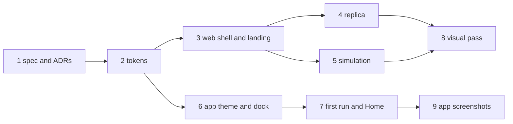

# Tasks: ux-redesign

Rules: a task is done only per `definition-of-done.md`. Commit after each, for example `feat(web): landing page [spec:ux-redesign task:3]`. No new dependency (ADR 0027, 0028).

## Dependency graph

## Wave 1: decisions and tokens

- [x] 1. Spec, ADRs 0026 to 0028, steering update.
  - Requirements: R1 to R10
- [ ] 2. `tokens.json`, `tools/tokens/build.mjs`, generated `tokens.css` and Kotlin colours, test UX3.
  - Depends on: 1
  - Requirements: R9

## Wave 2: web

- [x] 3. Web shell (dock or rail), landing page at `/`, `/judge` redirect, size budget update, test UX4 and UX9.
  - Depends on: 2
  - Requirements: R6, R10
- [x] 4. Replica `/app`, `/app/insights`, `/app/settings` with real data and the empty state, tests UX1, UX2, UX6, UX7.
  - Depends on: 3
  - Requirements: R2, R3, R4, R7
- [x] 5. Simulation `/app/simulate` from the replay file, banner and explanations, tests UX2 and UX5.
  - Depends on: 3
  - Requirements: R8

## Wave 3: app

- [ ] 6. Compose `Theme.kt` from tokens, three item dock, route changes (Area merges into Home, Log into Insights).
  - Depends on: 2
  - Requirements: R3, R9
- [ ] 7. One step first run, Home with map and feed, setup cards, test UX8.
  - Depends on: 6
  - Requirements: R1, R2, R5

## Wave 4: checks

- [x] 8. Playwright visual pass at 390 x 844 and 1280 x 800 for `/`, `/app`, `/app/insights`, `/app/settings`, `/app/simulate`. Screenshots in `docs/visual/`.
  - Depends on: 4, 5
  - Requirements: R6, R7, R8, R10
- [ ] 9. App screenshots and TalkBack pass in the Kiro IDE pass (needs a device or emulator).
  - Depends on: 7
  - Requirements: R1, R2, R3
