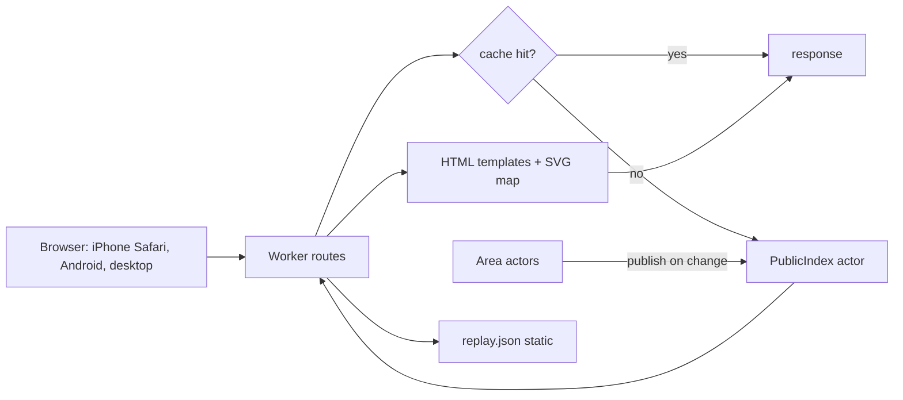
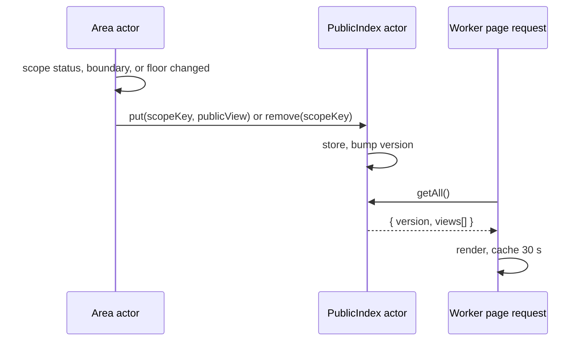
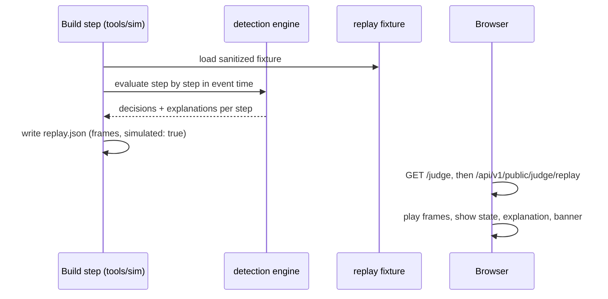

# Design: web-and-area-pages

Status: APPROVED by delegation on 2026-11-14. Based on `requirements.md`. Tasks in `tasks.md`.

## 1. Overview



- **Worker routes** are plain functions `(request, env) -> Response`. HTML is built with string templates and an escape helper. No framework, no client bundle.
- **Public index**: a single Durable Object holding the latest public scope views. Area actors push to it only when a view changes or disappears. Readers cost one request.
- **Judge mode** is static: a prebuilt `replay.json` and a small script.
- **Catalog** is a JSON file imported at build time.

## 2. Verified facts and sources

| Fact | Source |
|---|---|
| Workers Free: 100,000 requests per day and 10 ms CPU per request. Durable Objects Free: 100,000 requests per day. | https://developers.cloudflare.com/workers/platform/limits/ , https://developers.cloudflare.com/durable-objects/platform/pricing/ |
| `cache.match` and `cache.put` work on the default cache; responses with `Cache-Control` that forbids caching return 413 on put; the docs mention `.workers.dev` only for query-string keys. Whether the Cache API operates on the deployed domain must be tested. | https://developers.cloudflare.com/workers/runtime-apis/cache/ |
| H3 cell area and boundary helpers (`cellToBoundary`) in `h3-js`. | https://github.com/uber/h3-js |

To confirm with the docs server: Cache API behaviour on `workers.dev`, static assets and `ASSETS` binding limits and billing, `wrangler.toml` vars for `APK_URL`, headers that `Response` allows (CSP nonce), and Playwright usage for visual checks (the Playwright power).

## 3. Routes

| Route | Content | Cache |
|---|---|---|
| `/` | Hero line, Judge mode button, install button, SVG map of catalog areas, area list | 30 s |
| `/area/:slug` | Status, since, history, install button, legend | 30 s |
| `/c/:cell` | Same as an area page for a cell; noindex | 30 s |
| `/judge` | Replay player, banner, explanation panel | 1 h |
| `/install` | APK link, version, size, checksum, iPhone note | 5 min |
| `/privacy` | Plain text | 1 h |
| `/sitemap.xml`, `/robots.txt` | From catalog | 1 h |
| `/api/v1/public/map` | JSON of areas with states | 30 s |
| `/api/v1/public/area/:slug` | JSON of one area | 30 s |
| `/api/v1/public/cell/:cell/outages?days=30` | Public history for the phone's `power-log` | 30 s |
| `/api/v1/public/judge/replay` | Replay JSON, `simulated: true` | 1 h |

## 4. Status derivation

```
areaStatus(area, views):
  cells = area.cells
  covering = views where view.boundary intersects cells
  if covering is empty: return { kind: 'NO_COVERAGE' }
  level  = max over covering (open outage level, else RESTORED if lastRestored within 24 h, else NORMAL)
  order  = CONFIRMED > POSSIBLE > RESTORED > NORMAL
  precision = best precision among the views that gave the max (CELL > LINKED > COARSE)
```

- "Restored" shows for 24 hours after the end of an outage, then the area is Normal. (`RESTORED_DISPLAY_MS` starting value, tunable.)
- An area is covered by a wider view only through the boundary of that view; the page then shows "Based on a wider area".
- The rule never shows a status for a scope below 3 members, because the index never holds one (area-cells R9.1).

## 5. Public index



- `PublicView` is exactly the type in `area-cells` design section 5. Nothing else is stored.
- One row per scope (a few hundred at most in the field test). A write happens only on a change, so it costs rows written only at status changes.
- If the index is empty or unreachable, pages show "Status is not available right now" with the install button and a link to Judge mode, and the response is not cached for more than 5 seconds.
- Amendment to `area-cells`: R2.2 adds "publish to the public index", task 10 adds the publisher.

## 6. Pages

### Area page layout (mobile first, top to bottom)
1. Title "Is there power in Yaba right now?".
2. State block: label, one sentence, "Since 2:14 p.m. (Lagos time)" (server rendered with the catalog time zone offset; script upgrades to the viewer's time zone).
3. Precision note when not `CELL`.
4. Install button (direct APK) and, for iPhone, "See how it works" linking to Judge mode.
5. 30-day history list (start, end or unknown, level).
6. "How this works" and "Your privacy" in three lines each.
7. Legend of the five states (with "Your spot only" described as private to a phone).

### Colours and text

| State | Label | Sentence |
|---|---|---|
| Normal | Power on | Power looks normal. |
| Your spot only | Your spot only | Only your phone lost power. (Never on real pages) |
| Possible | Possible power cut | Some phones lost power. We are checking. |
| Confirmed | Power cut | Power is out. Many phones lost it together. |
| Restored | Power is back | Power came back. |

Pidgin pack optional ("Light don come!" for Restored), kept in the same string file.

### Map
- Server builds an SVG with one `<polygon>` per cell from `cellToBoundary`, projected with a simple equirectangular fit to the catalog's bounding box. Labels use the catalog name at the centre cell. Colours come from the state, each polygon has `<title>` text for screen readers.
- The home page draws only catalog area cells. Cells outside any catalog area never appear.

## 7. Judge mode replay



`replay.json` shape:

```ts
type Replay = {
  simulated: true;
  label: 'Simulated replay';
  recordedDevices: number;          // honest count of real devices, or 0 if synthetic
  source: 'RECORDED' | 'SYNTHETIC';
  durationMs: number;
  phones: { alias: string; role: 'REAL' | 'SIMULATED_NEIGHBOR' }[];
  frames: {
    tMs: number;
    cells: { cell: string; state: 'NORMAL'|'POSSIBLE'|'CONFIRMED'|'RESTORED'|'SPOT_ONLY' }[];
    events: { alias: string; type: string }[];
    explanation?: Explanation;      // from the engine, counts only
  }[];
};
```

- When the field test has no recording yet, `source` is `SYNTHETIC` and the page says so. The brief's rule: "states the device count honestly".
- Frames come from the real engine, not from hand-written states (W5).
- The banner "Simulated replay" is in the HTML, not injected by script, and in `<title>`.
- The same file feeds the app's Judge mode (`demo-mode`).

## 8. Security and headers

- `Content-Security-Policy: default-src 'none'; script-src 'nonce-{n}'; style-src 'nonce-{n}'; img-src 'self' data:; connect-src 'self'; base-uri 'none'; form-action 'none'; frame-ancestors 'none'`.
- `Referrer-Policy: no-referrer`, `X-Content-Type-Options: nosniff`, no cookies.
- Every dynamic string passes through `escapeHtml`. Slugs and cells are validated against the catalog and the H3 helper.
- `GET` and `HEAD` only; other methods get 405.
- The nonce is generated per response; cached bodies keep their nonce, which is acceptable because the page has no user-supplied script and the cache key is per URL. If a nonce-per-cache-entry problem appears, use hashes instead (task 5 decides).

## 9. Caching

```
get(url):
  hit = cache.match(url)          # Cache API when available
  if hit: return hit
  hit = isolateCache.get(url)     # fallback, TTL checked
  if hit and fresh: return hit
  render, set Cache-Control: public, max-age=30, s-maxage=30
  cache.put / isolateCache.set
```

Test the Cache API on the deployed domain in task 5. If it fails, only the isolate cache and browser caching reduce load, and the design remains correct, only costlier.

## 10. Catalog

```ts
type CatalogArea = {
  slug: string;              // 'yaba'
  name: string;              // 'Yaba'
  centreCell: string;        // res-8
  rings: number;             // gridDisk radius
  tzOffsetMin: number;       // 60 for Lagos
  country: string;           // 'NG'
  source: string;            // URL used to find the centre
  checkedBy: string;         // person and date
};
```

- Cells for the area = `gridDisk(centreCell, rings)` computed at build time and written into `catalog.generated.json`.
- Starting list: Yaba, Surulere, Ikeja, Maryland, Victoria Island, Ikoyi, Lekki, Ajah, Ikorodu, Festac. Centre coordinates are not trusted until a person checks them; the `checkedBy` field must be non-empty for an area to be listed (W7).

## 11. Error handling

| Case | Behavior |
|---|---|
| Public index unavailable | Page without status, install button, 5 s cache. |
| Unknown slug | 404 page with the area list. |
| Invalid cell | 404, no hint. |
| Judge replay missing | Page explains "Replay not built" and shows the install button. |
| Script disabled | Server-rendered status still shows. |
| Clock skew on a page's "since" | Times are event time from the engine. |
| Index shows an outage older than 12 hours with no restore | Shows "End unknown". |
| Cache API missing | Fallback cache. |
| HTML over 30 KB | Test fails the build. |
| H3 library cannot load at build | Build fails; the Worker uses prebuilt boundaries. |

## 12. Testing strategy

Property IDs `W1` to `W9`. Vitest and fast-check; page render is pure `(data) -> string`. Visual checks with the Playwright power on a phone-sized viewport (WebKit engine stands in for Safari).

| ID | Property | Requirement | Test |
|---|---|---|---|
| W1 | For any status data, the area page HTML contains the state label text, an install link and the title, with no script needed. | R1.4, R3 | `W1_page_without_script` |
| W2 | No page or API response contains an install ID, a push token, a member count below 3, or a boundary of a scope that is not in the index. | R4.3, R11.1 | `W2_public_privacy` |
| W3 | Every status maps to exactly one of Normal, Possible, Confirmed, Restored; real pages never contain "Your spot only" as a status. | R2 | `W3_five_states` |
| W4 | Responses carry the intended cache headers, and the fallback cache never serves an entry older than its TTL. | R9 | `W4_cache_ttl` |
| W5 | Every replay frame's state and explanation equal the engine's output for the same fixture prefix. | R6.4, R6.6 | `W5_replay_matches_engine` |
| W6 | `/judge` and its API always carry `simulated: true` and the banner; real routes never read replay data; `/judge` never reads the index. | R6.2, R6.8 | `W6_simulated_separation` |
| W7 | The sitemap lists exactly the catalog areas with `checkedBy` set; `/c/` pages are `noindex`; robots disallows `/c/` and `/api/`. | R10.3, R11.5 | `W7_sitemap_robots` |
| W8 | All responses have the required security headers; any string with markup characters is escaped in output. | R1.6, R11.2, R11.3 | `W8_headers_and_escaping` |
| W9 | A valid cell with no public scope gives byte-identical bodies whether it has no phones or fewer than 3. | R4.4 | `W9_cell_page_indistinguishable` |

Other tests: HTML size budget; the SVG map for every catalog area; status derivation table tests (precision, restored display window); a Playwright run at 390 x 844 for `/`, `/area/yaba`, `/judge` and `/install`; the `/judge-demo` slash command (steering) runs this check list.

Traceability: `docs/traceability.md`.
