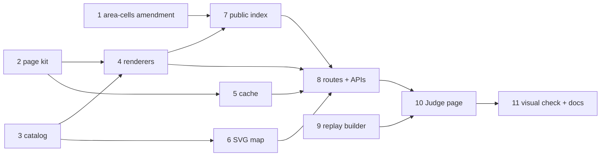

# Tasks: web-and-area-pages

Rules: only real dependencies are listed. Tasks in the same wave run in parallel. A task is done only per `definition-of-done.md`. Commit after each, for example `feat(web): five states [spec:web-and-area-pages task:4]`.

Highest reasoning effort: default. Plan mode first for tasks 5 and 8. Confirm Cloudflare APIs with the docs server and put the doc URL in a comment.

Depends on `area-cells` (tasks 8, 10), `detection-engine` (tasks 13, 16), `event-ingest` (task 1). No new dependency: HTML by string templates, SVG by hand.

## Wave 1

- [x] 1. Amend `area-cells`: R2.2 publish to the public index, and add a publisher in the reducer outputs. Record the singleton in ADR 0010 (public index).
  - Depends on: `area-cells` 8
  - Requirements: R8.1, R8.2
- [x] 2. Page kit: `escapeHtml`, nonce and header helpers, layout, the five-state string pack with optional Pidgin. Tests W8.
  - Depends on: `event-ingest` 1
  - Requirements: R1, R2, R11
- [x] 3. Catalog file and generator: schema, validator, `catalog.generated.json` with cells, and the starting Lagos list with sources. Centre coordinates verified by the human before an area is listed. Test W7 (catalog part).
  - Depends on: `area-cells` 2
  - Requirements: R10

## Wave 2

- [x] 4. Status derivation and page renderers: area, cell, home, install, privacy, 404, and the legend. Tests W1, W2, W3, W9.
  - Depends on: 2, 3
  - Requirements: R2, R3, R4, R7
- [ ] 5. Cache layer (Cache API plus isolate fallback), test on the deployed domain, and the nonce or hash decision. Tests W4.
  - Status: Cache API wrapper, isolate fallback, nonce decision and W4 tests done; the "test on the deployed domain" step is open (needs a deploy).
  - Depends on: 2
  - Requirements: R9
- [x] 6. SVG map renderer from catalog cells and states. Unit and snapshot tests.
  - Depends on: 3
  - Requirements: R5

## Wave 3

- [x] 7. Public index actor, reader and the publisher hook, with a unit test of tombstones when members fall below 3. Test W2 (index part).
  - Depends on: 1, 4
  - Requirements: R8
- [ ] 8. Routes and JSON APIs, 405 handling, sitemap and robots. Tests W7.
  - Depends on: 4, 5, 6, 7
  - Requirements: R1, R9, R11
- [ ] 9. Replay builder in `tools/sim`: fixture to `replay.json` through the engine, honest device count, source flag. Test W5.
  - Depends on: `detection-engine` 16
  - Requirements: R6.4, R6.6

## Wave 4

- [ ] 10. Judge page: banner, controls, explanation panel, "Your spot only" frame, offline refresh. Tests W6.
  - Depends on: 8, 9
  - Requirements: R6

## Wave 5

- [ ] 11. Visual check at 390 x 844 with the Playwright power; `/judge-demo` steering updated with the check list; HTML size test; traceability (W1 to W9); `docs/kiro-log.md`.
  - Depends on: 10
  - Requirements: all

## Dependency graph

## Not in this spec
- The Judge mode screens inside the app: `demo-mode`.
- Stretch features ("Power's back" live count, share card page).
- Maps with real streets: not planned.
